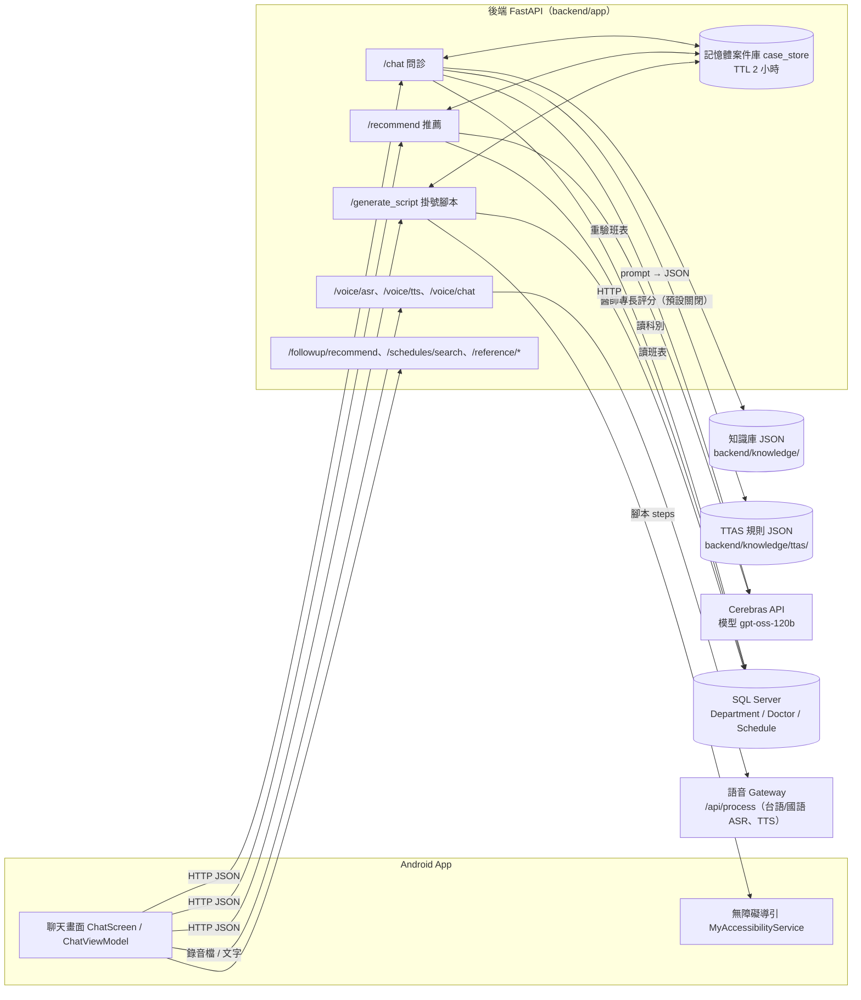
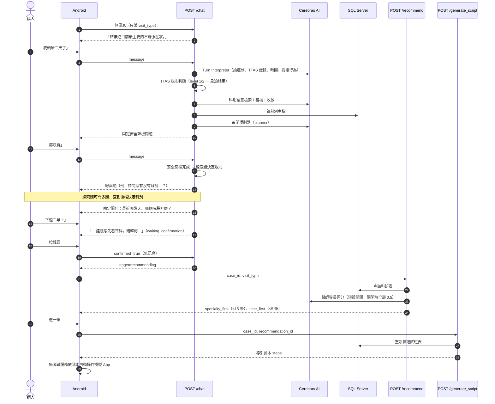
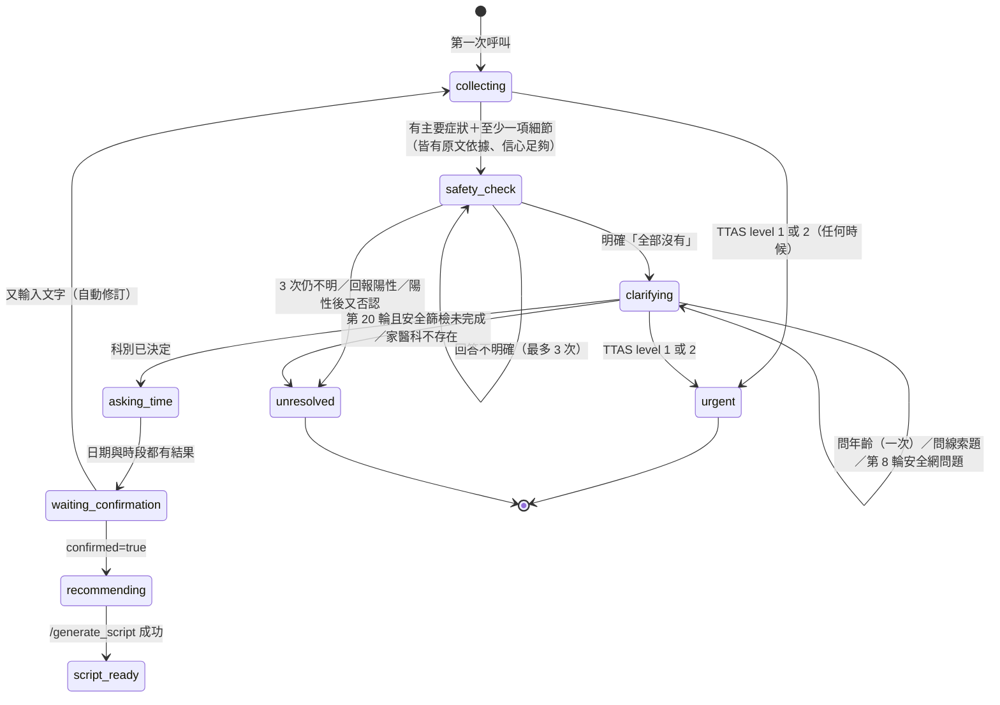
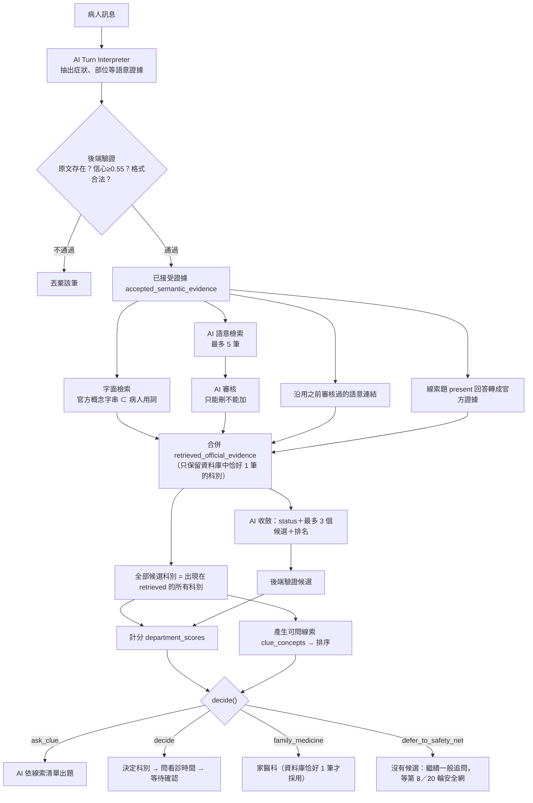

# 問診邏輯說明

> 對象：組員（不一定看過後端代碼）
> 依據：`New_Android_Backend` 分支目前代碼（撰寫時最新 commit `5f16cb9`；2026-11-03 對照代碼更新到 `c7b2ca6`，新增內容見第 11 節的更新紀錄）。
> 原則：本文件一律以**目前實際代碼**為準；`docs/修改計畫.md` 只當背景。兩者不一致的地方集中寫在第 9 節。
> 出處格式：（`檔案路徑` → `函式名稱`）。路徑皆相對於專案根目錄。
> 看不懂或代碼沒寫清楚的地方標「⚠ 待確認」，彙整在第 10 節。

---

## 0. 一分鐘看懂

這套系統讓病人用**自然語言聊天**，系統邊聊邊判斷：

1. **有沒有急迫危險**（TTAS 檢傷規則＋固定的安全篩檢問題）——危險就停止掛號、建議就醫。
2. **該看哪一科**（臺北榮總官方「症狀→科別」資料＋AI 理解病人的話＋後端計分）。
3. **什麼時候方便看診**（AI 理解「下週三早上」，後端換算成真正日期）。
4. 病人按確認後，到資料庫查**真實班表**，排出推薦清單，再產生 Android 自動掛號的操作腳本。

核心分工一句話：**AI 負責「聽懂人話」，後端負責「驗證、計分、決定流程」，資料庫負責「真實的科別、醫師、班表」。** AI 說的任何東西都要先通過後端驗證（例如：AI 引用的病人原話必須真的出現在病人訊息中），才會被採用。

---

## 1. 系統總覽

### 1.1 整體架構圖



### 1.2 每一端負責什麼

| 元件 | 負責 | 代碼位置 |
|---|---|---|
| Android App | 聊天畫面、錄音、播放語音、顯示推薦卡片、依腳本做無障礙自動點擊。**不做醫療判斷**，所有狀態以後端回傳為準。急迫停止判斷：`clarification_status=urgent`、`warning_required`，或回覆文字同時含「119」與「急診／情況危急」。 | `android/.../viewmodel/ChatViewModel.kt` → `requiresUrgentStop` |
| 後端 API | 流程狀態機、驗證 AI 輸出、科別計分與決定、TTAS 規則判斷、日期換算、班表過濾與排序。 | `backend/app/routes/*`、`backend/app/services/*` |
| AI 模型 | 固定使用 Cerebras 的 `gpt-oss-120b`，一律要求 JSON 輸出（`response_format=json_object`），單次逾時 8 秒、不自動重試。 | `backend/app/services/ai_service.py` → `complete_runtime_json`、`_complete_cerebras`（常數 `RUNTIME_AI_PROVIDER="cerebras"`、`RUNTIME_AI_MODEL="gpt-oss-120b"`；`config.py` 的 `ai_timeout_seconds=8.0`） |
| 資料庫 | SQL Server，表 `Department`、`DepartmentCategory`、`Doctor`、`Schedule`。科別是否存在、醫師、班表都以資料庫為準。連線資訊來自 `.env`（`DB_SERVER` 等）。 | `backend/app/db.py` → `create_db_connection`、`fetch_active_departments`、`fetch_available_slots` |
| 語音 ASR/TTS | 後端轉呼叫外部語音 Gateway（`{VOICE_GATEWAY_URL}/api/process`），服務類型 `taiwanese_asr`／`chinese_asr`／`taiwanese_tts`／`chinese_tts`。`VOICE_ENABLED` 預設 false。 | `backend/app/services/voice_client.py` → `VoiceGatewayClient`；`backend/app/routes/voice.py` |
| 科別知識庫 | 官方「症狀→科別」資料，559 筆（主檔 541 筆＋補充 18 筆），對應 36 個科別。 | `backend/knowledge/vghtpe_department_guidance.json`、`supplemental_guidance_*.json` |
| TTAS 規則庫 | 衛福部急診五級檢傷規則，64 條，其中 28 條可執行（`enabled`）。 | `backend/knowledge/ttas/active_rules.json` |

補充：
- 案件（對話狀態）存在後端**記憶體**的 dict 中，閒置 2 小時過期（`CASE_TTL_SECONDS = 2 * 60 * 60`）。後端重開就會清空。（`backend/app/services/case_store.py` → `_prune_expired`）
- Android 端實際的語音用法：錄音後呼叫 `/voice/asr` 只把辨識文字填進輸入框（不推進問診），按送出才呼叫 `/chat`；播放用 `/voice/tts`。`/voice/chat`（一次做完 ASR→chat→TTS）後端有、Repository 也有包裝，但 ChatViewModel 沒有呼叫。（`ChatViewModel.kt` → `stopTaiwaneseRecordingAndTranscribe`；`MedicalRepository.kt` → `transcribeVoice`）
- 資料庫位置：⚠ 待確認。代碼的 `DB_SERVER` 預設值是 `medichain-server.database.windows.net`（Azure），實際值寫在各機器的 `.env`；README 說示範環境是手機透過 Tailscale 連 310 電腦上的 FastAPI。SQL 是否在 310 上，要看 310 的 `.env`。

---

## 2. 一次問診的完整流程

### 2.1 時序圖（從第一句話到掛號）



### 2.2 每一步由誰處理、狀態存在哪裡

`/chat` 單一輪的處理順序（全部在 `backend/app/routes/chat.py` → `chat`）：

| 順序 | 做什麼 | 函式 | 寫入的狀態 |
|---|---|---|---|
| 1 | 找出或建立案件（`case_id` 有存檔就用存檔；客戶端送來的舊快照會被清掉所有伺服器結論後才採用） | `_resolve_case`；`case_store.py` → `get_case`、`sanitize_untrusted_snapshot`、`create_case` | `case_store._CASES` |
| 2 | 特殊入口：`answers`（舊固定問卷）回 400；回診 `return_visit` 叫你改用 `/followup/recommend`；`quick_search` 回 400；`revision_requested=true` 走修訂 | `chat`、`_begin_revision` | — |
| 3 | 若案件已在等待確認／已確認，又收到新文字 → 視為**自動修訂**（延續問診，只重算科別） | `_should_treat_user_input_as_revision`、`_begin_revision` | 科別、確認、輪數等狀態重設；已回答內容保留 |
| 4 | 把病人訊息存進對話紀錄（不解析） | `rule_engine.py` → `apply_user_message` | `history_records` |
| 5 | 呼叫 AI Turn Interpreter，驗證後套用：症狀證據、TTAS 證據、時間偏好、指定科別、對話行為、就診者是誰與年齡（`patient_profile`，見 4.5.1） | `rag_triage_adapter.py` → `refine_case_with_ai`；`pediatric_routing.py` → `validate_patient_profile`、`apply_patient_profile` | `semantic_extractions`、`patient_input`、`ttas_evidence`、`availability.time_preferences`、`patient_subject`／`patient_relation_text`／`patient_age_text` |
| 6 | 記錄經驗證的對話行為；若是「不想再回答」→ `clue_user_declined=True` | `conversation_service.py` → `validated_dialogue_act` | `last_dialogue_act`、`clue_user_declined` |
| 7 | TTAS 規則判斷 | `ttas_evaluator.py` → `apply_ttas_evaluation` | `ttas_result`、`triage` |
| 8 | 若本輪在安全篩檢中 → 判讀安全回答 | `conversation_service.py` → `capture_safety_screen_answer` | `patient_input.red_flags_checked` 等 |
| 9 | TTAS level 1 或 2 → **急迫結束**（stage=done） | `ttas_requires_immediate_action` | `clarification_status="urgent"` |
| 10 | 否則：記錄病人對上一題的回答（線索題／安全網題／年齡題／一般題） | `capture_prior_answer_reference`、`capture_pending_answer`、`clear_answered_pending` | `clarification_evidence`、`clue_concepts_asked` |
| 11 | 重算科別（只在：有新輸入、Turn Interpreter 成功、且不在安全篩檢中或本輪剛完成篩檢；若本輪是在回答看診時間且沒有新症狀，則保留原科別不重算） | `settle_unanswered_clue_question`；`department_reasoning_service.py` → `reason_about_departments` | `candidate_departments`、`department_result`、`clue_decision` |
| 12 | 安全網：病人選家醫科／拒答且沒有候選／到第 20 輪 → 走家醫科 | `safety_net_family_medicine_reason`、`adopt_safety_net_family_medicine` | `clue_decision`、`department_result` |
| 13 | 呼叫 AI 追問規劃器（若允許） | `request_clarification` | — |
| 14 | 後端決定下一步：進安全篩檢／問年齡（見 4.5.1）／問線索題／問看診時間／完成 | `advance_conversation` | `turn_count`、`pending_clarification_intent`、`triage.next_question` 等 |
| 15 | 決定 `stage`（collecting / waiting_confirmation / recommending / done） | `chat`（第 372～407 行的分支） | `conversation_state.stage` |
| 16 | 若急迫或科別變了 → 清掉已存的推薦 | `case_store.py` → `clear_recommendations` | `_RECOMMENDATIONS_BY_CASE` |
| 17 | 組回覆文字（確認句、急迫句、無法釐清句等都是後端固定文字） | `ai_reply_generator.py` → `build_department_confirmation_reply`、`generate_triage_reply` | `reply_source` |

說明：`generate_triage_reply` 目前**不會**呼叫 AI 改寫回覆，一律回傳後端準備好的文字。（`backend/app/services/ai_reply_generator.py` → `generate_triage_reply`）

---

## 3. 問診狀態與對話管理

### 3.1 主要狀態欄位

全部定義在 `backend/app/schemas.py` → `ConversationState`。以下只列跟流程有關的：

| 欄位 | 意思 | 何時改變 |
|---|---|---|
| `stage` | `collecting`（收集中）／`waiting_confirmation`（等病人確認科別）／`recommending`（已確認）／`script_ready`（已產生腳本）／`done`（急迫結束） | 每輪結尾由 `chat` 決定；`/generate_script` 成功設 `script_ready` |
| `clarification_status` | `collecting`／`clarifying`（追問中）／`safety_check`（安全篩檢中）／`sufficient`（資料足夠）／`unresolved`（無法繼續）／`urgent`（急迫） | `advance_conversation`、`_enter_safety_check`、`_unresolved`、急迫分支 |
| `turn_count` | 病人訊息輪數（一則訊息算 1） | `advance_conversation`：`turn_count += len(user_sources)`；急迫分支也會加 |
| `department_status` | `unresolved`／`ambiguous`／`resolved` | 每次 `reason_about_departments` 重算 |
| `candidate_departments` | AI 收斂後、經驗證的候選科別（最多 3 個） | `validate_candidate_proposal` |
| `department_clue_candidates` | 本輪官方檢索到的**全部**候選科別 ID | `store_clue_offer` |
| `department_clue_offer` | 排序後可問的線索概念（最多 10 個） | `store_clue_offer` |
| `clue_questions_asked` | 已問幾題線索題 | `_record_clue_question` |
| `clue_concepts_asked` | 每個問過的概念與病人回答（present／absent／uncertain／unanswered），最多保留 30 筆 | `append_clue_records`（`MAX_CLUE_CONCEPT_RECORDS = 30`）、`_capture_clue_answers` |
| `clue_decision` | 本輪決定結果（`ask_clue`／`decide`／`family_medicine`／`family_medicine_unavailable`／`defer_to_safety_net`），每輪重算 | `apply_clue_decision`、`adopt_safety_net_family_medicine` |
| `clue_user_declined` | 病人表示不想再回答；修訂前一直保留 | `chat`、`_begin_revision` |
| `pending_clarification_intent` | 目前在等病人回答哪一題（例如 `department_clue_2`、`safety_net_choice`、`appointment_availability`） | `advance_conversation`、各 capture 函式 |
| `safety_answer_attempts` | 安全篩檢已回答幾次 | `capture_safety_screen_answer` |
| `safety_positive_reported` | 本次安全篩檢是否曾回報陽性 | 同上；只有修訂會清除 |
| `safety_net_asked`／`safety_net_choice` | 第 8 輪「繼續描述還是先掛家醫科」是否問過、病人選什麼 | `_ask_safety_net_question`、`_capture_safety_net_choice` |
| `availability_status` | 看診時間：`not_asked`／`asked`／`answered`／`unspecified` | `_ask_availability`、`availability_settled` |
| `availability_date_attempts`／`availability_session_attempts` | 日期、時段兩個面向各問了幾次 | `_ask_availability` |
| `is_complete`、`awaiting_confirmation`、`confirmed` | 問診完成、等待確認、已確認 | `advance_conversation`、`chat` |
| `patient_subject`／`patient_relation_text`／`patient_age_text` | 就診者是本人（`self`）還是家人他人（`other`）、對他的逐字稱呼（例「小女兒」）、就診者年齡原文（例「7歲」）。2026-11-03 新增；修訂不清除 | `pediatric_routing.py` → `apply_patient_profile` |
| `patient_age_question_asked`／`patient_age_answer` | 年齡題是否問過（整個案件只問一次）、病人對年齡題的原話 | `_ask_age_question`、`capture_pending_answer` |
| `reply_source` | 本輪回覆來自哪裡（例：`AI_PLANNER`、`CLUE_TEMPLATE`、`AGE_QUESTION`、`AVAILABILITY_QUESTION`、`SAFETY_NET_QUESTION`、`CONFIRMATION`、`URGENT_BACKEND`、`SAFETY_POSITIVE_STOP`、`TECHNICAL_FALLBACK`、`STUCK_FALLBACK`） | 各處 |

### 3.2 狀態怎麼前進



（圖中 `asking_time` 不是真正的欄位值，代表 `clarification_status=clarifying` 且 `pending_clarification_intent=appointment_availability`；`urgent`、`unresolved` 是 `clarification_status`，`waiting_confirmation`、`recommending`、`script_ready` 是 `stage`。）

**進入安全篩檢的條件**（`conversation_service.py` → `advance_conversation`，變數 `safety_ready`）：
- 有主要症狀（`patient_input.symptom`），且這段文字真的出現在病人訊息裡；
- 有至少一項細節：部位、持續時間、嚴重度、發作方式、伴隨症狀之一（信心 ≥ 0.55、有原文依據），或已有任何已接受的追問回答；
- 本輪沒有信心低於 0.55 的醫療欄位。

> 白話：病人說「頭暈」不夠，說「頭暈三天了」就會進安全篩檢。部位、持續多久、嚴重度**不是必填**，只要有其中一項細節即可。

**完成問診（進入等待確認）的條件**（`advance_conversation` 的 `sufficient` 分支）：
- 安全篩檢已完成，且科別 `resolved`；
- 以下其一：後端線索題已決定（`decide`／`family_medicine`）、本輪是回答看診時間、或 AI planner 建議 `sufficient`；
- 且上面的 `safety_ready` 成立（安全網家醫科路徑例外，不需要本輪細節）；
- 看診時間兩個面向都已有結果，否則先問時間（見第 6 節）。

### 3.3 輪數提示與上限（實際數值）

數值在 `backend/app/config.py`：

| 設定 | 值 | 作用 | 出處 |
|---|---|---|---|
| `SAFETY_NET_ASK_TURN` | **8** | 第 8 輪起，若科別仍未決定、安全篩檢已完成、沒有待回答的線索題，且還沒問過 → 問一次固定句「目前還沒辦法確定要看哪一科，要繼續描述，還是先掛家庭醫學科？」 | `conversation_service.py` → `advance_conversation`、`_ask_safety_net_question` |
| `HARD_TURN_CAP` | **20** | 本輪結束時達 20 輪且科別未決定 → 走家醫科（需安全篩檢已完成）；若安全篩檢都還沒完成 → `unresolved` 結束 | `safety_net_family_medicine_reason`、`advance_conversation`、`continue_safety_check` |
| `SAFETY_ANSWER_CAP` | **3** | 安全篩檢最多回答 3 次（要求解釋不算） | `conversation_service.py` 常數 |
| `CLUE_QUESTION_LIMIT` | **5** | 線索題最多 5 題 | `department_clues.py` → `decide` |
| `CLUE_CONCEPTS_PER_QUESTION` | **3** | 每題最多問 3 個概念 | `_clue_question_spec` |
| `CLUE_PLANNER_CONCEPT_LIMIT` | **10** | 交給 AI 出題的候選概念最多 10 個 | `store_clue_offer` |
| 線索題重問 | **1 次** | 一題沒有任何合格回答 → 換句話重問 1 次；再沒回答 → 該題未答概念記 `uncertain` | `settle_unanswered_clue_question`（`clue_reask_count < 1`） |
| `AVAILABILITY_QUESTION_LIMIT` | **2** | 看診日期、時段各最多問 2 次 | `conversation_service.py` 常數 |

**第 8 輪的特別規則（`turn_limit_top_score`）**：第 8 輪（`turn_count + 1 >= 8` 且還沒問過安全網）時，如果剛好**只有一個非家醫科的科別分數最高**，直接決定該科，不問安全網；平手或最高的是家醫科，才照常問安全網。（`department_reasoning_service.py` → `apply_clue_decision` 的 `turn_limit_reached`；`department_clues.py` → `decide`）

**第 8 輪安全網的回答**：由 Turn Interpreter 判斷 `answer_choice`（`family_medicine`／`continue`）。只有「有原文依據、`answered`、信心 ≥ 0.55 的 `family_medicine`」才算選家醫科；這題能掛的只有家醫科，所以「先決定掛號」「先掛就好」也算（prompt 規則 15d）。其他情況（離題、低信心、AI 失敗）都當作繼續。第 8 輪固定只問一次；之後只有「問診卡住」且病人還沒選過繼續時才會再問（見 3.5）。（`_capture_safety_net_choice`）

**沒有進展計數**：`consecutive_no_progress_turns` 仍會累加，但目前只作診斷紀錄，不會因此結束對話。（`advance_conversation`）

### 3.4 病人說「不想再回答」時

1. Turn Interpreter 判斷 `dialogue_act=decline_further_questions`（prompt 第 27 條：明確表示不想再回答、或說不出更多；想直接掛號，例如「我要先掛號」「我說我要先掛號」也算；單純對某題答「沒有」「不知道」不算）。後端只檢查：信心 ≥ 0.55、`source_text` 逐字出現在本輪訊息。（`validated_dialogue_act`）
2. 通過後設 `clue_user_declined=True`，直到修訂才清除。（`chat`）
3. 若當下有線索題在等回答：不重問，未答概念記 `uncertain`，釋放該題，同一輪就可決定。（`settle_unanswered_clue_question`）
4. **有候選科別**：`decide()` 以 `reason=user_declined` 用目前分數決定；平手依 AI 排名，AI 候選中都沒有平手科別才走家醫科。（`department_clues.py` → `decide`）
5. **沒有候選科別**：走安全網家醫科路徑，`reason=user_declined_no_candidates`。這個原因在 `SAFETY_NET_REASONS` 裡，所以就算系統整理過的症狀名稱和病人原話對不上，也會直接進入確認。（`safety_net_family_medicine_reason`）
6. 不變的規則：安全篩檢未完成時不會因拒答而決定；決定後仍要病人按確認。

### 3.5 拿不到可用的下一題時

AI planner 的題目不能用（重複問、問已答過的事、格式壞掉…），或根本沒給題目時，後端分兩種情況處理（`advance_conversation`、`_recover_stuck_turn`）：

- **AI 真的出錯**（逾時、供應商錯誤，或這一輪沒有呼叫 planner）→ `TECHNICAL_FALLBACK`「系統剛剛沒有回應，請再傳一次剛才的訊息。」
- **AI 有回應，但題目都不能用（卡住）** → 不叫病人重試，改走固定的下一步：
  1. 安全篩檢還沒完成 → 固定開放式問題「可以再多說一點嗎？例如哪裡不舒服、從什麼時候開始、有多嚴重。」（`STUCK_FALLBACK`，原本等待中的題目保留）
  2. 科別已決定 → 直接問看診時間或進入確認。
  3. 科別未決定、病人還沒選過「繼續描述」→ 問安全網題「要繼續描述，還是先掛家庭醫學科？」
  4. 科別未決定、病人已選過「繼續描述」→ 同第 1 點的開放式問題；第 20 輪上限仍會走家醫科。

安全篩檢時病人要求解釋、但 AI 沒給出可用的解釋 → 固定說明「這題是想確認您有沒有需要馬上去急診的狀況；如果都沒有，回答「沒有」就可以。」加上完整安全題。（`continue_safety_check`）

### 3.5 其他對話行為

| 對話行為 | 後端怎麼處理 | 出處 |
|---|---|---|
| `request_explanation`（看不懂問題） | 不算一次安全回答、不算線索題未回答；planner 需附 1～2 句白話 `explanation`（4～150 字、不得含問號／分號／「科」「醫師」等字／簡體字），通過才顯示在問題前。 | `capture_safety_screen_answer`、`settle_unanswered_clue_question`、`_valid_explanation` |
| `claims_already_answered`（我剛剛說過了） | AI 須引用一筆**之前已接受**的證據原文，後端比對成立才當作已回答；不能用來回答安全篩檢與安全網題。 | `validate_prior_answer_reference`、`capture_prior_answer_reference` |
| `correction`（我說錯了） | 必須同時輸出有原文依據的更正證據；欄位值真的被換掉時，清掉目前科別結論重算。 | `rag_triage_adapter.py` → `refine_case_with_ai`；`invalidate_corrected_department_context` |
| 指定科別（「我想看皮膚科」） | AI 輸出 `department_preference`，後端驗證 `dept_id` 與名稱在資料庫中恰好 1 筆、信心 ≥ 0.55、有原文依據；通過後科別直接採用病人指定，**不跑線索題**，但安全篩檢照做。 | `department_preference_service.py` → `validate_department_preference`、`resolve_requested_department`；`reason_about_departments` |
| 修訂（`revision_requested` 或確認後又輸入文字） | **延續問診**：保留已回答的追問（`clarification_evidence`）、問過的題目（`asked_clarification_intents`）、線索題的概念與回答（`clue_concepts_asked`、`clue_questions_asked`）、問過的部位題與看診時間狀態，已回答的不會再問。只清空科別判斷、確認與推薦、輪數、安全網與本次安全篩檢陽性紀錄，讓新補充的內容能重算科別。 | `chat.py` → `_begin_revision` |

---

## 4. 科別判定（最詳細）

### 4.1 整體流程



觸發時機：每輪病人有新輸入、Turn Interpreter 成功、且不在安全篩檢中（或本輪剛完成篩檢）時，`reason_about_departments` 會**整個重算**（不是累加）。例外：本輪是在回答看診時間且沒有新的症狀證據 → 保留已決定的科別不重算。（`chat.py` → `chat` 的 `department_kept`；`department_reasoning_service.py` → `reason_about_departments`）

### 4.2 候選科別從哪裡來

**第 0 步：病人有指定科別嗎？** 有且驗證通過 → 直接採用，結束。（`reason_about_departments` → `resolve_requested_department`）

**第 1 步：載入知識庫並對到資料庫**（`department_knowledge.py` → `load_department_knowledge`、`resolve_department_names`）
- 知識庫每筆記錄有 `canonical_dept_id`（例：眼科 1329）。後端用這個 ID 去資料庫 `Department` 找，**恰好 1 筆**才算 `resolved`，否則該科不參與。

**第 2 步：四種證據來源合併**（`reason_about_departments`）

| 來源 | 做法 | 出處 |
|---|---|---|
| 字面檢索 | 對每筆「present、狀態 available/partial」的症狀證據，把它的 `normalized_value` 和 `source_text` 正規化（NFKC、去空白、小寫）。官方概念字串若**包含在**其中，就命中。另外：同一則訊息中相鄰的 present 片段（例「腰酸」＋「背痛」）會合成整段「腰酸背痛」再比對一次，但計分不會因此多加分。 | `retrieve_official_evidence`、`adjacent_present_spans` |
| AI 語意檢索 | 把已接受證據＋官方概念清單給 AI，請它找語意相符的概念（最多 5 筆，概念必須逐字取自清單、信心 ≥ 0.55）。 | `retrieve_semantic_official_evidence`（purpose `department_semantic_retrieval`） |
| AI 審核 | 第二次呼叫 AI，逐筆判斷上一步的連結是否忠於原話，只能刪不能加；`supported=true` 且有理由才保留。 | 同上（purpose `department_retrieval_entailment`） |
| 舊連結沿用 | 之前審核過的語意連結（最多保留 50 筆）只要原文仍是目前的 present 證據、且沒被否認，就重建。 | `retained_semantic_official_evidence`（`_MAX_SEMANTIC_LINKS = 50`） |
| 線索題回答 | 病人對線索題答 present 的概念，轉成官方證據（標記 `evidence_origin=clue_answer`）；若目前語意證據對該概念是 absent／uncertain 則不建。 | `department_clues.py` → `clue_answer_evidence` |

- 字面已經命中的「科別＋概念」，語意結果不再重複加入。（`_new_concept_rows`）
- 否認（absent）或不確定（uncertain）的症狀**不會**產生候選。

**第 2.5 步：主詞過濾**（2026-11-02 新增，`subject_filtered_evidence`）

病人說過任何部位後，沒有自帶部位的症狀**只能幫忙，不能帶走**：

- 自帶部位的證據照常計分：原文或官方概念含部位（例「眼睛紅」）、原文和部位相接（例「眼睛」＋「紅腫」），或來自主訴那一句。這些證據對到的科別稱為「部位科別」。
- 其他證據只在它的科別也是部位科別時保留。例外：它的部位（同一句話、它回答的那題，或部位反問的回答）在病人其他話裡都沒出現，代表是另一個獨立的不舒服，照常計分（例「鼻子也會流鼻水」）。
- 實例：「眼睛紅腫酸痛」→ 系統問「請問眼睛是否有分泌物？」→「有淺黃色分泌物」。「分泌物」雖然是婦產科概念，但主詞是眼睛（來自題目），而婦產科不是部位科別，所以不計分。
- 部位完全不明（病人沒說，題目也沒指定，例如「還有其他不適症狀嗎？」），而且過濾後沒有任何證據時，後端用固定句反問一次：「請問您說的「淺黃色分泌物」是在哪個部位呢？」（`BODY_PART_PENDING_INTENT`、`_ask_body_part_question`）。每段原文只問一次，病人回什麼都會釋放這題。
- 病人從沒說過部位時不過濾，行為與以前相同。
- 後面才說的部位也會留成證據（`rule_engine._is_new_body_part`），但不會取代第一個部位；改口換部位仍照原本的更正流程。

**第 3 步：全部候選** = 合併後證據中出現的**所有**科別（不是只有 AI 的前 3 名）。（`department_clues.py` → `candidate_dept_ids`）

**第 4 步：AI 收斂**（purpose `department_convergence`）
- 輸入：已接受證據、合併後的官方證據、問過的追問、線索題回答。
- 輸出：`status`（resolved/ambiguous/unresolved）、最多 3 個 `candidates`（每個有 `dept_id`、`confidence`、`supporting_evidence`）、`uncertainty_reason`、`next_question_intent`。
- 後端驗證（`validate_candidate_proposal`）：`dept_id` 必須在資料庫恰好 1 筆；`confidence` 在 0～1；每筆 `supporting_evidence` 的原文、來源 ID、概念都必須完全對應到第 2 步的某筆證據；不合格的候選整個丟棄。依 confidence 排序取前 3。
- **AI resolved 的條件**：status=resolved、驗證後只剩 1 個候選、且 confidence ≥ 0.55。此時 `department_status=resolved`。其他情況 `ambiguous`（有候選）或 `unresolved`（沒有）。

### 4.3 分數怎麼算

只有一條規則（`department_clues.py` → `department_scores`）：

> **某科分數 ＝ 支持該科的「不同病人原文片段」數 ＋ 病人答 present、且該科持有該概念的「不同線索題題號」數**

細節：
- 同一段原文對到同一科的多個同義概念，只算 1 分（例：「頭暈」同時對到「頭暈」「眩暈」也只 1 分）。
- 來自線索題回答的證據（`evidence_origin=clue_answer`）不算進「原文片段」，改用題號計分，避免重複。
- 合併片段（例「腰酸背痛」）若它的組成片段已在該科計分，就不再加分。
- **absent 不扣分。**
- 跨科概念：病人答 present 的概念，**目前知識庫中**持有它的每個候選科別都加分（不是看出題當時的快照）。
- 沒有權重、沒有 AI 分數參與計分。AI 的 confidence 只用在「平手時的排名」與「目標科別優先度」。

⚠ 待確認：病人回答線索題「有耳鳴」時，如果 Turn Interpreter 除了 `concept_answers` 之外**又**把「耳鳴」抽成一筆症狀證據，字面檢索會再命中一次，該科會同時得到「原文片段」與「題號」各 1 分。代碼沒有排除這種情況；是否算重複加分、prompt 規則 16 的「額外 evidence」是否涵蓋這種回答，需要確認。

### 4.4 線索題：怎麼選題

**可問的概念**（`department_clues.py` → `clue_concepts`）—— 從候選科別在知識庫中的概念挑出，條件：
1. 病人還沒提過（不在已命中的概念或已接受的症狀值裡）；
2. 還沒得到 present／absent 結論（uncertain／未回答的可以再問）；
3. **不是所有候選都有**（大家都有的概念無法區分）；
4. 至少一筆是 `direct_routing_evidence`（院方「症狀→科別」指引）；只有 `department_specialty_evidence` 的概念不出題，但仍參與檢索與計分；
5. 不能**只屬於家醫科**（家醫科是終點，不是區分對象；但其他概念的科別清單照樣包含家醫科）；
6. **不能是敏感概念**（2026-11-03 新增，`never_ask_concept`）：概念含「愛滋、梅毒、淋病、菜花、披衣菌、性病、癌、腫瘤、惡性、白血病、懷孕」任一字就不出題（目前知識庫有 24 個，例「梅毒」「乳癌」「腫瘤」「懷孕」）。病人自己說出口時仍照常檢索與計分。
   - 起因：病人說「流鼻水咳嗽喉嚨痛」讓感染科成為候選，線索題就問出「寒顫、小便疼痛、愛滋病」。官方表格把病名和症狀列在一起，所以要擋。（`department_clues.py` → `_NEVER_ASK_MARKERS`、`clue_concepts`）

**排序**（`rank_clue_concepts`、`department_priority`），依序比較：
1. 概念所屬候選科別中最好的「目標優先度」：分數高者優先；同分看 AI 收斂候選的順序（在前者優先，不在其中的排最後）；家醫科不給優先度；
2. 只屬於一個候選科別（獨有）優先；
3. 有 `direct_routing_evidence` 優先；
4. 來源優先度 `source_priority` 小者優先（臺北榮總症狀指引 1、其他臺北榮總來源 2、臺中榮總 3）；
5. 問過但沒結論（uncertain）的往後；
6. 概念字串排序（讓結果穩定）。

取前 10 個（`CLUE_PLANNER_CONCEPT_LIMIT`）交給 AI planner。

**出題與驗證**（`conversation_service.py` → `request_clarification`、`_clue_rejection`）：
- AI 從清單選 **1～3 個**、彼此至少共享一個候選科別的概念；
- 問句必須**逐字包含**每個所選概念字串（可加括號白話說明），只能有一個問號，以「請問」開頭（prompt 要求，後端沒檢查開頭），不得提到科別、醫師、診斷；
- 病人在描述家人時，問句要問那個人（例「請問她有沒有…」「請問您兒子有沒有…」），不得改問使用者本人（2026-11-03 新增，prompt 要求，後端沒檢查）。起因：「我小女兒感冒」被問成「請問您是否有嗅覺喪失」。（`conversation_service.py` → `_clue_prompt`）
- 重問時概念必須和原題完全相同；
- 一般驗證：問句 4～180 字、不得含簡體字、不得含「確診／科／醫師／掛號…」等字、不得與之前問過的句子重複（整段對話都算，修訂前問過的也算）。
- **不合格 → 修復一次**；修復還不合格 → 後端固定句：「請問有沒有以下情況，或以前曾被告知有：A、B、C？」（重問時前面加「想再確認一次，」；2026-11-03 拿掉「您」，本人或家人都讀得通），`reply_source=CLUE_TEMPLATE`，**算一題**。（`department_clues.py` → `CLUE_TEMPLATE`、`CLUE_REASK_TEMPLATE`、`template_clue_selection`）
- AI 逾時或供應商錯誤 → `TECHNICAL_FALLBACK`「系統剛剛沒有回應，請再傳一次剛才的訊息。」，**不算題數**。

**回答判讀**（`rag_triage_adapter.py` → `_concept_answers_from_ai`；`conversation_service.py` → `_capture_clue_answers`）：
- Turn Interpreter 對每個問過的概念回 `present`／`absent`／`uncertain`，`source_text` 必須逐字出現在本輪訊息（「有」「沒有」也可以），信心 ≥ 0.55，同一概念不可重複；
- 整題籠統「不知道」→ 全部記 `uncertain`，算有回答；
- 沒回答到的概念維持 `unanswered`，之後還能問。

### 4.5 決定規則（什麼時候定科、什麼時候改家醫科）

`department_clues.py` → `decide`，每輪由 `apply_clue_decision` 呼叫。**安全篩檢未完成前不會呼叫**；有線索題在等回答、或病人在要求解釋時也不呼叫（除非 AI 已 resolved）。

依序判斷：

| 順序 | 條件 | 結果 `kind` / `reason` |
|---|---|---|
| 0 | 就診者未滿 18 歲（見 4.5.1）；在 `apply_clue_decision` 裡、`decide()` 之前判斷，**優先於下面全部規則**（包括 AI resolved、待回答的線索題） | `decide` / `pediatric_default` |
| 1 | 沒有任何候選 | `defer_to_safety_net` / `no_candidates`（繼續一般追問，等第 8、20 輪安全網） |
| 2 | AI 收斂 resolved 的科在候選中 | `decide` / `ai_resolved`（**直接採 AI 的科，不比分數**） |
| 3 | 病人拒答（`clue_user_declined`） | 依最高分決定 / `user_declined` |
| 4 | 答 present 的概念只落在**一個**候選科別 | 依最高分決定 / `clue_confirmed_single_department` |
| 5 | 沒有可問線索 | 依最高分決定 / `no_askable_clues` |
| 6 | 已問滿 5 題 | 依最高分決定 / `question_limit` |
| 7 | 第 8 輪（尚未問過安全網） | 只有一個非家醫科最高分才決定 / `turn_limit_top_score`；否則繼續 |
| 8 | 以上皆否 | `ask_clue` / `continue`（出下一題） |

**「依最高分決定」的平手處理（規則 C）**：
- 最高分只有一科 → 決定該科；
- 平手 → 在平手科別中，選**本輪 AI 收斂候選排名最前**的那一科（`reason=tie_broken_by_ai_rank`）；
- 平手科別都不在 AI 候選中（或 AI 失敗、候選為空）→ **家醫科**。
- 不會再加問第 6 題。`tiebreak_clues()` 函式還在，但決定流程已不呼叫。

**家醫科怎麼採用**（`apply_clue_decision`、`adopt_safety_net_family_medicine`、`_live_department`）：
- 用設定值 `FAMILY_MEDICINE_DEPT_ID`（預設 **1233**）向資料庫找，**恰好 1 筆**才採用；
- 回覆固定為：「目前的症狀無法明確區分科別，系統建議先由家庭醫學科初步評估。」＋「請確認後取得推薦掛號方案。」（`config.py` 的 `family_medicine_fallback_message`；`ai_reply_generator.py` → `build_department_confirmation_reply`）
- 不是恰好 1 筆 → `family_medicine_unavailable`，回「資訊不足，無法判斷科別。請改用手動選科或洽醫院掛號服務。」並結束（`unresolved`），不虛構、不改推別科。（`_family_medicine_unavailable`）

**走家醫科的所有情況**：
1. 線索題平手且平手科別都不在 AI 候選中；
2. 第 8 輪安全網病人選「先掛家醫科」（`safety_net_choice`）；
3. 病人拒答且沒有任何候選（`user_declined_no_candidates`）；
4. 第 20 輪仍未決定（`safety_net_turn_cap`）。

以上全部都要病人**按確認**才進入推薦；AI 不能宣布確認。

### 4.5.1 未滿 18 歲先看兒科（2026-11-03 新增）

代碼：`backend/app/services/pediatric_routing.py`；接入點 `department_reasoning_service.py` → `apply_clue_decision`、`conversation_service.py` → `_age_question_due`、`_ask_age_question`。

**依據**：臺中榮總「症狀查詢 › 18歲以下兒童」頁寫兒童的任何症狀若無法確認，可先掛一般兒科（https://www.vghtc.gov.tw/SymptomQuery/605）。「未滿 18 歲」這個切點是使用者決定的。

**第 1 步：AI 判斷就診者是誰**（Turn Interpreter 第 8 個頂層欄位 `patient_profile`，prompt 規則 32）
- 欄位：`subject`（`self` 本人看病／`other` 替家人他人描述）、`relation_text`（對就診者的逐字稱呼，例「小女兒」「我媽」；self 時必須 null）、`age_text`（就診者本人年齡或學齡的逐字原文，例「7歲」「6個月大」「國小三年級」）、`source_text`、`confidence`。
- AI 只判斷「誰在生病」，不得猜年齡、不得由症狀推年齡。prompt 範例：「我是幼稚園老師，喉嚨痛」是 self（幼稚園是工作地點）；「我小孩感冒傳染給我，我現在咳嗽」是 self；「我女兒幫我掛號，我頭暈」是 self；「我兒子咳嗽好幾天了」是 other、`relation_text=兒子`。
- prompt 會把後端目前記錄的就診者帶給 AI；後端還沒記錄、但之前的訊息已說過是誰時，AI 本輪也要補輸出（`source_text` 可取自之前的訊息）。
- 這個欄位是**選填**：AI 沒輸出不算格式錯誤。（`_turn_interpretation_rejection_reason`）

**第 2 步：後端驗證**（`validate_patient_profile`）
- 五個欄位剛好齊全；`subject` 只能 self／other；信心 ≥ 0.55；`source_text` 必須逐字出現在**整段對話任一則病人訊息**中（不只本輪）；`relation_text`、`age_text` 必須包含在 `source_text` 裡；空字串當作沒說；self 不能帶 `relation_text`。不合格整筆丟棄。
- 通過後存進狀態：換了一個人（subject 或稱呼不同）就整筆取代；同一個人本輪沒講年齡，保留之前的年齡。（`apply_patient_profile`）

**第 3 步：後端判斷是不是兒童**（`patient_status`，全部是固定規則，不用 AI）

| 依序 | 看什麼 | 結果 |
|---|---|---|
| 1 | 年齡原文（`patient_age_text`），以及年齡題的回答（`patient_age_answer`，這裡也接受單純數字「7」） | 用程式讀出數字：有任何一個 < 18 歲、或「X 個月大」、或學齡字（幼稚園、托嬰、國小、小學、國中、高中、高職、國一～高三、小一～小六年級）→ **兒童**；有年齡且都 ≥ 18 → **成人** |
| 2 | 稱呼含兒童字（寶寶、寶貝、嬰兒、幼兒、新生兒、小朋友、小孩、孩子、小寶）或學齡字 | **兒童** |
| 3 | `other`、稱呼是看不出年齡的親屬（兒子、女兒、孫子、孫女、外孫、姪子、姪女、外甥），且還沒問過年齡 | **要問年齡** |
| 4 | 其他（本人、我媽、說不出年齡…） | **成人**，照原本流程 |

注意：「三個月」不算年齡（通常是症狀持續多久），只有「三個月大」才算。（`_MONTHS`）

**第 4 步：要問年齡時**（`_age_question_due`、`_ask_age_question`）
- 條件：安全篩檢已完成、沒有其他題目在等回答、病人沒有指定科別、第 3 步結果是「要問年齡」。
- 後端固定問句：「請問您{稱呼}今年幾歲？」（例「請問您兒子今年幾歲？」；稱呼前的「我／我的／我家」會去掉），`reply_source=AGE_QUESTION`。這題排在線索題前面。
- **整個案件只問一次**；病人回什麼都會釋放這題。回答讀不出年齡（例「不知道」）→ 當成人，照原本流程。（`capture_pending_answer`）

**第 5 步：兒童怎麼定科**（`apply_clue_decision` → `pediatric_dept_id`）
- 安全篩檢完成後，只要判斷是兒童，就**直接決定兒科**，不比分數、不問線索題；就算官方證據完全沒對到任何科（`retrieved` 為空）也一樣。
- 選哪個兒科：官方證據已經對到兒科次專科（目前只有兒童腸胃科 1322）→ 用該科；否則 → 兒童內科 1320。
- 科別必須在資料庫恰好 1 筆才採用；查不到就退回原本的決定規則。
- 病人自己指定科別時，指定科別優先（`resolve_requested_department` 在更前面就結束）。
- 確認句：「根據您剛才提到的…。就診者未滿 18 歲，依醫院就醫指引，兒童的各種症狀可先看兒科，因此目前建議您先看兒童內科。請確認後取得推薦掛號方案。」推薦卡片的科別理由也用同樣說法。（`ai_reply_generator.py` → `build_department_confirmation_reply`；`patient_reason_text.py` → `_department_sentence`）

**實例**
- 「我女兒 5 歲，發燒三天」→ AI：other、「女兒」、「5歲」→ 兒童 → 安全篩檢後直接建議兒童內科。
- 「我兒子咳嗽好幾天了」→ AI：other、「兒子」、沒年齡 → 安全篩檢後問「請問您兒子今年幾歲？」→「7歲」→ 兒童內科；→「35」→ 成人，照原本流程問線索題。
- 「我家寶寶便秘」→ 稱呼含「寶寶」→ 兒童；若官方證據對到兒童腸胃科（例「嬰兒便秘」）→ 兒童腸胃科。
- 「我媽頭暈」→ 「媽」不在親屬清單 → 成人，不問年齡。

### 4.6 知識庫內容與來源

檔案：
- 主檔：`backend/knowledge/vghtpe_department_guidance.json`（541 筆）
- 補充檔：`backend/knowledge/supplemental_guidance_20261021.json`（1 筆：骨科「足部疼痛」）、`backend/knowledge/supplemental_guidance_20261102.json`（9 筆：眼科「紅眼睛」「眼睛紅」「畏光」「乾眼症」「眼睛乾澀」「眼睛疲勞」「飛蚊症」，過敏免疫風濕「乾眼症」「眼睛乾澀」）、`backend/knowledge/supplemental_guidance_20261102_pediatrics.json`（8 筆，2026-11-03 新增：兒童內科 1320「小兒發燒」「小孩發燒」「熱痙攣」；兒童腸胃科 1322「牛奶過敏」「腸絞痛」「嬰兒哭鬧」「小兒便秘」「嬰兒便秘」）
  - 兒科資料只收「有標明兒童」的寫法，所以成人說「發燒」「便秘」不會被帶到兒科；院方頁面同時列的家醫科依使用者決定不收。來源是臺北榮總症狀說明頁 fid 6747～6750。
  - 兒童內科以前在知識庫裡沒有任何資料。
- 來源登記：`backend/knowledge/sources.json`（18 個來源，補充檔各自帶來源；合計 27 個）
- 科別 ID 對照：`backend/knowledge/department_canonical_mapping.json`（35 科）＋補充檔裡的 `mappings`（目前 1 科：兒童腸胃科 1322，已在 310 的 MediChainDB 核對過），合計 36 科。補充檔可以帶新科別對照是 2026-11-03 新增的。（`load_department_canonical_mapping`）
- 載入程式：`load_department_knowledge` 會讀主檔＋所有 `supplemental_guidance_*.json`。每次重算科別都會重新讀檔（沒有快取），目前約 10 毫秒。

| 醫院 | 筆數 | 主要來源 |
|---|---|---|
| 臺北榮總（`vghtpe`） | 528 | 便民手冊「依病症查詢就醫科別」(112 筆)、內科部「就診科別參考」(117 筆)、醫師及專長查詢 (107 筆)、整形外科／美容醫學、健康e點通（精神科疾病照護）等；以及 2026-11-02 新增的院方症狀說明頁（眼科、兒科） |
| 臺中榮總（`vghtc`） | 31 | 「耳鼻喉頭頸部」頁，優先度 3，標記 `fallback_for_vghtpe=true` |

兩種證據類型：
- `direct_routing_evidence`（263 筆）：院方「這個症狀看哪科」的指引——**可出線索題**。
- `department_specialty_evidence`（296 筆）：科別或醫師專長說明——**只用於檢索與計分，不出題**。

規模與速度：559 筆、418 個不重複概念。AI 語意檢索（7.2 #2）會把「已對到資料庫的候選科別」的概念清單**整份**放進 prompt，目前約 3,200 字；知識庫變大時，這份清單會跟著變長。

載入時的檢查（任一不合格整個知識庫載入失敗）（`validate_department_knowledge`、`_validate_source_policy`）：
- 每筆都要有 `source_id`、`source_url`、`retrieved_at` 等欄位，且與來源登記一致；
- 網址必須是官方 HTTPS 網域（`www.vghtpe.gov.tw`、`wd.vghtpe.gov.tw`、`ihealth.vghtpe.gov.tw`、`www.vghtc.gov.tw`），優先度要符合醫院政策；
- `evidence_text` ≤ 120 字且必須包含概念字串；
- 科別 ID 必須與對照表一致；臺中榮總資料必須標記 fallback。

⚠ 已知限制（代碼現況）：字面檢索是「官方概念 ⊂ 病人用詞」。例如病人說「眼睛紅紅的很癢」，若 AI 把症狀正規化成「癢」，只會字面對到家醫科的「癢」，對不到眼科的「眼睛癢」，需要靠 AI 語意檢索補上。

### 4.7 實例一：頭暈＋耳鳴（線索題確認單一科別）

以下數字是用**目前知識庫與 `department_clues.py` 的實際函式**算出來的；標「假設」的是 AI 輸出，實際每次可能不同。

**第 1 輪** 病人：「最近一直頭暈，三天了」
- Turn Interpreter（假設）：`symptom=頭暈`（present）、`duration=3天`。
- 有症狀＋細節 → 進安全篩檢，回固定問句「請問是否有突發胸痛、嚴重呼吸困難、意識不清、大量出血、半邊無力或劇烈頭痛等急迫症狀？」。（這一輪會算科別，但安全篩檢未完成，`decide()` 不跑。）

**第 2 輪** 病人：「都沒有」
- 安全篩檢以陰性完成 → 同一輪算科別。
- 字面檢索：「頭暈」命中官方概念「頭暈」，持有它的科別有 7 個：

| dept_id | 科別 | 證據類型 |
|---|---|---|
| 1232 | 一般內科 | direct |
| 1233 | 家庭醫學科 | direct |
| 1240 | 血液腫瘤科 | specialty |
| 1241 | 心臟內科 | direct |
| 1242 | 腎臟科 | direct |
| 1274 | 神經內科 | direct |
| 1333 | 耳科 | direct |

（假設 AI 語意檢索沒有再加別的科。）

- 分數：7 科都是 **1 分**（同一段原文「頭暈」）。
- AI 收斂（假設）：`ambiguous`，候選順序 `[1333 耳科, 1274 神經內科, 1232 一般內科]`。
- 可問線索共 64 個，排序後前 10 個：

| 名次 | 概念 | 持有科別 |
|---|---|---|
| 1 | 耳分泌物 | 耳科 |
| 2 | 耳痛 | 耳科 |
| 3 | 耳聾 | 耳科 |
| 4 | 耳腫 | 耳科 |
| 5 | 耳鳴 | 耳科 |
| 6 | 重聽 | 耳科 |
| 7 | 眩暈 | 神經內科、耳科 |
| 8 | 肌肉抽筋 | 神經內科 |
| 9 | 腰酸背痛 | 神經內科 |
| 10 | 走路不穩 | 神經內科 |

  為什麼耳科的排最前：7 科同分，比第二個鍵「AI 候選順序」，耳科排第一。

- `decide()` → `ask_clue`（有候選、沒 resolved、沒拒答、有可問線索、0 < 5 題）。
- AI planner 從清單選 1～3 個同科概念出題，例如「請問您有沒有耳鳴、耳痛或耳聾（聽力變差）的情況，或以前曾被告知有？」（若 AI 兩次都不合格，後端固定句會選前 3 個同科概念：耳分泌物、耳痛、耳聾）。這是第 1 題，`clue_questions_asked=1`。

**第 3 輪** 病人：「有耳鳴，不會痛，聽力正常」
- Turn Interpreter（假設）：`耳鳴=present`、`耳痛=absent`、`耳聾=absent`。
- 重算分數：耳科 = 1（原文「頭暈」）＋ 1（第 1 題答 present）＝ **2**；其他 6 科仍 **1**。
- 答 present 的概念「耳鳴」只有耳科持有 → 條件 4 成立。
- 最高分只有耳科 → `decide`，`dept_id=1333`，`reason=clue_confirmed_single_department`。
- 科別已決定，但還沒問時間 → 回固定問句「最近哪幾天、哪個時段比較方便看診？…」。

**第 4 輪** 病人回答時間後 → 回確認句「根據您剛才提到的症狀「頭暈」、持續時間「3天」…這些情況較符合耳科的診療範圍，因此目前建議您先看耳科。請確認後取得推薦掛號方案。」→ `waiting_confirmation`。

### 4.8 實例二：同樣頭暈，但病人拒答（平手處理）

接續實例一的第 2 輪（7 科各 1 分），病人沒有回答線索題，而是說：「我真的說不出更多了」。

- Turn Interpreter（假設）：`dialogue_act=decline_further_questions`，通過驗證 → `clue_user_declined=True`；待回答的第 1 題未答概念記為 `uncertain`。
- `decide()`：條件 3（拒答）成立 → 依最高分決定。7 科都是 1 分，**平手**。
- 情境 A：本輪 AI 收斂候選（假設）為 `[1274 神經內科, 1333 耳科]` → 平手科別中 AI 排名最前的是神經內科 → `decide`，`dept_id=1274`，`reason=tie_broken_by_ai_rank`。
- 情境 B：本輪 AI 收斂失敗或候選為空 → 沒有排名可用 → `family_medicine`（`reason=user_declined`），用 `FAMILY_MEDICINE_DEPT_ID=1233` 查資料庫恰好 1 筆才採用。
- 兩種情境都接著問看診時間，再等病人確認。

---

## 5. TTAS 檢傷分級

### 5.1 誰負責什麼

**兩者都有，但分工明確：AI 只抽「事實」，後端規則決定「級數」。**

| 步驟 | 誰 | 內容 | 出處 |
|---|---|---|---|
| 抽證據 | AI（Turn Interpreter） | 依「目前可執行的 TTAS 證據清單」從本輪原文抽 `ttas_evidence`（例：`chemical_eye_injury=true`、`gcs=7`）。prompt 規則 17～25：不得補正常值、不得把主觀形容升格（例如不能由「喘得很嚴重」自己產生 `respiratory_distress=severe`）、不得輸出級數。 | `rag_triage_adapter.py` → `_build_symptom_collection_prompt` |
| 驗證 | 後端 | 欄位在白名單、值型別正確、信心 ≥ 0.55、`source_text` 逐字出現在本輪訊息。 | `ttas_evidence.py` → `validate_ttas_evidence_items` |
| 判斷 | 後端規則 | 只跑 `implementation_status=enabled` 的規則；條件全部成立才算命中，取命中規則中最小（最急）的級數。資料不足時 `status=insufficient_information`、**不給級數、不預設第 4/5 級**。 | `ttas_evaluator.py` → `evaluate_ttas` |

規則資料：`backend/knowledge/ttas/active_rules.json`，共 **64** 條：

| 級數 | enabled（會執行） | reference_only（只參考，不執行） |
|---|---|---|
| 1 | 4 | 2 |
| 2 | 15 | 16 |
| 3 | 8 | 12 |
| 4 | 1 | 5 |
| 5 | 0 | 1 |

被設成 `reference_only` 的規則都有 `hardening_reason`，通常是需要臨床判斷、後端無法從文字驗證（例：呼吸窘迫嚴重度、胸痛、半邊無力）。來源為衛福部「急診五級檢傷分類基準」105.1.1 施行版，加上 107.5.1、108.6.11 修正。（`backend/knowledge/ttas/source_manifest.json`）

可執行規則舉例：意識 GCS 3～8 → 第 1 級；體溫 > 41°C 或 < 32°C → 第 1 級；化學物質噴到眼睛 → 第 2 級；開放性骨折（上肢或下肢）→ 第 2 級；突發或最劇烈頭痛 → 第 2 級（成人規則）。

注意：標為成人（`adult`）或兒童（`pediatric`）的規則，**必須先有年齡證據**（`age_years` 或 `age_months`）才會判斷；沒有年齡時該規則跳過，年齡記入 `missing_evidence`。成人＝18 歲以上或 216 個月以上。（`ttas_evaluator.py` → `evaluate_ttas`、`_population`）

### 5.2 各級對應的系統行為

| 結果 | 系統行為 | 出處 |
|---|---|---|
| 命中第 1 或 2 級 | 立刻 `clarification_status=urgent`、`stage=done`，回「目前 TTAS 初步篩檢結果較急迫，請儘速由醫療人員評估；如症狀持續惡化請尋求緊急醫療協助。」；`/recommend`、`/generate_script` 回 400。**任何一輪都會檢查**，不受輪數或線索題影響。 | `ttas_evaluator.py` → `apply_ttas_evaluation`、`ttas_requires_immediate_action`；`chat.py` → `chat`；`case_store.py` → `case_is_urgent` |
| 命中第 3、4、5 級 | 只記錄在 `ttas_result` 與 `triage.reasons`，**流程照常**（繼續問診與推薦）。 | `apply_ttas_evaluation` |
| 資料不足 | 不給級數，流程照常；`missing_evidence` 只記錄，**不會**因此追問。 | `evaluate_ttas` |

### 5.3 固定安全篩檢問題（與 TTAS 並行）

因為很多急迫情況（胸痛、半邊無力…）的 TTAS 規則是 `reference_only`，後端另外有一題**固定的安全篩檢**：

> 「請問是否有突發胸痛、嚴重呼吸困難、意識不清、大量出血、半邊無力或劇烈頭痛等急迫症狀？」
> （`backend/app/services/question_specs.py` → `QUESTION_SPECS` 的 `emergency_symptoms` 第一句）

| 病人回答（由 Turn Interpreter 判讀，後端驗證） | 系統行為 | 出處 |
|---|---|---|
| 明確「全部沒有」（`answered`＋`absent`，有原文、信心 ≥ 0.55） | 篩檢完成，繼續找科別 | `capture_safety_screen_answer` |
| 回報「有」（`answered` 或 `partial`＋`present`） | **立即停止**，`reply_source=SAFETY_POSITIVE_STOP`，回「您回報的狀況可能需要立即處理，線上問診無法判斷嚴重程度，因此不會繼續掛號導引。請立即前往急診；情況危急請撥打 119。」（不宣稱 TTAS 級數） | `_patient_reported_positive`、`SAFETY_POSITIVE_REPLY` |
| 本輪 TTAS 證據有布林 true，但病人沒直接答「有」 | 記為陽性；之後就算說「沒有」也不能以陰性完成，改為停止 | `_safety_positive_answer`（`absent_after_positive`） |
| 不明確、部分否認、離題 | 重問**完整**問句（AI 可在前面加一段白話解釋）；最多 3 次，之後回「目前無法可靠確認急迫症狀，不能繼續一般掛號導引…」 | `continue_safety_check`、`SAFETY_ANSWER_CAP=3`、`SAFETY_UNRESOLVED_REPLY` |
| 要求解釋 | 不算次數 | `capture_safety_screen_answer` |

---

## 6. 日期與時段

### 6.1 什麼時候問

科別決定、安全篩檢完成、原本就要進入確認時，若看診時間還沒有結果，後端先問時間（**這一輪不呼叫 planner**）。（`conversation_service.py` → `advance_conversation`、`availability_settled`、`_ask_availability`）

分「日期」「時段」兩個面向，缺哪個問哪個：

| 情況 | 問句（固定文字） |
|---|---|
| 兩個都缺 | 「最近哪幾天、哪個時段比較方便看診？不方便的時間也可以告訴我；都可以的話直接說『都可以』。」 |
| 只缺時段 | 「那一天中，上午、下午還是晚上比較方便？都可以的話直接說『都可以』。」 |
| 只缺日期 | 「那最近哪幾天比較方便？都可以的話直接說『都可以』。」 |

- 面向「有資料」的判斷只看已驗證的結構化資料：日期面向＝任何非 session 的時間偏好，或舊欄位 `preferred_dates`／`preferred_days`；時段面向＝任何帶 session 的偏好，或 `preferred_sessions`。（`availability_dimension_has_data`）
- 病人答「都可以」（有原文依據的回答，但沒有產生時間資料）→ 該題問到的面向記為 `unrestricted`。
- 每個面向最多問 **2** 次（完整問句算兩面向各 1 次）；問滿還沒答案 → `exhausted`（當作沒有限制）。兩面向都 `exhausted` 且完全沒有時間資料 → `availability_status=unspecified`，其他 → `answered`。
- 病人一開始就講過時間（例如第一句就說「下週三早上」），已有的面向不會再問。
- 修訂不會重設時間狀態。

### 6.2 怎麼解析「下週三早上」

1. **AI 理解語意**（Turn Interpreter prompt 規則 26）：輸出 `time_preferences`，每筆有 `kind`（`date`／`date_range`／`relative_week`／`relative_weekday`／`weekday`／`weekday_group`／`session`）、`relation`（`exclude` 不行／`prefer` 希望／`acceptable` 也可以）、`priority`（prefer/acceptable 必填正整數，exclude 必須為 null）。相對日期只能輸出 `week_offset` 和英文星期，**不得自己算日期**。
2. **後端驗證**：`source_text` 逐字出現在本輪訊息、信心 ≥ 0.55、欄位合法。（`time_preference_service.py` → `validate_and_resolve_time_preferences`；`schemas.py` → `TimePreference.validate_shape`）
3. **後端換算日期**：以**台北時區當天**為基準，`relative_weekday` = 本週一 + `week_offset` 週 + 星期幾。結果寫入 `resolved_dates`、`reference_date`。（`_resolve_dates`；`rag_triage_adapter.py` 用 `datetime.now(TAIPEI_ZONE).date()`）

例：今天 2026-11-02（週一），病人說「下週三早上」，AI 預期輸出：

```json
[
  {"kind":"relative_weekday","relation":"prefer","priority":1,"week_offset":1,"weekday":"wednesday","source_text":"下週三","confidence":0.95},
  {"kind":"session","relation":"prefer","priority":1,"session":"morning","source_text":"早上","confidence":0.95}
]
```

後端換算：本週一 2026-11-02 → 下週一 2026-11-09 → 週三 **2026-11-11**；`morning` 對應班表的「上午」。

- 同一目標（相同 kind＋日期／星期／時段）的新偏好會取代舊的。（`apply_time_preferences`）
- 「最好下午」是 `prefer`，不是「只能下午」；「只能下午」要把其他時段各輸出一筆 `exclude`（prompt 規則 26）。

### 6.3 怎麼查可掛號時段（`/recommend`）

（`appointment_service.py` → `recommend_appointments`）

1. **確認科別**：病人指定科別優先，否則用 `department_result`；必須在資料庫恰好對到。
2. **查班表**：`db.py` → `fetch_available_slots`，條件 `dept_id`、日期從今天到 N 天後、醫師 `is_active=1`、初診／複診符合。N = `search_horizon_days`：預設 **21** 天；若病人指定的日期更遠，延長到該日（最多 **90** 天）。班表狀態只接受空白或 `open`／`available`／`可掛號`（「請假休診」「額滿」「額滿關診」等都排除），佔位醫師（`is_placeholder`）也排除。（`db.py` → `_schedule_status_is_available`、`_fetch_available_slots_from_db`）
3. **過濾**（`schedule_filter.py` → `open_rows`、`session_is_open`、`row_is_available`）：
   - 今天的診次在截止時間後不推薦：上午 **10:00**、下午 **15:00**、晚上 **19:00**（`SESSION_RECOMMENDATION_CUTOFFS`）；
   - 病人說「不行」的日期／時段（`exclude`）**一律排除，永不放寬**（`filter_hard_exclusions`）。
4. **時間層級（不設權重）**：每個診次算 (日期名次, 時段名次)，符合偏好取最小 priority，不符合則為「最大 priority + 1」；再用「誰都不比它好」的分層（Pareto）分成第 0、1、2… 層。（`time_preference_vectors`、`pareto_time_tiers`）
   - 例：「下週三上午」= (1,1) 第 0 層；「下週三下午」(1,2) 與「下週四上午」(2,1) 都是第 1 層；「下週四下午」(2,2) 第 2 層。
5. **醫師專長分數**（`specialty_scoring.py` → `score_doctor_specialties`）：
   - 設定 `AI_DOCTOR_SCORING_ENABLED` 預設 **false** → 全部醫師中性值 **0.5**。
   - 開啟時：每位醫師只評一次，AI 從五個等級選一個，後端換成分數：very_high 1.0、high 0.75、medium 0.5、low 0.25、none 0.0（`RELEVANCE_LEVELS`）；temperature=0、固定 seed `20261107`；每批 **10** 位、最多 **4** 批、最多 **40** 位、總時間 **12** 秒。超過容量、逾時、任一批格式錯 → **全部改中性 0.5**（公平原則）。
6. **排序**（`_ranking_key`、`_doctor_grouped_slots`）：

| 欄 | 排序鍵（依序） | 上限 |
|---|---|---|
| `specialty_first` 專長優先 | 專長分數高→時間層級→日期→時段→doctor_id；再「先選醫師、再選時段」 | 最多 **5** 位醫師 × 每位最多 **3** 個時段 = **15** 筆 |
| `time_first` 時間優先 | 時間層級→日期→時段→專長分數高→doctor_id | **5** 筆 |

   - 回傳的 `score`（0～100）只是相容顯示，不參與排序；`time_score` 為 1.0（第 0 層）或 0.0。（`weighted_score`）
   - 任一欄為空 → 503，回「目前找不到符合條件的…班表」。（`routes/recommend.py`；`ai_reply_generator.py` → `build_no_schedule_message`）

7. **掛號腳本**（`routes/generate_script.py` → `generate_script`）：用 `schedule_id` 重新查資料庫確認班表還在、初複診一致（不一致回 409），並檢查和 `/recommend` 相同的條件（非急迫、已完成、安全篩檢完成、已確認）。

---

## 7. AI 與後端的分工

### 7.1 誰決定什麼

| 判斷 | AI | 後端規則 |
|---|---|---|
| 病人說了什麼症狀、部位、多久、多嚴重 | ✅ 抽取 | 驗證原文存在、信心 ≥ 0.55、格式（例：嚴重度只能 mild/moderate/severe） |
| 是否回答了上一題、對話行為 | ✅ 判讀 | 驗證原文、信心、intent 對得上 |
| TTAS 證據 | ✅ 抽取 | 驗證；**級數由規則決定** |
| 是否急迫 | ❌ | ✅ TTAS level 1/2、安全篩檢陽性 |
| 安全篩檢是否完成 | ❌（只判讀回答） | ✅ 只有 grounded 的 answered＋absent 才算完成 |
| 症狀對到哪個官方概念 | ✅ 語意檢索＋審核 | 字面檢索；概念必須在知識庫中 |
| 候選科別排名 | ✅ 收斂 AI | 驗證 `dept_id` 在資料庫、證據可追溯 |
| 計分、線索清單、出題範圍 | ❌ | ✅ `department_clues.py` |
| 線索題問句措辭 | ✅ planner | 驗證概念逐字出現、單一問號、禁用字 |
| 就診者是誰、年齡原文 | ✅ 抽取（`patient_profile`） | 驗證原文；**是否未滿 18 歲由程式讀數字判斷** |
| 最終決定科別 | 只有「AI resolved」一種情況由 AI 提出 | ✅ `decide()`；兒科優先、家醫科、確認關卡 |
| 看診時間語意 | ✅ | 換算實際日期、排除、分層 |
| 醫師專長相關程度 | ✅（預設關閉） | 驗證 ID、失敗全部中性 |
| `stage`、`confirmed`、`is_complete` | ❌ 不得輸出 | ✅ |
| 固定問句（安全篩檢、看診時間、安全網、確認句、家醫科話術） | ❌ | ✅ 後端固定文字 |

AI 不可用（沒設 `CEREBRAS_API_KEY`）時：不呼叫 Turn Interpreter，本輪無法理解 → 不算科別、不出題，回技術性提示。只有病人「指定科別」的舊快照路徑還能沿用。（`chat.py` → `chat` 的 `semantic_ai_allowed`、`turn_interpretation_complete`）

### 7.2 每一種 AI 呼叫

所有呼叫都經 `ai_service.py` → `complete_runtime_json`，JSON 模式、逾時 8 秒。

| # | 用途（purpose） | 何時呼叫 | 輸入 | 預期輸出 | 不合格時 | 出處 |
|---|---|---|---|---|---|---|
| 1 | `semantic_extraction`（Turn Interpreter） | 每輪有病人文字 | 對話紀錄、目前已收集資料、待回答題目資訊、TTAS 證據清單、資料庫科別清單 | 7 個必填頂層欄位：`semantic_extractions`、`pending_answer`、`ttas_evidence`、`time_preferences`、`dialogue_act`、`prior_answer_reference`、`department_preference`；外加選填的 `patient_profile`（2026-11-03 新增，見 4.5.1） | 結構不合格 → 帶 `rejection_reason` **修復一次**；仍不合格或修復失敗 → 本輪視為未理解（`interpretation_complete=False`），不算科別、不出題；呼叫本身失敗 → 回傳 None。單筆欄位不合格只丟棄該筆 | `rag_triage_adapter.py` → `refine_case_with_ai`、`_turn_interpretation_rejection_reason` |
| 2 | `department_semantic_retrieval` | 算科別且有 present 症狀 | 已接受證據、官方概念清單 | `{"matches":[{patient_source_text, knowledge_concept, confidence}]}`，最多 5 筆 | 超過 5 筆或格式錯 → 整批不用；單筆不合格丟棄；失敗 → 只用字面結果 | `retrieve_semantic_official_evidence` |
| 3 | `department_retrieval_entailment` | #2 有結果時 | 已接受證據、#2 的連結 | `{"judgments":[{..., supported, reason}]}` | 格式錯或失敗 → #2 的結果全部不用 | 同上 |
| 4 | `department_convergence` | 有任何官方證據時 | 已接受證據、官方證據、問過的追問、線索題回答 | `status`、最多 3 個候選（含證據）、`uncertainty_reason`、`next_question_intent` | 單一候選不合格就丟棄；JSON 解析失敗或例外 → 本輪科別 `unresolved`、清空線索、`clue_decision=None` | `reason_about_departments`、`validate_candidate_proposal` |
| 5 | `conversation_clarification`（＋`_repair`） | 需要下一個問題時 | 對話紀錄、證據、候選、待回答題、線索清單等 | `status`、`question`、`explanation`、`intent`、`reason`、`information_needs`、（線索模式）`clue_concepts` | 不合格 → 修復一次；仍不合格：線索模式用後端固定句，其他回技術性提示。逾時／供應商錯誤 → 技術性提示（不算題數）。安全篩檢中只採用 explanation，問句固定 | `request_clarification`、`_question_rejection` |
| 6 | `doctor_scoring` | `/recommend`，且 `AI_DOCTOR_SCORING_ENABLED=true` | 已接受症狀證據、醫師 ID 與專長 | `{"scores":[{doctor_id, level}]}` | 任何缺漏、多出、重複、等級不合法、逾時 → 全部 0.5 | `specialty_scoring.py` → `score_doctor_specialties` |

AI 被明確禁止輸出、即使輸出也不生效的欄位：`stage`、`confirmed`、`red_flags_checked`、`department_result`、`is_complete`、`doctor_id`、`schedule_id`（planner 若輸出就判 `workflow_authority` 不合格）。（`_question_rejection`）

---

## 8. 主要 API 一覽

| 方法 路徑 | 用途 | 主要參數 | 回傳 | 出處 |
|---|---|---|---|---|
| `POST /chat` | 問診一輪（含確認、修訂） | `case_id`、`message`（或 `messages`）、`visit_type`（initial/followup/return_visit/quick_search）、`confirmed`、`revision_requested`、`require_existing_case` | `TriageResult`：`case_id`、`reply`、`next_question`、`needMoreInfo`、`conversation_state`、`department_result`、`triage`、`triage_case` | `routes/chat.py` → `chat` |
| `GET /chat/{case_id}/resume` | 回到先前的問診（唯讀，不延長過期時間） | 路徑 `case_id` | `CaseResumeResult`：stage、是否確認、科別、下一題、是否可繼續 | `routes/chat.py` → `resume_case` |
| `POST /recommend` | 取得推薦診次 | `case_id`（或 `triage_case`／`userQuery`）、`visit_type`、`confirmed` | `RecommendationResult`：`recommendations.specialty_first`（≤15）、`time_first`（≤5）、`total_count`、`fallback_departments`（目前固定空） | `routes/recommend.py` → `recommend` |
| `POST /generate_script` | 產生無障礙掛號腳本 | `case_id`、`recommendation_id`、（Quick Search 時）`recommendation` | `ScriptResponse`：`isSuccess`、`steps`、`recommendation`、`step_count` | `routes/generate_script.py` → `generate_script` |
| `POST /followup/recommend` | 回診（不問診）查原醫師班表 | `childDept`／`dept_id`、`original_doctor`、`availability` | `FollowupRecommendResponse`（最多 5 筆） | `routes/followup.py`；`followup_service.py` |
| `GET /schedules/search` | 快速查詢：指定科別、日期、時段 | `dept_id`、`date`、`period`（morning/afternoon/evening） | `QuickSearchResponse` | `routes/schedules.py` |
| `GET /reference/departments` | 科別清單 | — | 科別 ID 與名稱 | `routes/reference.py` |
| `GET /reference/doctors` | 某科醫師清單 | `department` | 醫師 ID 與姓名 | `routes/reference.py` |
| `POST /voice/asr` | 語音轉文字（只回草稿，不推進問診） | 音檔、`lang`（taiwanese/chinese） | `{text, lang, asr_failed, error}` | `routes/voice.py` → `voice_asr` |
| `POST /voice/tts` | 文字轉語音 | `{text, lang, speed(0.25～4.0), session_id(UUID)}` | `{audio_base64, audio_format, tts_failed, error}` | `routes/voice.py` → `voice_tts` |
| `POST /voice/tts/cleanup` | 清除某 session 的 TTS 快取 | `session_id` | `{session_id, cleared}` | `routes/voice.py` → `cleanup_tts` |
| `POST /voice/chat` | 一次完成 ASR→/chat→TTS（App 目前未使用） | 音檔、`case_id`、`visit_type`、`lang`、`confirmed` | `VoiceChatResponse` | `routes/voice.py` → `voice_chat` |
| `GET /voice/health`、`GET /health` | 健康檢查 | — | 狀態 | `routes/voice.py`、`main.py` |

常見錯誤碼：400（流程條件不符，例如急迫、未完成、未確認）、404（案件或推薦不存在）、409（visit_type 不一致、班表已變）、422（缺欄位或科別無法驗證）、503（資料庫或班表查詢失敗、找不到班表）。

---

## 9. 與修改計畫的差異

以下是 `docs/修改計畫.md` 的寫法與目前代碼不同之處。**本文件未修改任何代碼。** 部分項目計畫在第 14 節「現在的真實進度」已有補記，但前面的規格章節沒有同步改寫，一併列出。

| # | 計畫位置 | 計畫寫什麼 | 代碼實際怎麼做 | 檔案 |
|---|---|---|---|---|
| 1 | §8.1、§8.8、§6-E「每欄最多五筆」 | `/recommend` 兩欄、每欄最多 5 筆 | 專長欄最多 5 位醫師 × 3 時段 = **15** 筆；時間欄 5 筆。（計畫 §14 2026-10-31 已補記，但 §8、§6-E 未改） | `services/appointment_service.py`（`SPECIALTY_DOCTOR_LIMIT=5`、`SPECIALTY_SLOTS_PER_DOCTOR=3`、`TIME_FIRST_LIMIT=5`）；`schemas.py` → `RecommendationColumns` |
| 2 | §8.2、§8.7、§6-C | AI 只輸出 `doctor_id` + 0～1 分數 | AI 輸出五個固定等級（very_high/high/medium/low/none），後端換成 1.0/0.75/0.5/0.25/0。（§14 已補記，前文未改） | `services/specialty_scoring.py` → `RELEVANCE_LEVELS`、`_validate_complete_batch` |
| 3 | 第 9 節「線索題收斂 › 決定規則」：「觸發決定（任一）：AI resolved／…→ 依最高分決定」；§1 收斂分支圖同 | AI resolved 也是「依最高分決定」 | AI resolved 時**直接採 AI 選的科**（`reason=ai_resolved`），不比較分數 | `services/department_clues.py` → `decide` |
| 4 | 第 9 節「線索題收斂 › 決定規則」 | 觸發決定只列 4 種 | 另有 `user_declined`（Commit 6，計畫其他段落有寫）與 `turn_limit_top_score`（第 8 輪唯一最高分直接決定；只在 §14 2026-11-01 補記） | `services/department_clues.py` → `decide`；`services/department_reasoning_service.py` → `apply_clue_decision` |
| 5 | 第 9 節「觸發決定」：「線索確認且只剩 1 科」 | 字面像是「候選只剩 1 科」 | 實際條件是「答 present 的概念只落在 1 個候選科別」，候選本身可能還有很多科；決定時仍取最高分 | `services/department_clues.py` → `clue_confirmed_departments`、`decide` |
| 6 | §14 2026-11-01 第二段 | 「眼睛紅」「畏光」知識庫無對應，需官方來源才能補 | 已補：`supplemental_guidance_20261102.json` 新增眼科「紅眼睛」「眼睛紅」「畏光」等 9 筆（commit `5f16cb9`） | `backend/knowledge/supplemental_guidance_20261102.json` |
| 7 | Phase 3「新增資料」 | 知識庫為 `vghtpe_department_guidance.json`＋`sources.json` | 另外會自動載入所有 `supplemental_guidance_*.json`（目前 3 檔、18 筆，各自帶來源；也可帶新的科別對照） | `services/department_knowledge.py` → `load_department_knowledge` |
| 8 | §1 急迫流程圖「資料不足 → 在對話中針對缺失資訊追問」；Phase 5「資料不足：必要時在對話中追問」 | TTAS 資料不足時會追問缺的資訊 | TTAS `missing_evidence` 只記錄，**沒有任何地方用來追問**；急迫相關追問只有固定安全篩檢題 | `services/ttas_evaluator.py` → `evaluate_ttas`（`missing_evidence` 無其他呼叫者） |
| 9 | §8.4、§6-B | 日期與時段互有優劣時，「優先用一句澄清問題確認日期重要還是下午重要」 | 沒有這個澄清問題；直接用 Pareto 分層，兩者放同一層，再以實際日期、時段排序 | `services/time_preference_service.py` → `pareto_time_tiers` |
| 10 | §2.3、Phase 4「dept_id 必須存在 active Department」 | 只採用「active」科別 | 讀科別的 SQL 沒有 active 條件（`Department` JOIN `DepartmentCategory` 全部列出）；`_canonical_departments` 只在資料列帶 `is_active` 時才過濾，但查詢沒選這欄 | `backend/app/db.py` → `fetch_active_departments`；`services/department_preference_service.py` → `_canonical_departments` |
| 11 | §8.5、§8.6 | 醫師專長由 AI 評分，失敗才中性 | 開關 `AI_DOCTOR_SCORING_ENABLED` 預設 **false**（`.env.example` 也是 false），預設情況全部 0.5；是否開啟取決於部署環境的 `.env` | `backend/app/config.py`；`services/specialty_scoring.py` → `score_doctor_specialties` |
| 12 | Phase 2「防止 AI 無限聊」② | 「科別 resolved 時（包含正在問看診時間、等待確認）不會問」 | 一致；但另有「回答看診時間且無新症狀 → 不重算科別」的規則（§14 2026-11-01 補記），前文未寫 | `routes/chat.py` → `chat`（`department_kept`） |

---

## 10. 待確認事項彙整

1. **資料庫位置**：代碼預設 `DB_SERVER=medichain-server.database.windows.net`（Azure）；實際值在各機器 `.env`。請確認 310 的 `.env` 是否指向 310 本機 SQL Server。（`backend/app/config.py`、`backend/app/db.py`）
2. **醫師專長 AI 評分是否開啟**：預設 `AI_DOCTOR_SCORING_ENABLED=false`。計畫 §14 提到 310 實測「專長欄名單一致」，請確認 310 的 `.env` 是否為 true。（`backend/app/config.py`）
3. **線索題回答可能重複加分**：病人答「有耳鳴」時，若 Turn Interpreter 同時把「耳鳴」抽成症狀證據，該科會同時得到「原文片段」與「線索題題號」各 1 分。代碼未排除，需確認這是否符合設計。（`services/department_clues.py` → `department_scores`；`services/rag_triage_adapter.py` prompt 規則 16）
4. **「active」科別**：`fetch_active_departments` 沒有 active 條件，請確認 SQL `Department` 表是否有停用欄位、是否需要過濾。（`backend/app/db.py`）
5. **`AI_PROVIDER`、`LLM_MODEL`、`GOOGLE_API_KEY` 設定**：`config.py` 仍有這些設定，但執行時固定用 Cerebras（`RUNTIME_AI_PROVIDER` 常數），`ai_provider` 設定沒有被讀取。是否保留待確認。（`backend/app/services/ai_service.py`）
6. **`AI_REPLY_GENERATION_ENABLED`／`AI_REPLY_TIMEOUT_SECONDS`**：`config.py` 有定義，但代碼中沒有任何地方讀取；`generate_triage_reply` 不呼叫 AI。（`backend/app/services/ai_reply_generator.py`）
7. **第 1 輪浪費一次 planner 呼叫**：剛好要進入安全篩檢的那一輪，planner 仍會被呼叫，但結果不採用（固定改問安全篩檢題）。是否需要省掉待確認；不影響結果。（`routes/chat.py` → `clarification_planning_allowed`；`conversation_service.py` → `advance_conversation`）
8. **等待確認時說「不是這科」**：會觸發自動修訂，以同樣證據重算，可能又得到同一科。計畫 Commit 5「已知限制」有記錄，代碼未處理。（`routes/chat.py` → `_should_treat_user_input_as_revision`）
9. **確認句的時間摘要**：確認句只會引用舊欄位 `preferred_dates`／`preferred_days`／`preferred_sessions`，不會引用新的 `time_preferences`，所以病人用自然語言說的時間不一定出現在確認句中。是否需要調整待確認。（`services/ai_reply_generator.py` → `build_availability_preference_summary`）
10. **Android 急迫判斷**：Android 用 `clarification_status`、`warning_required`，以及「回覆含 119 且含急診／情況危急」字串判斷要不要停止；`reply_source=SAFETY_POSITIVE_STOP` 沒有被讀取。若後端改了急迫話術，Android 可能判斷失效。（`android/.../viewmodel/ChatViewModel.kt` → `requiresUrgentStop`）
11. **兒童仍會跑一輪科別 AI**：判斷是兒童後，語意檢索、審核、收斂三次 AI 呼叫照樣執行，結果最後被兒科決定蓋過。不影響結果，只多花時間；是否要提早跳過待確認。（`department_reasoning_service.py` → `reason_about_departments`、`apply_clue_decision`）
12. **年齡題可能在科別已決定後才問**：本輪科別計算先跑、年齡題後問，所以「我兒子…」可能已先被一般規則決定某科，再問年齡；下一輪病人回答後才重算成兒科或維持原科。結果正確，但中間狀態會短暫顯示成人的科別結論。（`apply_clue_decision`、`advance_conversation`）
13. **兒科次專科只有兒童腸胃科**：`PEDIATRIC_SUBSPECIALTY_DEPT_IDS` 目前只有 1322。若之後補其他兒科次專科（例如兒童心臟科），要一起加進這個清單，否則仍會被歸到兒童內科。（`pediatric_routing.py`）
14. **兒童眼睛、耳朵等症狀也會先到兒科**：目前規則對所有症狀一律先兒科（依臺中榮總「可先掛一般兒科」）。若希望某些部位直接看專科（例如兒童眼睛外傷看眼科），需要另訂規則。

---

## 11. 更新紀錄

| 日期 | commit | 改了什麼（全部後端） | 本文件對應位置 |
|---|---|---|---|
| 2026-11-02 | `352b730`、`0aa52d0`、`d2e9eff` | 主詞過濾、修訂延續問診、卡住時不叫病人重試 | 4.2 第 2.5 步、3.5、3.5 其他對話行為 |
| 2026-11-02 | `2e06a5e` | 新增兒科知識 8 筆（兒童內科 3、兒童腸胃科 5），新增科別對照兒童腸胃科 1322；補充檔可帶 `mappings` | 1.2、4.6、第 9 節 #7 |
| 2026-11-02 | `2dfb2d3` | 線索題不問性病、癌症／腫瘤、懷孕相關概念 | 4.4 可問概念第 6 條 |
| 2026-11-03 | `561f541` | 描述家人時線索題問那個人；固定句拿掉「您」 | 4.4 出題與驗證 |
| 2026-11-03 | `4beb4fa` | 未滿 18 歲先看兒科；Turn Interpreter 新增 `patient_profile`；沒年齡的「兒子／女兒」問一次年齡 | 2.2、3.1、3.2、4.5、4.5.1、7.1、7.2 |
| 2026-11-03 | `c7b2ca6` | `patient_profile` 可引用之前的訊息、空字串當沒說、prompt 帶入目前記錄的就診者 | 4.5.1 第 1、2 步 |
