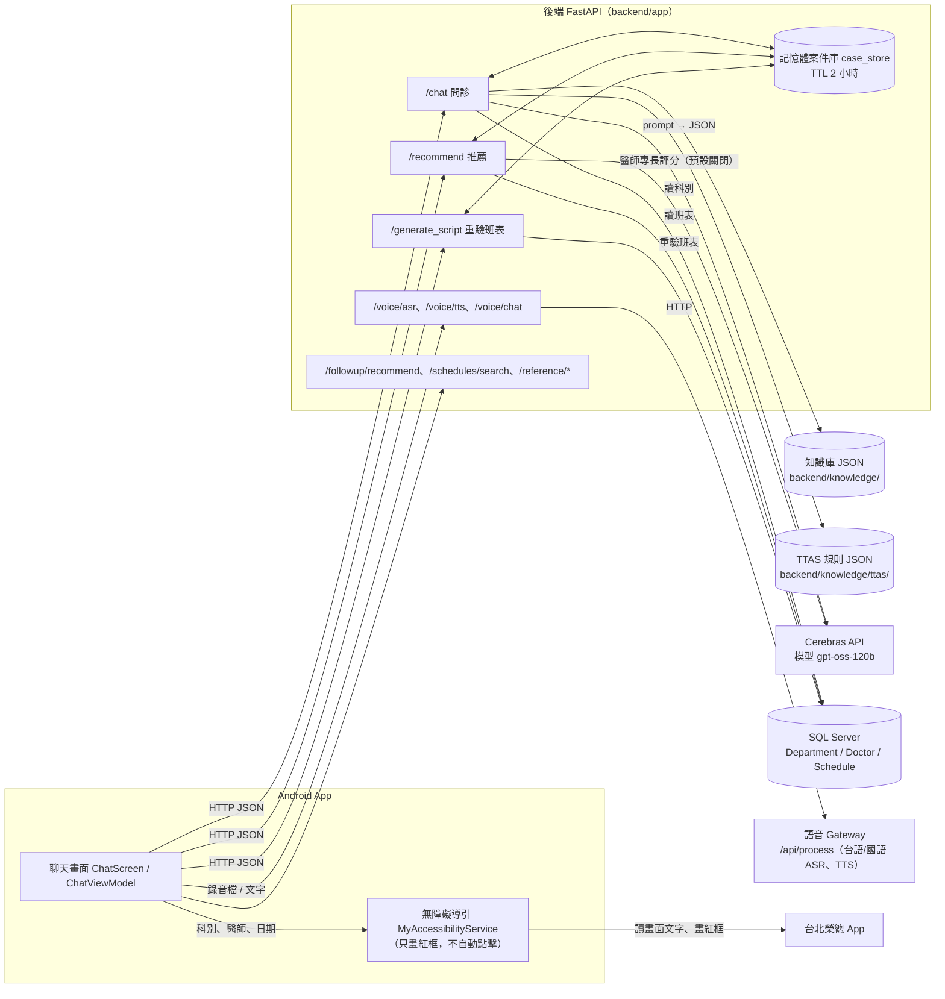
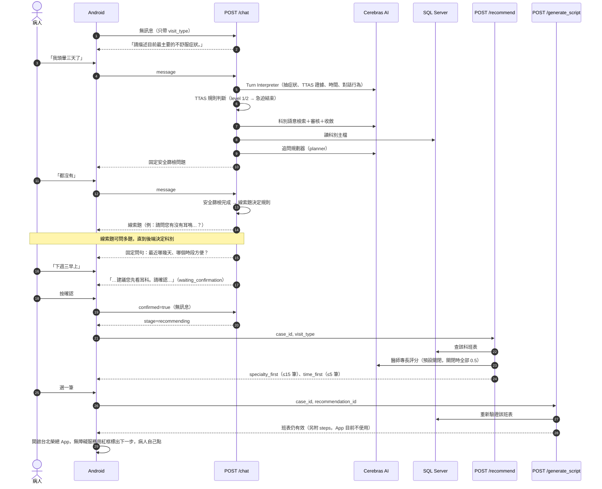
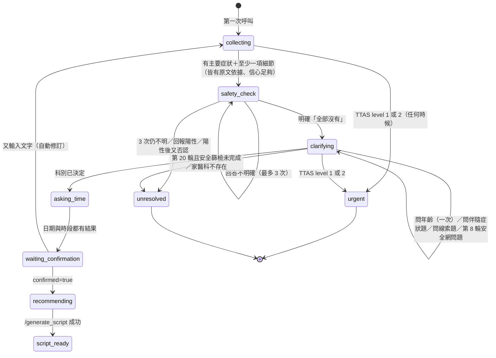
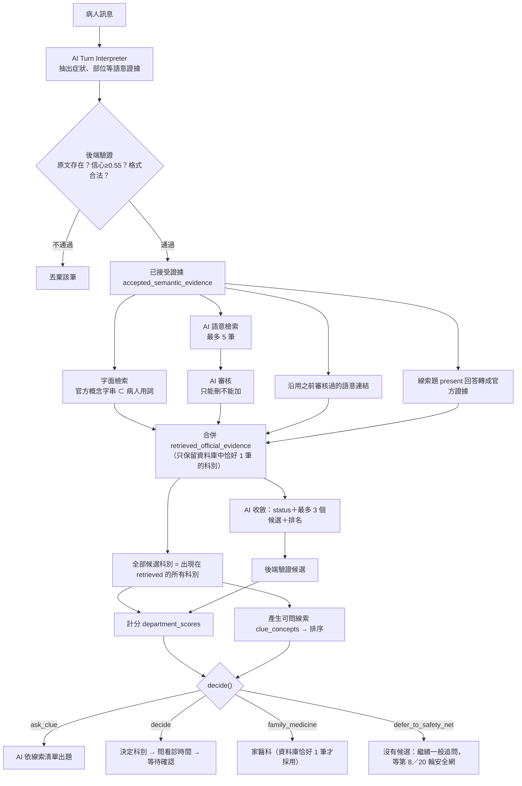

# 問診邏輯說明

> 對象：組員（不一定看過後端代碼）
> 依據：`New_Android_Backend` 分支目前代碼（撰寫時最新 commit `5f16cb9`；2026-11-03 對照代碼更新到 `c7b2ca6`，新增內容見第 11 節的更新紀錄；同日依 Android 代碼更正「無障礙導引」的描述：只畫紅框、不自動點擊，見第 10 節 #16）。
> 原則：本文件一律以**目前實際代碼**為準；`docs/修改計畫.md` 只當背景。兩者不一致的地方集中寫在第 9 節。
> 出處格式：（`檔案路徑` → `函式名稱`）。路徑皆相對於專案根目錄。
> 看不懂或代碼沒寫清楚的地方標「⚠ 待確認」，彙整在第 10 節。

---

## 0. 一分鐘看懂

這套系統讓病人用**自然語言聊天**，系統邊聊邊判斷：

1. **有沒有急迫危險**（TTAS 檢傷規則＋固定的安全篩檢問題）——危險就停止掛號、建議就醫。
2. **該看哪一科**（臺北榮總為主、其他榮總與公私立醫院為輔的官方「症狀→科別」資料＋AI 理解病人的話＋後端計分）。
3. **什麼時候方便看診**（AI 理解「下週三早上」，後端換算成真正日期）。
4. 病人按確認後，到資料庫查**真實班表**，排出推薦清單；病人選一筆後，後端再查一次確認班表還在，App 開啟台北榮總 App，由無障礙服務用**紅框**標出下一步（不會自動點擊，由病人自己操作）。

核心分工一句話：**AI 負責「聽懂人話」，後端負責「驗證、計分、決定流程」，資料庫負責「真實的科別、醫師、班表」。** AI 說的任何東西都要先通過後端驗證（例如：AI 引用的病人原話必須真的出現在病人訊息中），才會被採用。

---

## 1. 系統總覽

### 1.1 整體架構圖



### 1.2 每一端負責什麼

| 元件 | 負責 | 代碼位置 |
|---|---|---|
| Android App | 聊天畫面、錄音、播放語音、顯示推薦卡片；病人選定班表後開啟台北榮總 App，由無障礙服務在畫面上用紅框標出下一步（**只標示、不自動點擊**，個資由病人自己填；導引步驟由 App 依科別、醫師、日期自己產生，沒有使用 `/generate_script` 回傳的 `steps`）。**不做醫療判斷**，所有狀態以後端回傳為準。急迫停止判斷：`clarification_status=urgent`、`warning_required`，或回覆文字同時含「119」與「急診／情況危急」。「無法確認急迫症狀」停止判斷：`reply_source=SAFETY_UNRESOLVED_STOP`。兩者都跳彈窗、移除輸入框，只差標題文字（「急迫症狀提醒」／「無法確認急迫症狀」）；歷史紀錄與首頁近期紀錄的這兩類圖示改為橘色。後端「已記錄您希望看……」指定科別確認句，聊天畫面會把逗號前那段加粗（只改顯示）。 | `android/.../viewmodel/ChatViewModel.kt` → `requiresUrgentStop`、`requiresSafetyUnresolvedStop`；`android/.../service/MyAccessibilityService.kt` → `generateDynamicScript`、`highlight` |
| 後端 API | 流程狀態機、驗證 AI 輸出、科別計分與決定、TTAS 規則判斷、日期換算、班表過濾與排序。 | `backend/app/routes/*`、`backend/app/services/*` |
| AI 模型 | 固定使用 Cerebras 的 `gpt-oss-120b`，一律要求 JSON 輸出（`response_format=json_object`），單次逾時 8 秒、不自動重試。 | `backend/app/services/ai_service.py` → `complete_runtime_json`、`_complete_cerebras`（常數 `RUNTIME_AI_PROVIDER="cerebras"`、`RUNTIME_AI_MODEL="gpt-oss-120b"`；`config.py` 的 `ai_timeout_seconds=8.0`） |
| 資料庫 | SQL Server，表 `Department`、`DepartmentCategory`、`Doctor`、`Schedule`。科別是否存在、醫師、班表都以資料庫為準。連線資訊來自 `.env`（`DB_SERVER` 等）。 | `backend/app/db.py` → `create_db_connection`、`fetch_active_departments`、`fetch_available_slots` |
| 語音 ASR/TTS | 後端轉呼叫外部語音 Gateway（`{VOICE_GATEWAY_URL}/api/process`），服務類型 `taiwanese_asr`／`chinese_asr`／`taiwanese_tts`／`chinese_tts`。`VOICE_ENABLED` 預設 false。 | `backend/app/services/voice_client.py` → `VoiceGatewayClient`；`backend/app/routes/voice.py` |
| 科別知識庫 | 官方「症狀→科別」資料，3,424 筆（主檔 541 筆＋補充 2,883 筆），來自 11 個醫院／體系，對應 42 個科別。 | `backend/knowledge/vghtpe_department_guidance.json`、`supplemental_guidance_*.json` |
| TTAS 規則庫 | 衛福部急診五級檢傷規則，64 條，其中 28 條可執行（`enabled`）。 | `backend/knowledge/ttas/active_rules.json` |

補充：
- 案件（對話狀態）存在後端**記憶體**的 dict 中，閒置 2 小時過期（`CASE_TTL_SECONDS = 2 * 60 * 60`）。後端重開就會清空。（`backend/app/services/case_store.py` → `_prune_expired`）
- Android 端實際的語音用法：錄音後呼叫 `/voice/asr` 只把辨識文字填進輸入框（不推進問診），按送出才呼叫 `/chat`；播放用 `/voice/tts`。`/voice/chat`（一次做完 ASR→chat→TTS）後端有、Repository 也有包裝，但 ChatViewModel 沒有呼叫。（`ChatViewModel.kt` → `stopTaiwaneseRecordingAndTranscribe`；`MedicalRepository.kt` → `transcribeVoice`）
- 資料庫位置：⚠ 待確認。代碼的 `DB_SERVER` 預設值是 `medichain-server.database.windows.net`（Azure），實際值寫在各機器的 `.env`；README 說示範環境是手機透過 Tailscale 連 310 電腦上的 FastAPI。SQL 是否在 310 上，要看 310 的 `.env`。

---

## 2. 一次問診的完整流程

### 2.1 時序圖（從第一句話到掛號）



### 2.2 每一步由誰處理、狀態存在哪裡

`/chat` 單一輪的處理順序（全部在 `backend/app/routes/chat.py` → `chat`）：

| 順序 | 做什麼 | 函式 | 寫入的狀態 |
|---|---|---|---|
| 1 | 找出或建立案件（`case_id` 有存檔就用存檔；客戶端送來的舊快照會被清掉所有伺服器結論後才採用） | `_resolve_case`；`case_store.py` → `get_case`、`sanitize_untrusted_snapshot`、`create_case` | `case_store._CASES` |
| 2 | 特殊入口：`answers`（舊固定問卷）回 400；回診 `return_visit` 叫你改用 `/followup/recommend`；`quick_search` 回 400；`revision_requested=true` 走修訂 | `chat`、`_begin_revision` | — |
| 3 | 若案件已在等待確認／已確認，又收到新文字 → 視為**自動修訂**（延續問診，只重算科別） | `_should_treat_user_input_as_revision`、`_begin_revision` | 科別、確認、輪數等狀態重設；已回答內容保留 |
| 4 | 把病人訊息存進對話紀錄（不解析） | `rule_engine.py` → `apply_user_message` | `history_records` |
| 5 | 呼叫 AI Turn Interpreter，驗證後套用：症狀證據、TTAS 證據、時間偏好、指定科別、對話行為、就診者是誰與年齡（`patient_profile`，見 4.5.1） | `rag_triage_adapter.py` → `refine_case_with_ai`；`pediatric_routing.py` → `validate_patient_profile`、`apply_patient_profile` | `semantic_extractions`、`patient_input`、`ttas_evidence`、`availability.time_preferences`、`patient_subject`／`patient_relation_text`／`patient_age_text` |
| 6 | 記錄經驗證的對話行為；若是「不想再回答」→ `clue_user_declined=True` | `conversation_service.py` → `validated_dialogue_act` | `last_dialogue_act`、`clue_user_declined` |
| 7 | TTAS 規則判斷 | `ttas_evaluator.py` → `apply_ttas_evaluation` | `ttas_result`、`triage` |
| 8 | 若本輪在安全篩檢中 → 判讀安全回答 | `conversation_service.py` → `capture_safety_screen_answer` | `patient_input.red_flags_checked` 等 |
| 9 | TTAS level 1 或 2 → **急迫結束**（stage=done） | `ttas_requires_immediate_action` | `clarification_status="urgent"` |
| 10 | 否則：記錄病人對上一題的回答（線索題／安全網題／年齡題／一般題） | `capture_prior_answer_reference`、`capture_pending_answer`、`clear_answered_pending` | `clarification_evidence`、`clue_concepts_asked` |
| 11 | 重算科別（只在：有新輸入、Turn Interpreter 成功、且不在安全篩檢中或本輪剛完成篩檢；若本輪是在回答看診時間且沒有新症狀，則保留原科別不重算） | `settle_unanswered_clue_question`；`department_reasoning_service.py` → `reason_about_departments` | `candidate_departments`、`department_result`、`clue_decision` |
| 12 | 安全網：病人選家醫科／拒答且沒有候選／到第 20 輪 → 走家醫科 | `safety_net_family_medicine_reason`、`adopt_safety_net_family_medicine` | `clue_decision`、`department_result` |
| 13 | 呼叫 AI 追問規劃器（若允許） | `request_clarification` | — |
| 14 | 後端決定下一步：進安全篩檢／問年齡（見 4.5.1）／問伴隨症狀題（只剩一科時，見 4.5.2）／問線索題／問看診時間／完成 | `advance_conversation` | `turn_count`、`pending_clarification_intent`、`triage.next_question` 等 |
| 15 | 決定 `stage`（collecting / waiting_confirmation / recommending / done） | `chat`（第 372～407 行的分支） | `conversation_state.stage` |
| 16 | 若急迫或科別變了 → 清掉已存的推薦 | `case_store.py` → `clear_recommendations` | `_RECOMMENDATIONS_BY_CASE` |
| 17 | 組回覆文字（確認句、急迫句、無法釐清句等都是後端固定文字）。確認句的「不適部位」列出病人說過的所有部位，照說的順序、最多 3 個（例「屁股、大腿」；2026-11-03 起，以前只顯示最後存下的一個） | `ai_reply_generator.py` → `build_department_confirmation_reply`、`_stated_body_parts`、`generate_triage_reply` | `reply_source` |

說明：`generate_triage_reply` 目前**不會**呼叫 AI 改寫回覆，一律回傳後端準備好的文字。（`backend/app/services/ai_reply_generator.py` → `generate_triage_reply`）

---

## 3. 問診狀態與對話管理

### 3.1 主要狀態欄位

全部定義在 `backend/app/schemas.py` → `ConversationState`。以下只列跟流程有關的：

| 欄位 | 意思 | 何時改變 |
|---|---|---|
| `stage` | `collecting`（收集中）／`waiting_confirmation`（等病人確認科別）／`recommending`（已確認）／`script_ready`（已產生腳本）／`done`（急迫結束） | 每輪結尾由 `chat` 決定；`/generate_script` 成功設 `script_ready` |
| `clarification_status` | `collecting`／`clarifying`（追問中）／`safety_check`（安全篩檢中）／`sufficient`（資料足夠）／`unresolved`（無法繼續）／`urgent`（急迫） | `advance_conversation`、`_enter_safety_check`、`_unresolved`、急迫分支 |
| `turn_count` | 病人訊息輪數（一則訊息算 1） | `advance_conversation`：`turn_count += len(user_sources)`；急迫分支也會加 |
| `department_status` | `unresolved`／`ambiguous`／`resolved` | 每次 `reason_about_departments` 重算 |
| `candidate_departments` | AI 收斂後、經驗證的候選科別（最多 3 個） | `validate_candidate_proposal` |
| `department_clue_candidates` | 本輪官方檢索到的**全部**候選科別 ID | `store_clue_offer` |
| `department_clue_offer` | 排序後可問的線索概念（最多 10 個） | `store_clue_offer` |
| `clue_questions_asked` | 已問幾題線索題 | `_record_clue_question` |
| `clue_concepts_asked` | 每個問過的概念與病人回答（present／absent／uncertain／unanswered），最多保留 30 筆 | `append_clue_records`（`MAX_CLUE_CONCEPT_RECORDS = 30`）、`_capture_clue_answers` |
| `clue_decision` | 本輪決定結果（`ask_clue`／`ask_companion`／`decide`／`family_medicine`／`family_medicine_unavailable`／`defer_to_safety_net`），每輪重算 | `apply_clue_decision`、`adopt_safety_net_family_medicine` |
| `companion_questions_asked`／`companion_question_sources` | 只剩一科時，伴隨症狀題問了幾次（最多 2 次）、問的當下有計分的病人原文（用來判斷回答有沒有帶出新症狀）。2026-11-03 新增；修訂不清除 | `conversation_service.py` → `_ask_companion_question` |
| `clue_user_declined` | 病人表示不想再回答；修訂前一直保留 | `chat`、`_begin_revision` |
| `pending_clarification_intent` | 目前在等病人回答哪一題（例如 `department_clue_2`、`safety_net_choice`、`appointment_availability`） | `advance_conversation`、各 capture 函式 |
| `safety_answer_attempts` | 安全篩檢已回答幾次 | `capture_safety_screen_answer` |
| `safety_positive_reported` | 本次安全篩檢是否曾回報陽性 | 同上；只有修訂會清除 |
| `safety_net_asked`／`safety_net_choice` | 第 8 輪「繼續描述還是先掛家醫科」是否問過、病人選什麼 | `_ask_safety_net_question`、`_capture_safety_net_choice` |
| `availability_status` | 看診時間：`not_asked`／`asked`／`answered`／`unspecified` | `_ask_availability`、`availability_settled` |
| `availability_date_attempts`／`availability_session_attempts` | 日期、時段兩個面向各問了幾次 | `_ask_availability` |
| `is_complete`、`awaiting_confirmation`、`confirmed` | 問診完成、等待確認、已確認 | `advance_conversation`、`chat` |
| `patient_subject`／`patient_relation_text`／`patient_age_text` | 就診者是本人（`self`）還是家人他人（`other`）、對他的逐字稱呼（例「小女兒」）、就診者年齡原文（例「7歲」）。2026-11-03 新增；修訂不清除 | `pediatric_routing.py` → `apply_patient_profile` |
| `patient_age_question_asked`／`patient_age_answer` | 年齡題是否問過（整個案件只問一次）、病人對年齡題的原話 | `_ask_age_question`、`capture_pending_answer` |
| `reply_source` | 本輪回覆來自哪裡（例：`AI_PLANNER`、`CLUE_TEMPLATE`、`AGE_QUESTION`、`COMPANION_QUESTION`、`AVAILABILITY_QUESTION`、`SAFETY_NET_QUESTION`、`CONFIRMATION`、`URGENT_BACKEND`、`SAFETY_POSITIVE_STOP`、`SAFETY_UNRESOLVED_STOP`、`TECHNICAL_FALLBACK`、`STUCK_FALLBACK`） | 各處 |

### 3.2 狀態怎麼前進



（圖中 `asking_time` 不是真正的欄位值，代表 `clarification_status=clarifying` 且 `pending_clarification_intent=appointment_availability`；`urgent`、`unresolved` 是 `clarification_status`，`waiting_confirmation`、`recommending`、`script_ready` 是 `stage`。）

**進入安全篩檢的條件**（`conversation_service.py` → `advance_conversation`，變數 `safety_ready`）：
- 有主要症狀（`patient_input.symptom`），且這段文字真的出現在病人訊息裡；
- 有至少一項細節：部位、持續時間、嚴重度、發作方式、伴隨症狀之一（信心 ≥ 0.55、有原文依據），或已有任何已接受的追問回答；
- 本輪沒有信心低於 0.55 的醫療欄位。

> 白話：病人說「頭暈」不夠，說「頭暈三天了」就會進安全篩檢。部位、持續多久、嚴重度**不是必填**，只要有其中一項細節即可。

**完成問診（進入等待確認）的條件**（`advance_conversation` 的 `sufficient` 分支）：
- 安全篩檢已完成，且科別 `resolved`；
- 以下其一：後端線索題已決定（`decide`／`family_medicine`）、本輪是回答看診時間、或 AI planner 建議 `sufficient`；
- 且上面的 `safety_ready` 成立（安全網家醫科路徑例外，不需要本輪細節）；
- 看診時間兩個面向都已有結果，否則先問時間（見第 6 節）。

### 3.3 輪數提示與上限（實際數值）

數值在 `backend/app/config.py`：

| 設定 | 值 | 作用 | 出處 |
|---|---|---|---|
| `SAFETY_NET_ASK_TURN` | **8** | 第 8 輪起，若科別仍未決定、安全篩檢已完成、沒有待回答的線索題，且還沒問過 → 問一次固定句「目前還沒辦法確定要看哪一科，要繼續描述，還是先掛家庭醫學科？」 | `conversation_service.py` → `advance_conversation`、`_ask_safety_net_question` |
| `SAFETY_NET_NO_CANDIDATE_TURN` | **3** | 2026-11-04 新增。第 3 輪起，若這一輪科別比對有正常跑完、除了家醫科一個候選科都沒有（`department_uncertainty_reason` 為「目前沒有可精確對應正式科別的官方症狀證據」，或候選只剩家醫科），其他條件同上 → 提早問同一題。資料庫或 AI 失敗造成的沒有候選不算；有候選但收斂不出來的照樣等第 8 輪。只問一次：選「繼續描述」後第 8 輪不會再問。起因：「舌頭痛」「屁股疼」知識庫完全對不到，問了 8 輪才給家醫科。 | `conversation_service.py` → `_knowledge_found_no_department`、`NO_OFFICIAL_EVIDENCE_REASON` |
| `HARD_TURN_CAP` | **20** | 本輪結束時達 20 輪且科別未決定 → 走家醫科（需安全篩檢已完成）；若安全篩檢都還沒完成 → `unresolved` 結束 | `safety_net_family_medicine_reason`、`advance_conversation`、`continue_safety_check` |
| `SAFETY_ANSWER_CAP` | **3** | 安全篩檢最多回答 3 次（要求解釋不算） | `conversation_service.py` 常數 |
| `CLUE_QUESTION_LIMIT` | **5** | 線索題最多 5 題 | `department_clues.py` → `decide` |
| `CLUE_MIN_QUESTIONS` | **3** | 兩科以上候選時，線索題至少問 3 題才定科（AI 收斂說 resolved 也要等）。2026-11-03 新增 | `config.py`；`department_clues.py` → `decide` |
| `COMPANION_QUESTION_LIMIT` | **2** | 只剩一科時，伴隨症狀題最多問 2 次 | `conversation_service.py` 常數 |
| `CLUE_CONCEPTS_PER_QUESTION` | **3** | 每題最多問 3 個概念 | `_clue_question_spec` |
| `CLUE_PLANNER_CONCEPT_LIMIT` | **10** | 交給 AI 出題的候選概念最多 10 個 | `store_clue_offer` |
| 線索題重問 | **1 次** | 一題沒有任何合格回答 → 換句話重問 1 次；再沒回答 → 該題未答概念記 `uncertain` | `settle_unanswered_clue_question`（`clue_reask_count < 1`） |
| `AVAILABILITY_QUESTION_LIMIT` | **2** | 看診日期、時段各最多問 2 次 | `conversation_service.py` 常數 |

**第 8 輪的特別規則（`turn_limit_top_score`）**：第 8 輪（`turn_count + 1 >= 8` 且還沒問過安全網）時，如果剛好**只有一個非家醫科的科別分數最高**，直接決定該科，不問安全網；平手或最高的是家醫科，才照常問安全網。（`department_reasoning_service.py` → `apply_clue_decision` 的 `turn_limit_reached`；`department_clues.py` → `decide`）

**第 8 輪安全網的回答**：由 Turn Interpreter 判斷 `answer_choice`（`family_medicine`／`continue`）。只有「有原文依據、`answered`、信心 ≥ 0.55 的 `family_medicine`」才算選家醫科；這題能掛的只有家醫科，所以「先決定掛號」「先掛就好」也算（prompt 規則 15d）。其他情況（離題、低信心、AI 失敗）都當作繼續。第 8 輪固定只問一次；之後只有「問診卡住」且病人還沒選過繼續時才會再問（見 3.5）。（`_capture_safety_net_choice`）

**沒有進展計數**：`consecutive_no_progress_turns` 仍會累加，但目前只作診斷紀錄，不會因此結束對話。（`advance_conversation`）

### 3.4 病人說「不想再回答」時

1. Turn Interpreter 判斷 `dialogue_act=decline_further_questions`（prompt 第 27 條：明確表示不想再回答、或說不出更多；想直接掛號，例如「我要先掛號」「我說我要先掛號」也算；單純對某題答「沒有」「不知道」不算）。後端只檢查：信心 ≥ 0.55、`source_text` 逐字出現在本輪訊息。（`validated_dialogue_act`）
2. 通過後設 `clue_user_declined=True`，直到修訂才清除。（`chat`）
3. 若當下有線索題在等回答：不重問，未答概念記 `uncertain`，釋放該題，同一輪就可決定。（`settle_unanswered_clue_question`）
4. **有候選科別**：`decide()` 以 `reason=user_declined` 用目前分數決定；平手依 AI 排名，AI 候選中都沒有平手科別才走家醫科。（`department_clues.py` → `decide`）
5. **沒有候選科別**：走安全網家醫科路徑，`reason=user_declined_no_candidates`。這個原因在 `SAFETY_NET_REASONS` 裡，所以就算系統整理過的症狀名稱和病人原話對不上，也會直接進入確認。（`safety_net_family_medicine_reason`）
6. 不變的規則：安全篩檢未完成時不會因拒答而決定；決定後仍要病人按確認。

### 3.5 拿不到可用的下一題時

AI planner 的題目不能用（重複問、問已答過的事、格式壞掉…），或根本沒給題目時，後端分兩種情況處理（`advance_conversation`、`_recover_stuck_turn`）：

- **AI 真的出錯**（逾時、供應商錯誤，或這一輪沒有呼叫 planner）→ `TECHNICAL_FALLBACK`「系統剛剛沒有回應，請再傳一次剛才的訊息。」
- **AI 有回應，但題目都不能用（卡住）** → 不叫病人重試，改走固定的下一步：
  1. 安全篩檢還沒完成 → 固定開放式問題「可以再多說一點嗎？例如哪裡不舒服、從什麼時候開始、有多嚴重。」（`STUCK_FALLBACK`，原本等待中的題目保留）
  2. 科別已決定 → 直接問看診時間或進入確認。
  3. 科別未決定、病人還沒選過「繼續描述」→ 問安全網題「要繼續描述，還是先掛家庭醫學科？」
  4. 科別未決定、病人已選過「繼續描述」→ 同第 1 點的開放式問題；第 20 輪上限仍會走家醫科。

安全篩檢時病人要求解釋、但 AI 沒給出可用的解釋 → 固定說明「這題是想確認您有沒有需要馬上去急診的狀況；如果都沒有，回答「沒有」就可以。」加上完整安全題。（`continue_safety_check`）

### 3.5 其他對話行為

| 對話行為 | 後端怎麼處理 | 出處 |
|---|---|---|
| `request_explanation`（看不懂問題） | 不算一次安全回答、不算線索題未回答；planner 需附 1～2 句白話 `explanation`（4～150 字、不得含問號／分號／「科」「醫師」等字／簡體字），通過才顯示在問題前。 | `capture_safety_screen_answer`、`settle_unanswered_clue_question`、`_valid_explanation` |
| `claims_already_answered`（我剛剛說過了） | AI 須引用一筆**之前已接受**的證據原文，後端比對成立才當作已回答；不能用來回答安全篩檢與安全網題。 | `validate_prior_answer_reference`、`capture_prior_answer_reference` |
| `correction`（我說錯了） | 必須同時輸出有原文依據的更正內容：醫療證據、看診時間（`time_preferences`）或指定科別其中之一（2026-11-03 起時間、科別也算；以前只認醫療證據，修訂後只改時間的「我想要下週三不然就下週二」會被判成沒理解，回「系統剛剛沒有回應」）；欄位值真的被換掉時，清掉目前科別結論重算。 | `rag_triage_adapter.py` → `refine_case_with_ai`；`invalidate_corrected_department_context` |
| 指定科別（「我想看皮膚科」） | AI 輸出 `department_preference`，後端驗證 `dept_id` 與名稱在資料庫中恰好 1 筆、信心 ≥ 0.55、有原文依據；通過後科別直接採用病人指定，**不跑線索題**，但安全篩檢照做。安全篩檢完成後就跟後端定科一樣，直接問看診時間／進確認，**不再讓 AI planner 出題**（`requested_department_adopted`，2026-11-03 起；修訂後也一樣。起因：310 實測「我想要直接掛婦產科」→ 確認 → 我想修改 → AI 改問「下週二上午還是下週三上午？」「疼痛的程度」，「直接讓我掛號」也沒用）。 | `department_preference_service.py` → `validate_department_preference`、`resolve_requested_department`；`reason_about_departments` |
| 修訂（`revision_requested` 或確認後又輸入文字） | **延續問診**：保留已回答的追問（`clarification_evidence`）、問過的題目（`asked_clarification_intents`）、線索題的概念與回答（`clue_concepts_asked`、`clue_questions_asked`）、問過的部位題與看診時間狀態，已回答的不會再問。只清空科別判斷、確認與推薦、輪數、安全網與本次安全篩檢陽性紀錄，讓新補充的內容能重算科別。按「我想修改」後的**第一句**如果沒有改到任何症狀、看診時間或指定科別（例「我想要更改日期跟時段」），或 AI 沒能理解，後端不重算、不呼叫 planner，固定回「請直接告訴我要改成什麼，例如「改成下週四下午」「改看皮膚科」，或補充新的症狀。」（`reply_source=REVISION_DETAIL_QUESTION`，只問 1 次；病人說「直接讓我掛號」則照常進確認）。確認前直接打字的自動修訂不套用這條，因為那句本身就是修改內容。 | `chat.py` → `_begin_revision`、`revision_detail_due`；`conversation_service.py` → `ask_revision_detail_question` |

---

## 4. 科別判定（最詳細）

### 4.1 整體流程



觸發時機：每輪病人有新輸入、Turn Interpreter 成功、且不在安全篩檢中（或本輪剛完成篩檢）時，`reason_about_departments` 會**整個重算**（不是累加）。例外：本輪是在回答看診時間且沒有新的症狀證據 → 保留已決定的科別不重算。（`chat.py` → `chat` 的 `department_kept`；`department_reasoning_service.py` → `reason_about_departments`）

### 4.2 候選科別從哪裡來

**第 0 步：病人有指定科別嗎？** 有且驗證通過 → 直接採用，結束。安全篩檢完成後算「後端已定科」，不再交給 AI 出題。（`reason_about_departments` → `resolve_requested_department`；`conversation_service.py` → `requested_department_adopted`）

**第 1 步：載入知識庫並對到資料庫**（`department_knowledge.py` → `load_department_knowledge`、`resolve_department_names`）
- 知識庫每筆記錄有 `canonical_dept_id`（例：眼科 1329）。後端用這個 ID 去資料庫 `Department` 找，**恰好 1 筆**才算 `resolved`，否則該科不參與。

**第 2 步：四種證據來源合併**（`reason_about_departments`）

| 來源 | 做法 | 出處 |
|---|---|---|
| 字面檢索 | 對每筆「present、狀態 available/partial」的症狀證據，把它的 `normalized_value` 和 `source_text` 正規化（NFKC、去空白、小寫）。官方概念字串若**包含在**其中，就命中；但概念若是從一個詞的中間開始，不算字面命中，交給語意檢索由 AI 判斷意思。「詞」有兩種，都不是寫死的詞表：(1) AI 拆出來的部位（`body_part` 的原文與正規化值，2 字以上），例「舌頭痛」AI 拆成部位「舌頭」＋症狀「疼痛」，「頭痛」從「舌頭」中間開始 → 不算；(2) 同一段裡命中的較長官方概念，例「坐骨神經痛」裡的「經痛」、「心肌炎」裡的「肌炎」、「下背痛」裡的「背痛」 → 不算。AI 自己的症狀名稱若就是官方詞（例「額頭痛」AI 正規化成「頭痛」），照常命中。沒有部位的症狀不受影響（例「我經痛很嚴重」→「經痛」→ 婦產科）。另外：同一則訊息中相鄰的 present 片段（例「腰酸」＋「背痛」）會合成整段「腰酸背痛」再比對一次，但計分不會因此多加分。 | `retrieve_official_evidence`、`literal_concepts`、`_body_part_words`、`adjacent_present_spans` |
| AI 語意檢索 | 把已接受證據＋官方概念清單給 AI，請它找語意相符的概念（最多 5 筆，概念必須逐字取自**送出的清單**、信心 ≥ 0.55）。清單先經「挑詞」縮短（見下方）。 | `retrieve_semantic_official_evidence`（purpose `department_semantic_retrieval`） |
| AI 審核 | 第二次呼叫 AI，逐筆判斷上一步的連結是否忠於原話，只能刪不能加；`supported=true` 且有理由才保留。審核規則明說：概念的部位可以是原文部位的上位部位，少了左右側不算改變含義（「右耳痛」可對應「耳痛」），但不同部位不行（「舌頭痛」不是「頭痛」）。2026-11-04 前審核曾以「耳痛沒有『右』」刪掉這筆。2026-11-04 起審核還要逐筆標 `body_part_match`：概念的部位和原文是同一部位（同義說法或只少了左右側，例「屁股」與「臀部」）填 `same`、概念沒寫部位（例「麻木」）填 `none`、概念的部位比原文大或不同（例「大腿」對「下肢」）填 `other`；只在第 2.3 步使用，標錯或沒標時當作沒有。 | 同上（purpose `department_retrieval_entailment`） |
| 舊連結沿用 | 之前審核過的語意連結（最多保留 50 筆）只要原文仍是目前的 present 證據、且沒被否認，就重建。 | `retained_semantic_official_evidence`（`_MAX_SEMANTIC_LINKS = 50`） |
| 線索題回答 | 病人對線索題答 present 的概念，轉成官方證據（標記 `evidence_origin=clue_answer`）；若目前語意證據對該概念是 absent／uncertain 則不建。 | `department_clues.py` → `clue_answer_evidence` |

- **挑詞**（2026-11-04 新增，`concept_shortlist.py` → `shortlist`）：送給語意檢索的不是整份概念清單，而是替每個「查詢句」各挑：
  - 字面最像的前 20 個（字元 1～2 字片段的 TF-IDF，分數 > 0 才算）；
  - 本地向量模型（`CONCEPT_EMBEDDING_MODEL`，預設 `jinaai/jina-embeddings-v2-base-zh`）意思最像的前 30 個。
  - 查詢句＝present 症狀的 `source_text`、相接片段合成的整段原文、present 症狀的 `normalized_value`（去重）。
  - 多個查詢句依名次交錯合併（各句第 1 名、再各句第 2 名…），最多 150 個（`SHORTLIST_CAP`）。
  - 整份清單本來就不超過 150 個、模型沒載入、或清單裡有還沒算過向量的詞（知識庫改了但後端沒重開）→ 送整份清單，跟以前一樣。
  - AI 回的概念必須在**送出的短清單**裡，否則丟棄。
  - 模型與每個概念的向量存在 `backend/.model_cache/`（不進 git），後端啟動時載入（第一次會下載），只替新的概念補算向量。（`app/main.py` → `prepare_concept_shortlist`；`concept_shortlist.py` → `warm_up`）
  - 找到率量測：`backend/benchmark/concept_shortlist_recall.py`，102 句口語（`concept_shortlist_cases.json`）。2026-11-04 結果 101/102，只漏「大不出來」（「便秘」排第 94 名；此量測只用原話，沒用 AI 正規化的症狀名稱）。同日晚上醫師專長補齊、概念增加到 2,504 個後重跑，仍是 101/102（每句平均 49 個候選詞）。
- 字面已經命中的「科別＋概念」，語意結果不再重複加入。（`_new_concept_rows`）
- 否認（absent）或不確定（uncertain）的症狀**不會**產生候選。

**第 2.3 步：主訴沒有官方依據時，AI 不能把部位放大**（2026-11-04 新增，`part_bound_semantic_rows`、`chief_complaint_departments`）

- 什麼時候用：主訴那則訊息（第一則說出症狀的訊息）的證據，**不算放大部位的 AI 連結**時，沒有對到家醫科以外的任何科。字面、語意、舊連結都算，但放大部位的連結不能當主訴的依據（例：「我的屁股好痛」被 AI 放大成「下肢疼痛」→ 疼痛控制科，仍算主訴沒有依據）。
- 做什麼：所有經 AI 語意比對（含沿用的舊連結）找到的官方詞，包括主訴那句，都必須保留病人替這段症狀說的部位，否則這一筆不算。依序判斷：
  1. 官方詞裡有病人說的部位原話（左、右、雙、兩邊這類字先拿掉，所以「右耳」對「耳痛」算）→ 保留。病人說的部位一定是原話（AI 拆出的部位必須逐字出現在原文，`field_acceptance.py`），這一條由程式判斷。
  2. 審核 AI 標 `other`（部位放大或不同）→ 不算。即使 AI 這輪沒有拆出部位也一樣（310 重播：第一句只抽出症狀「痛」、沒有部位，「痛」→「下肢疼痛」仍被審核標 `other`）。
  3. 審核 AI 標 `same`（同一部位的不同說法，例「屁股」與「臀部腫塊」）或 `none`（官方詞沒寫部位，例「麻木」）→ 保留。
  4. 審核沒標：這段症狀沒有說部位就保留（交給第 2.5 步主詞過濾），有說部位就不算。
- 「病人替這段症狀說的部位」照主詞過濾的找法（同一則訊息、它回答的那題、部位反問的回答，`_symptom_subject`）。
- 字面比對不受影響：字面命中時，官方詞本來就整段出現在病人的話裡，不會放大部位。線索題回答也不受影響。
- 被擋下的連結仍會記住（`semantic_official_links`，含 `body_part_match`），只是這個條件成立時不算；log 記一行 `part-bound semantic filter`。
- 起因（2026-11-03 310 實測，第 10 節 #17）：主訴「我的屁股好痛」對不到任何官方詞，之後「我的大腿有點酸」被 AI 用上位部位對到「下肢酸痛」。知識庫裡「下肢」開頭的 11 個官方詞幾乎都只列心臟外科（血管問題），結果建議心臟外科，主訴卻完全沒有依據。現在這筆不算，沒有候選科，第 3 輪就問要不要先掛家庭醫學科（3.4 `SAFETY_NET_NO_CANDIDATE_TURN`）。
- 主訴不靠放大部位就有官方依據時不變：上位部位照樣可以用，因為第 3.5 步主訴過濾會把看不了主訴的科拿掉。（`backend/tests/test_part_bound_semantic.py`）
- 本機真 AI 重播（2026-11-04，「我的屁股好痛」→ 安全篩檢「沒有」→「我的大腿有點酸」）：改之前 2 次有效重播各出現一次疼痛控制科（第一句「好痛」被放大成「下肢疼痛」）；改之後 4 次有效重播全部在第 3 輪問「要繼續描述，還是先掛家庭醫學科？」，其中 1 次 AI 同時提了「好痛」→「下肢疼痛」、「酸」→「下肢酸痛」，審核都標 `other`，都被擋下。第 5 次碰到 Cerebras 連線錯誤，不列入。

**第 2.5 步：主詞過濾**（2026-11-02 新增，`subject_filtered_evidence`）

病人說過任何部位後，沒有自帶部位的症狀**只能幫忙，不能帶走**：

- 自帶部位的證據照常計分：原文或官方概念含部位（例「眼睛紅」）、原文和部位相接（例「眼睛」＋「紅腫」），或來自主訴那一句。這些證據對到的科別稱為「部位科別」。
- 其他證據只在它的科別也是部位科別時保留。例外：它的部位（同一句話、它回答的那題，或部位反問的回答）在病人其他話裡都沒出現，代表是另一個獨立的不舒服，照常計分（例「鼻子也會流鼻水」）。
- 實例：「眼睛紅腫酸痛」→ 系統問「請問眼睛是否有分泌物？」→「有淺黃色分泌物」。「分泌物」雖然是婦產科概念，但主詞是眼睛（來自題目），而婦產科不是部位科別，所以不計分。
- 部位完全不明（病人沒說，題目也沒指定，例如「還有其他不適症狀嗎？」），而且過濾後沒有任何證據時，後端用固定句反問一次：「請問您說的「淺黃色分泌物」是在哪個部位呢？」（`BODY_PART_PENDING_INTENT`、`_ask_body_part_question`）。每段原文只問一次，病人回什麼都會釋放這題。
- 病人從沒說過部位時不過濾，行為與以前相同。
- 後面才說的部位也會留成證據（`rule_engine._is_new_body_part`），但不會取代第一個部位；改口換部位仍照原本的更正流程。

**第 3 步：全部候選** = 合併後證據中出現的**所有**科別（不是只有 AI 的前 3 名）。（`department_clues.py` → `candidate_dept_ids`）

**第 3.5 步：主訴過濾**（2026-11-03 新增，`department_reasoning_service.py` → `decision_candidates`）

推薦的科必須看得了病人的**主訴**（第一則說出症狀的訊息）。

- 「主訴科別」＝證據原文出現在主訴那則訊息裡的科別（線索題回答的證據不算）。
- 有主訴科別（家醫科不算）時，**不持有主訴的科別從候選拿掉**：不出它的線索題、不計分、不會被決定，AI 收斂選它也不採用。家醫科照舊保留。
- 後來才說的症狀仍然有用：它會幫「同時持有主訴」的科加分。
- 沒有任何主訴科別（例如主訴只對到家醫科、或主訴沒對到任何科）時不過濾，行為與以前相同。
- 起因（實際對話）：主訴「我掉了好多頭髮」，線索題問風濕科「乾眼症」時病人答「我最近眼睛很乾」。「乾眼症」「眼睛乾澀」眼科也有，眼科因此變成候選；之後問眼科「刺眼」，病人答「眼睛有刺痛」，眼科以 4 比 3 贏過風濕科，結果「掉頭髮」被建議看眼科。現在眼科不持有「掉頭髮」，不會進候選；「眼睛很乾」只幫風濕科加分，結果是過敏免疫風濕科（掉髮＋眼乾兩個概念都是風濕科的官方概念）。（`backend/tests/test_chief_complaint_departments.py`）
- 影響例：「腰酸背痛」答「有關節痛」時，風濕科（有「關節痛」但沒有「腰酸背痛」）不再被拉進候選。

**第 4 步：AI 收斂**（purpose `department_convergence`）
- 輸入：已接受證據、合併後的官方證據、問過的追問、線索題回答。
- 輸出：`status`（resolved/ambiguous/unresolved）、最多 3 個 `candidates`（每個有 `dept_id`、`confidence`、`supporting_evidence`）、`uncertainty_reason`、`next_question_intent`。
- 後端驗證（`validate_candidate_proposal`）：`dept_id` 必須在資料庫恰好 1 筆；`confidence` 在 0～1；每筆 `supporting_evidence` 的原文、來源 ID、概念都必須完全對應到第 2 步的某筆證據；不合格的候選整個丟棄。依 confidence 排序取前 3。
- **AI resolved 的條件**：status=resolved、驗證後只剩 1 個候選、且 confidence ≥ 0.55。此時 `department_status=resolved`。其他情況 `ambiguous`（有候選）或 `unresolved`（沒有）。

### 4.3 分數怎麼算

只有一條規則（`department_clues.py` → `department_scores`）：

> **某科分數 ＝ 支持該科的「不同病人原文片段」數 ＋ 病人答 present、且該科持有該概念的「不同線索題題號」數**

細節：
- 同一段原文對到同一科的多個同義概念，只算 1 分（例：「頭暈」同時對到「頭暈」「眩暈」也只 1 分）。
- 來自線索題回答的證據（`evidence_origin=clue_answer`）不算進「原文片段」，改用題號計分，避免重複。
- **重說線索題答案不再加分**：某科已經因為線索題答 present 拿到題號分時，Turn Interpreter 從同一個回答另外抽出的症狀片段，對**這一科**不再算「原文片段」。判斷方式（任一成立）：片段對到的官方概念就是那題答 present 的概念；或片段整段落在那題回答的原文（`answer_source_text`）裡。同一句回答裡**另外說的新症狀**照樣計分；題目沒加到分的科別，照樣用原文片段計分。
  - 例：主訴「頭暈」，線索題「請問您有沒有耳鳴？」病人答「有耳鳴」，AI 又抽出症狀「耳鳴」→ 耳科 ＝ 頭暈 1 ＋ 題號 1 ＝ **2 分**（修正前是 3 分）。若答「有耳鳴，也會想吐」→「想吐」是新症狀，照樣加分。
  - 起因：2026-11-03 整理文件時發現（原第 10 節 #3）；修正前該科會同時得到「原文片段」與「題號」各 1 分，跟只回「有」的病人比起來，多說一句症狀名稱就多 1 分。（`backend/tests/test_department_clues.py`、`test_clue_questions.py` → `test_clue_answer_also_extracted_as_a_symptom_scores_once`）
- 合併片段（例「腰酸背痛」）若它的組成片段已在該科計分，就不再加分。
- **absent 不扣分。**
- 跨科概念：病人答 present 的概念，**目前知識庫中**持有它的每個候選科別都加分（不是看出題當時的快照）。
- 沒有權重、沒有 AI 分數參與計分。AI 的 confidence 只用在「平手時的排名」與「目標科別優先度」。


### 4.4 線索題：怎麼選題

**可問的概念**（`department_clues.py` → `clue_concepts`）—— 從候選科別在知識庫中的概念挑出，條件：
1. 病人還沒提過（不在已命中的概念或已接受的症狀值裡）；
2. 還沒得到 present／absent 結論（uncertain／未回答的可以再問）；
3. **不是所有候選都有**（大家都有的概念無法區分）；
4. 至少一筆是 `direct_routing_evidence`（院方「症狀→科別」指引）；只有 `department_specialty_evidence` 的概念不出題，但仍參與檢索與計分；
5. 不能**只屬於家醫科**（家醫科是終點，不是區分對象；但其他概念的科別清單照樣包含家醫科）；
6. **不能是敏感概念**（2026-11-03 新增，`never_ask_concept`）：概念含「愛滋、梅毒、淋病、菜花、披衣菌、性病、癌、腫瘤、惡性、白血病、懷孕」任一字就不出題（目前知識庫有 24 個，例「梅毒」「乳癌」「腫瘤」「懷孕」）。病人自己說出口時仍照常檢索與計分。
   - 起因：病人說「流鼻水咳嗽喉嚨痛」讓感染科成為候選，線索題就問出「寒顫、小便疼痛、愛滋病」。官方表格把病名和症狀列在一起，所以要擋。（`department_clues.py` → `_NEVER_ASK_MARKERS`、`clue_concepts`）

**這一題問哪一科**（2026-11-03 新增，`department_clues.py` → `ranked_targets`、`clue_target_department`；`department_reasoning_service.py` → `_clue_target`、`store_clue_offer`）

每一題只問**一個目標科**，交給 AI 的清單只放這一科的概念（其他候選科沒有的概念排前面）。家醫科不當目標。

1. 候選科先排名：分數高的在前；同分看 AI 收斂候選的順序；再同就看科別 ID。只算還有可問概念的科。
2. **還沒有任何一題答「有」**：照排名一科一科往下問（第 1 題問第 1 名，第 2 題問第 2 名…）。
3. **有題目答「有」之後**：只在「領先的科」和「最強的挑戰者」（排名第 2）之間輪流。被問比較少次的先問；一樣多就問領先的科。這樣一科不會只因為被多問幾次就贏。
4. 「被問幾次」＝有幾個**已回答**的題號問到這一科持有的概念（`asked_question_counts`）。

例：「掉頭髮」候選是皮膚科、風濕科、整形外科，各 1 分，AI 排名皮膚科 > 風濕科。第 1 題問皮膚科；答「有」→ 皮膚 2 分領先，第 2 題問風濕科；第 3 題兩科被問次數相同 → 問領先的科。

**排序**（`rank_clue_concepts`、`department_priority`；有目標科時只在目標科的概念裡排），依序比較：
1. 概念所屬候選科別中最好的「目標優先度」：分數高者優先；同分看 AI 收斂候選的順序（在前者優先，不在其中的排最後）；家醫科不給優先度；
2. 只屬於一個候選科別（獨有）優先；
3. 有 `direct_routing_evidence` 優先；
4. 來源優先度 `source_priority` 小者優先（臺北榮總症狀指引 1、其他臺北榮總來源 2、臺中榮總 3、高雄榮總 4、屏東榮總 5、榮總分院 6、公立醫院 7、私立醫院 8；4.6）；
5. 問過但沒結論（uncertain）的往後；
6. 概念字串排序（讓結果穩定）。

取前 10 個（`CLUE_PLANNER_CONCEPT_LIMIT`）交給 AI planner。

**出題與驗證**（`conversation_service.py` → `request_clarification`、`_clue_rejection`）：
- AI 從清單選 **1～3 個**、彼此至少共享一個候選科別的概念；
- 問句必須**逐字包含**每個所選概念字串（可加括號白話說明），只能有一個問號，以「請問」開頭（prompt 要求，後端沒檢查開頭），不得提到科別、醫師、診斷；
- 病人在描述家人時，問句要問那個人（例「請問她有沒有…」「請問您兒子有沒有…」），不得改問使用者本人（2026-11-03 新增，prompt 要求，後端沒檢查）。起因：「我小女兒感冒」被問成「請問您是否有嗅覺喪失」。（`conversation_service.py` → `_clue_prompt`）
- 重問時概念必須和原題完全相同；
- 一般驗證：問句 4～180 字、不得含簡體字、不得含「確診／科／醫師／掛號…」等字、不得與之前問過的句子重複（整段對話都算，修訂前問過的也算）。
- **不合格 → 修復一次**；修復還不合格 → 後端固定句：「請問有沒有以下情況，或以前曾被告知有：A、B、C？」（重問時前面加「想再確認一次，」；2026-11-03 拿掉「您」，本人或家人都讀得通），`reply_source=CLUE_TEMPLATE`，**算一題**。（`department_clues.py` → `CLUE_TEMPLATE`、`CLUE_REASK_TEMPLATE`、`template_clue_selection`）
- AI 逾時或供應商錯誤 → `TECHNICAL_FALLBACK`「系統剛剛沒有回應，請再傳一次剛才的訊息。」，**不算題數**。

**回答判讀**（`rag_triage_adapter.py` → `_concept_answers_from_ai`；`conversation_service.py` → `_capture_clue_answers`）：
- Turn Interpreter 對每個問過的概念回 `present`／`absent`／`uncertain`，`source_text` 必須逐字出現在本輪訊息（「有」「沒有」也可以），信心 ≥ 0.55，同一概念不可重複；
- 整題籠統「不知道」→ 全部記 `uncertain`，算有回答；
- 沒回答到的概念維持 `unanswered`，之後還能問。

### 4.5 決定規則（什麼時候定科、什麼時候改家醫科）

`department_clues.py` → `decide`，每輪由 `apply_clue_decision` 呼叫。**安全篩檢未完成前不會呼叫**；有線索題或伴隨症狀題在等回答、或病人在要求解釋時也不呼叫（除非 AI 已 resolved；這時如果 AI 的結論還不能採用，就先撤回，等題目回答完）。

下面的「目標科」是指家醫科以外的候選科。2026-11-03 起，目標科有兩個以上時**至少要問滿 3 題線索題**（`CLUE_MIN_QUESTIONS`）才會定科；起因是組員反映問診太短，「掉頭髮」第一句就被 AI 定成皮膚科、一題都沒問。

依序判斷：

| 順序 | 條件 | 結果 `kind` / `reason` |
|---|---|---|
| 0 | 就診者未滿 18 歲（見 4.5.1）；在 `apply_clue_decision` 裡、`decide()` 之前判斷，**優先於下面全部規則**（包括 AI resolved、待回答的線索題） | `decide` / `pediatric_default` |
| 1 | 沒有任何候選 | `defer_to_safety_net` / `no_candidates`（繼續一般追問，等第 8、20 輪安全網） |
| 2 | 病人拒答（`clue_user_declined`） | 依最高分決定 / `user_declined`（**不受 3 題下限限制**） |
| 3 | 目標科只有 0～1 個，且伴隨症狀題還該問（見 4.5.2） | `ask_companion` / `single_candidate` |
| 4 | AI 收斂 resolved 的科在候選中，**而且**：目標科只有 0～1 個、或沒有可問線索、或已問滿 3 題 | `decide` / `ai_resolved`（直接採 AI 的科，不比分數）。條件不成立時把 AI 的結論撤回成 `ambiguous`，繼續問 |
| 5 | 目標科只有 0～1 個（伴隨症狀題已問完） | 依最高分決定 / `single_candidate` |
| 6 | 沒有可問線索 | 依最高分決定 / `no_askable_clues` |
| 7 | 已問滿 5 題 | 依最高分決定 / `question_limit` |
| 8 | 已問滿 3 題，且**領先科**嚴格領先挑戰者，而且挑戰者沒有任何一題答「有」、或挑戰者被問的次數 ≥ 領先科 | 依最高分決定 / `clue_confirmed_single_department`（答「有」的只有領先科）或 `leader_confirmed` |
| 9 | 已問滿 3 題，最高分**平手**，平手的科每一科都有題目答「有」、而且被問的次數一樣多 | 依最高分決定（平手處理見下）/ `balanced_tie` 或 `tie_broken_by_ai_rank` |
| 10 | 第 8 輪（尚未問過安全網） | 只有一個非家醫科最高分才決定 / `turn_limit_top_score`；否則繼續 |
| 11 | 以上皆否 | `ask_clue` / `continue`（出下一題） |

白話：
- 「挑戰者」是排名第 2 的目標科（排名方式見 4.4「這一題問哪一科」）。
- 規則 8：領先的科分數比較高，而且對手那邊的題目都答「沒有」→ 定領先的科。對手也答過「有」、但被問的次數比較少 → 先補問對手，問到次數一樣再比。
- 規則 9：病人什麼都答「有」，兩科分數、題數都一樣 → 交給 AI 排名，再不行就家醫科。全部答「沒有」造成的平手不算，會繼續問到 5 題。

**「掉頭髮」實際跑出來的結果**（2026-11-03 用真實知識庫跑 `/chat`，AI 收斂假設排名皮膚科 > 風濕科，題目是後端固定句）：

| 病人回答 | 問了哪些科 | 結果 |
|---|---|---|
| 第 1、3 題答有（一般掉髮） | 皮膚、風濕、皮膚 | 3 題，皮膚科（`clue_confirmed_single_department`） |
| 第 2、3 題答有（像免疫問題） | 皮膚、風濕、風濕 | 3 題，過敏免疫風濕科（`leader_confirmed`） |
| 全部答有 | 皮膚、風濕、皮膚、風濕 | 4 題，平手 → AI 排名第一的皮膚科（`tie_broken_by_ai_rank`） |
| 全部答沒有 | 皮膚、風濕、整形、皮膚、皮膚 | 5 題，平手 → AI 排名第一的皮膚科 |
| 第 2 題（乾眼症）答「眼睛很乾」，其他答沒有 | 皮膚、風濕、風濕 | 3 題，過敏免疫風濕科（`clue_confirmed_single_department`）；眼科因主訴過濾（4.2 第 3.5 步）不進候選。改之前會被拉進眼科 |

**「依最高分決定」的平手處理（規則 C）**：
- 最高分只有一科 → 決定該科；
- 平手 → 在平手科別中，選**本輪 AI 收斂候選排名最前**的那一科（`reason=tie_broken_by_ai_rank`）；
- 平手科別都不在 AI 候選中（或 AI 失敗、候選為空）→ **家醫科**。
- 不會再加問第 6 題。`tiebreak_clues()` 函式還在，但決定流程已不呼叫。

**家醫科怎麼採用**（`apply_clue_decision`、`adopt_safety_net_family_medicine`、`_live_department`）：
- 用設定值 `FAMILY_MEDICINE_DEPT_ID`（預設 **1233**）向資料庫找，**恰好 1 筆**才採用；
- 回覆固定為：「目前的症狀無法明確區分科別，系統建議先由家庭醫學科初步評估。」＋「請確認後取得推薦掛號方案。」（`config.py` 的 `family_medicine_fallback_message`；`ai_reply_generator.py` → `build_department_confirmation_reply`）
- 不是恰好 1 筆 → `family_medicine_unavailable`，回「資訊不足，無法判斷科別。請改用手動選科或洽醫院掛號服務。」並結束（`unresolved`），不虛構、不改推別科。（`_family_medicine_unavailable`）

**走家醫科的所有情況**：
1. 線索題平手且平手科別都不在 AI 候選中；
2. 第 8 輪安全網病人選「先掛家醫科」（`safety_net_choice`）；
3. 病人拒答且沒有任何候選（`user_declined_no_candidates`）；
4. 第 20 輪仍未決定（`safety_net_turn_cap`）。

以上全部都要病人**按確認**才進入推薦；AI 不能宣布確認。

### 4.5.1 未滿 18 歲先看兒科（2026-11-03 新增）

代碼：`backend/app/services/pediatric_routing.py`；接入點 `department_reasoning_service.py` → `apply_clue_decision`、`conversation_service.py` → `_age_question_due`、`_ask_age_question`。

**依據**：臺中榮總「症狀查詢 › 18歲以下兒童」頁寫兒童的任何症狀若無法確認，可先掛一般兒科（https://www.vghtc.gov.tw/SymptomQuery/605）。「未滿 18 歲」這個切點是使用者決定的。

**第 1 步：AI 判斷就診者是誰**（Turn Interpreter 第 8 個頂層欄位 `patient_profile`，prompt 規則 32）
- 欄位：`subject`（`self` 本人看病／`other` 替家人他人描述）、`relation_text`（對就診者的逐字稱呼，例「小女兒」「我媽」；self 時必須 null）、`age_text`（就診者本人年齡或學齡的逐字原文，例「7歲」「6個月大」「國小三年級」）、`source_text`、`confidence`。
- AI 只判斷「誰在生病」，不得猜年齡、不得由症狀推年齡。prompt 範例：「我是幼稚園老師，喉嚨痛」是 self（幼稚園是工作地點）；「我小孩感冒傳染給我，我現在咳嗽」是 self；「我女兒幫我掛號，我頭暈」是 self；「我兒子咳嗽好幾天了」是 other、`relation_text=兒子`。
- prompt 會把後端目前記錄的就診者帶給 AI；後端還沒記錄、但之前的訊息已說過是誰時，AI 本輪也要補輸出（`source_text` 可取自之前的訊息）。
- 這個欄位是**選填**：AI 沒輸出不算格式錯誤。（`_turn_interpretation_rejection_reason`）

**第 2 步：後端驗證**（`validate_patient_profile`）
- 五個欄位剛好齊全；`subject` 只能 self／other；信心 ≥ 0.55；`source_text` 必須逐字出現在**整段對話任一則病人訊息**中（不只本輪）；`relation_text`、`age_text` 必須包含在 `source_text` 裡；空字串當作沒說；self 不能帶 `relation_text`。不合格整筆丟棄。
- 通過後存進狀態：換了一個人（subject 或稱呼不同）就整筆取代；同一個人本輪沒講年齡，保留之前的年齡。（`apply_patient_profile`）

**第 3 步：後端判斷是不是兒童**（`patient_status`，全部是固定規則，不用 AI）

| 依序 | 看什麼 | 結果 |
|---|---|---|
| 1 | 年齡原文（`patient_age_text`），以及年齡題的回答（`patient_age_answer`，這裡也接受單純數字「7」） | 用程式讀出數字：有任何一個 < 18 歲、或「X 個月大」、或學齡字（幼稚園、托嬰、國小、小學、國中、高中、高職、國一～高三、小一～小六年級）→ **兒童**；有年齡且都 ≥ 18 → **成人** |
| 2 | 稱呼含兒童字（寶寶、寶貝、嬰兒、幼兒、新生兒、小朋友、小孩、孩子、小寶）或學齡字 | **兒童** |
| 3 | `other`、稱呼是看不出年齡的親屬（兒子、女兒、孫子、孫女、外孫、姪子、姪女、外甥），且還沒問過年齡 | **要問年齡** |
| 4 | 其他（本人、我媽、說不出年齡…） | **成人**，照原本流程 |

注意：「三個月」不算年齡（通常是症狀持續多久），只有「三個月大」才算。（`_MONTHS`）

**第 4 步：要問年齡時**（`_age_question_due`、`_ask_age_question`）
- 條件：安全篩檢已完成、沒有其他題目在等回答、病人沒有指定科別、第 3 步結果是「要問年齡」。
- 後端固定問句：「請問您{稱呼}今年幾歲？」（例「請問您兒子今年幾歲？」；稱呼前的「我／我的／我家」會去掉），`reply_source=AGE_QUESTION`。這題排在線索題前面。
- **整個案件只問一次**；病人回什麼都會釋放這題。回答讀不出年齡（例「不知道」）→ 當成人，照原本流程。（`capture_pending_answer`）

**第 5 步：兒童怎麼定科**（`apply_clue_decision` → `pediatric_dept_id`）
- 安全篩檢完成後，只要判斷是兒童，就**直接決定兒科**，不比分數、不問線索題；就算官方證據完全沒對到任何科（`retrieved` 為空）也一樣。
- 選哪個兒科：官方證據已經對到兒科次專科（兒童腸胃科 1322；2026-11-04 起加上新生兒科暨健兒門診 1246、兒童牙科 1247、兒童泌尿暨兒童外科 1318）→ 用該科（同時對到多個時取 ID 最小的）；否則 → 兒童內科 1320。
- 科別必須在資料庫恰好 1 筆才採用；查不到就退回原本的決定規則。
- 病人自己指定科別時，指定科別優先（`resolve_requested_department` 在更前面就結束）。
- 確認句：「根據您剛才提到的…。就診者未滿 18 歲，依醫院就醫指引，兒童的各種症狀可先看兒科，因此目前建議您先看兒童內科。請確認後取得推薦掛號方案。」推薦卡片的科別理由也用同樣說法。（`ai_reply_generator.py` → `build_department_confirmation_reply`；`patient_reason_text.py` → `_department_sentence`）

**實例**
- 「我女兒 5 歲，發燒三天」→ AI：other、「女兒」、「5歲」→ 兒童 → 安全篩檢後直接建議兒童內科。
- 「我兒子咳嗽好幾天了」→ AI：other、「兒子」、沒年齡 → 安全篩檢後問「請問您兒子今年幾歲？」→「7歲」→ 兒童內科；→「35」→ 成人，照原本流程問線索題。
- 「我家寶寶便秘」→ 稱呼含「寶寶」→ 兒童；若官方證據對到兒童腸胃科（例「嬰兒便秘」）→ 兒童腸胃科。
- 「我媽頭暈」→ 「媽」不在親屬清單 → 成人，不問年齡。

### 4.5.2 只剩一科時先問有沒有其他不舒服（2026-11-03 新增）

代碼：`department_clues.py` → `decide`（`companion_due`）；`department_reasoning_service.py` → `apply_clue_decision`；`conversation_service.py` → `companion_question_due`、`_ask_companion_question`、`companion_question`。

**為什麼**：知識庫 2,504 個概念裡有 2,054 個只對到一科（2026-11-04 臺北榮總醫師專長補齊後；例「肛裂」只對到直腸外科；「牙痛」在 2026-11-03 中榮全表補收後同時對到牙科與口腔顎面外科，「痔瘡」在 2026-11-04 起也對到一般外科）。只有一科時沒有東西可以區分，以前一題都不問就定科。硬問那一科的症狀也不會改變結果，所以改問一題開放式的伴隨症狀題，讓病人有機會說出指向別科的症狀。

**規則**：
- 「只剩一科」＝家醫科以外的候選科只有 0～1 個（例「流鼻水」對到鼻科＋家醫科，也算只剩一科）。
- 第 1 次：「除了「{主要症狀}」，最近還有沒有其他不舒服的地方？」（主要症狀用 `patient_input.symptom`；沒有就省略前半句）。本人或家人都讀得通。
- 病人回什麼都會釋放這題（同部位反問）；新症狀照一般流程抽取、重算科別。
- 回答帶出**新的、有計分的病人原文**，而且還是只剩一科 → 再問一次「還有其他不舒服的地方嗎？沒有的話直接說「沒有」就可以。」；最多 2 次（`COMPANION_QUESTION_LIMIT`）。
- 回答沒有帶出新的計分原文 → 依規則 5 定科（`single_candidate`）。
- 新症狀讓候選變成兩科以上 → 改走一般線索題流程（至少 3 題）。新症狀帶進來的科如果不持有主訴，會被主訴過濾拿掉（4.2 第 3.5 步），不算多一科。
- AI 收斂說 resolved 也要等這題問完；病人拒答則直接定科。
- 這題是後端固定句，不呼叫 AI planner（`chat.py` 的 `clarification_planning_allowed`）。`reply_source=COMPANION_QUESTION`。
- 如果這一輪沒有重算科別（例如 Turn Interpreter 沒有完成），上一輪留下的 `ask_companion` 不會讓同一題再問一次（`companion_question_due` 會比對問的當下的原文）。

### 4.6 知識庫內容與來源

檔案：
- 主檔：`backend/knowledge/vghtpe_department_guidance.json`（541 筆）
- 補充檔：`backend/knowledge/supplemental_guidance_20261021.json`（1 筆：骨科「足部疼痛」）、`backend/knowledge/supplemental_guidance_20261102.json`（9 筆：眼科「紅眼睛」「眼睛紅」「畏光」「乾眼症」「眼睛乾澀」「眼睛疲勞」「飛蚊症」，過敏免疫風濕「乾眼症」「眼睛乾澀」）、`backend/knowledge/supplemental_guidance_20261102_pediatrics.json`（8 筆，2026-11-03 新增：兒童內科 1320「小兒發燒」「小孩發燒」「熱痙攣」；兒童腸胃科 1322「牛奶過敏」「腸絞痛」「嬰兒哭鬧」「小兒便秘」「嬰兒便秘」）
- 熱門科別補充檔（2026-11-03 新增，84 筆，全部是 `direct_routing_evidence`，來源是臺北榮總症狀說明頁共 21 頁）：
  - `supplemental_guidance_20261103_dermatology.json`（19 筆，fid 6704 掉髮、6705 皮膚癢、6706 皮膚疹）：皮膚科「掉髮」「圓形禿」「鬼剃頭」「皮膚癢」「皮膚炎」「冬季癢疹」「脫屑」「皮膚疹」「濕疹」「蕁麻疹」「藥物疹」「皮膚過敏」「紅疹」；過敏免疫風濕「掉髮」「皮膚疹」「蕁麻疹」「皮膚過敏」「濕疹」「紅疹」。
  - `supplemental_guidance_20261103_gastroenterology.json`（37 筆，fid 6712、6733～6741、6743）：胃腸肝膽科「消化不良」「胃灼熱」「燒心」「胃氣脹」「胃酸反流」「上腹部不適」「心窩灼熱」「逆流性食道炎」「溢酸水」「打嗝」「急性腹痛」「下痢」「飢餓痛」「腸阻塞」「腹脹」「茶色尿」「肝炎」「消化性潰瘍」「幽門螺旋桿菌」「想吐」「噁心」「胃炎」「胃潰瘍」「十二指腸潰瘍」「上消化道出血」「大便出血」「便血」「柏油樣」「慢性腹瀉」「糞便帶血」「喉嚨有異物感」「喉嚨有東西哽住」；一般外科「腹痛」「急性腹痛」「腸阻塞」；喉科「喉嚨有異物感」「喉嚨有東西哽住」（官方寫「耳鼻喉科」，咽喉症狀對到既有喉科）。
  - `supplemental_guidance_20261103_chest.json`（14 筆，fid 6713、6724～6727）：胸腔內科「打鼾」「睡眠中止」「慢性咳嗽」「持續咳嗽」「氣喘」「痰中帶血」「久咳不癒」「呼吸困難」「喘不過氣」「氣促」「胸部疼痛」；心臟內科「喘不過氣」「氣促」「胸部疼痛」。
  - `supplemental_guidance_20261103_orthopedics.json`（14 筆，fid 6730 背痛、6731 關節酸痛）：骨科、復健醫學、神經外科「背痛」「腿部酸麻」；骨科、復健醫學、過敏免疫風濕「關節酸痛」；骨科、復健醫學「退化性關節炎」；骨科、過敏免疫風濕「痛風」；過敏免疫風濕「類風濕性關節炎」。
  - 第二批（2026-11-03 夜間，89 筆，臺北榮總症狀說明頁 22 頁，fid 6698～6746 剩下的頁面）：
    - `supplemental_guidance_20261103_ent.json`（27 筆）：鼻科「過敏性鼻炎」「鼻子過敏」「鼻癢」「流鼻血」「鼻子癢」「鼻竇炎」「鼻中膈彎曲」「嗅覺失靈」；喉科「喉嚨痛」「咽喉炎」「扁桃腺發炎」「喉部腫痛」「頸部腫大」「甲狀腺腫大」「淋巴腺腫大」；耳科「耳朵疼痛」「外耳炎」「耳部流膿」「中耳積水」「中耳炎」「耳悶塞」「聽力不良」；一般外科「頸部腫大」「甲狀腺腫大」「淋巴腺腫大」；新陳代謝科「頸部腫大」「甲狀腺腫大」。官方寫「耳鼻喉科」，依症狀部位分到耳科／鼻科／喉科（頸部對喉科，官方標籤含喉頭頸科）。
    - `supplemental_guidance_20261103_eye.json`（11 筆）：眼科「過敏性結膜炎」「流淚」「結膜充血」「眼睛疼痛」「眼白充血」「眼屎」「刺眼」「急性結膜炎」「青光眼」「視網膜剝離」「視野突然變窄」。
    - `supplemental_guidance_20261103_neurology.json`（12 筆）：神經內科「三叉神經痛」「頭昏」「天旋地轉」「昏厥」「頭重重的」「眼前一片黑」「麻痺」「麻木」；神經外科「麻痺」「麻木」；心臟外科「周邊血管阻塞」；耳科「美尼爾氏症」「聽力障礙」。
    - `supplemental_guidance_20261103_general.json`（13 筆）：感染科「發高燒」「食物中毒」「蜂窩組織炎」；一般內科「發高燒」「食物中毒」「倦怠」；過敏免疫風濕「發高燒」；口腔顎面外科「口腔潰瘍」（官方寫「口腔外科」）；心臟內科、新陳代謝科「心跳加快」「心跳不規則」；新陳代謝科「甲狀腺機能亢進」。
    - `supplemental_guidance_20261103_urology_gynecology.json`（23 筆）：泌尿外科「尿中帶血」「解尿疼痛」「尿急」「泌尿道結石」「膀胱炎」「解尿困難」「攝護腺肥大」「泌尿道感染」「解尿不順」「小便無力」「夜尿」「尿失禁」「尿不乾淨」「滴尿」「尿滯留」；腎臟科「尿中帶血」「解尿疼痛」「泌尿道結石」；婦產科「乳房脹痛」「乳房腫脹」「陰部癢」「外陰癢」「陰道炎」；一般外科「乳房脹痛」「乳房腫脹」（見下方科別對應）。
    - 310 沒有同名科時的對應（2026-11-04 依官方資料決定，使用者表示這類醫療判斷不由使用者決定）：
      - 乳房特別門診（fid 6728）→ 既有一般外科 1290。依據：臺中榮總症狀查詢 `https://www.vghtc.gov.tw/SymptomQuery/605` 把「乳房疼痛」「乳房分泌物」只列一般外科。沒有新增 1292 乳房疾病門診／1262 乳醫中心門診的對照。
      - 心臟血管外科（fid 6729 麻痺頁）→ 既有心臟外科 1285，只收頁面上的血管原因「周邊血管阻塞」。不收一般「麻木」，因為臺中榮總症狀查詢的「手腳會麻」不列心臟外科（只有「下肢麻木」列心臟外科，知識庫原本就有）。
      - 神經修復科（fid 6729、6730）→ 不收。310 沒有對應科，兩頁同列的神經內科、神經外科、骨科、復健醫學已收。
    - 影響例：「喉嚨痛」以前只對到感染科，現在感染科與喉科平手，會用線索題分辨。
  - 規則同前：只收院方頁面「建議就診科別」列出的專科，不收家醫科；神經修復科（fid 6730）在 310 尚無對照，暫不收；已存在的概念不動，只補新詞。每筆 `evidence_text` 都已逐字核對院方頁面原文。
  - 影響例：「背痛」現在會直接對到骨科／復健醫學／神經外科；病人說「腰酸背痛」時，這三科同時有「背痛」與「腰酸背痛」，但同一段原文只算 1 分（4.3 合併片段規則），所以不會因此多加分。
  - 兒科資料只收「有標明兒童」的寫法，所以成人說「發燒」「便秘」不會被帶到兒科；院方頁面同時列的家醫科依使用者決定不收。來源是臺北榮總症狀說明頁 fid 6747～6750。
  - 兒童內科以前在知識庫裡沒有任何資料。
- 五科補強（2026-11-03 深夜，150 筆；使用者指定精神科、直腸外科、一般骨科、牙科、胸腔外科。臺北榮總症狀說明頁已用完，改用各科自己的頁面＋臺中榮總症狀查詢表）：
  - `supplemental_guidance_20261103_colorectal.json`（15 筆，`direct_routing_evidence`，優先度 1）：大腸直腸外科「何時該到大腸直腸外科就診」`https://wd.vghtpe.gov.tw/crs/Fpage.action?muid=702&fid=4910`。直腸外科「肛門出血」「大便帶血」「痔瘡」「肛裂」「痔瘡出血」「排便習慣的改變」「殘便」「大便解不完」「裡急後重」「長期便秘」「肛門疼痛」「排便帶黏液」「廔管」「大便潛血」「腹部硬塊」。頁面也列了腹痛、貧血、體重減輕、腹瀉，但這些太籠統，收了會讓一般腹痛都多一個直腸外科候選，所以不收。
  - `supplemental_guidance_20261103_orthopedic_injury.json`（6 筆）：骨科「扭傷」「腳踝扭傷」「翻腳刀」「韌帶受傷」來自健康e點通「扭傷之照護」`https://ihealth.vghtpe.gov.tw/media/476`。這頁寫明「預約掛號：骨科門診」，所以雖然是衛教頁（優先度 2），仍列 `direct_routing_evidence`。「骨折」「人工關節置換」來自骨科部骨折創傷科頁 fid 6432，屬 `department_specialty_evidence`。「落枕」找不到官方頁面把它對到骨科，所以不收（2026-11-04 起由義大醫院「症狀參考」補上，見下方外院擴建）。
  - `supplemental_guidance_20261103_thoracic_dental.json`（9 筆，`department_specialty_evidence`）：胸腔外科「氣胸」（胸腔外科衛教頁 fid 904）；牙科「牙周病」「牙齦發炎」「牙肉紅腫」「牙結石」「牙齦退縮」「洗牙」「植牙」「缺牙」（口腔醫學部牙周病科頁 fid 12930；310 沒有牙周病科，對到既有牙科 1248）。
  - `supplemental_guidance_20261103_vghtc_symptom_query.json`（120 筆，`direct_routing_evidence`，優先度 3，`fallback_for_vghtpe=true`）：臺中榮總症狀查詢 `https://www.vghtc.gov.tw/SymptomQuery/605` 的「症狀對照科別表」。為此 `_SOURCE_POLICY` 新增（`vghtc`, `symptom_department_guidance`）＝優先度 3。收了下面這些列，同一列列出的專科只要已對到 310 都一起收（不收家庭醫學、兒童心智、高齡、美沙東、放射腫瘤、甲狀腺科）；該科已有同一概念的 direct 資料就跳過：
    - 精神系統（精神部→精神科 71 筆）：憂鬱、躁期、焦慮、強迫、創傷、思覺失調、自閉／過動、飲食、物質、人格、失智、睡眠 12 列，例「憂鬱」「焦慮」「恐慌」「情緒低落」「過度擔心」「強迫症」「幻聽」「入睡困難」「戒斷症狀」。其中強迫與失智兩列同列神經內科，所以神經內科也多「強迫症」「記憶力退化」「失智症」等 10 筆。這些概念有不少原本已經是精神科的專長證據（只能計分），補上 direct 後**可以出線索題**。不收「自殺意念」「自傷」等字眼（線索題不會問），也不收同列的頭痛、頭暈、心悸、胸悶、口乾、貪食或厭食這類一般身體症狀。
    - 胸腔外科：「吞嚥困難」「心窩灼熱」「嘔酸水」「呼吸急促困難」（原本只是專長證據，現在可出題）；同列的胃腸肝膽科「嘔酸水」、心臟內科與心臟外科「呼吸急促困難」一起補。
    - 牙科（一般牙科）：「口腔出血」「咀嚼困難」「咬合不良」「張口受限」「牙關節疼」「張嘴會痛」；同列的口腔顎面外科、復健醫學、喉科（官方「耳鼻喉頭頸部」，口腔咽喉症狀照前例對到喉科）、骨科一起補。
    - 骨科：「關節腫」「關節僵硬」「肌肉萎縮」「肌肉抽筋」「手腳會麻」；同列的過敏免疫風濕、神經內科、神經外科、復健醫學、疼痛控制科、整形外科一起補。官方同表的「下肢水腫」雖列骨科，但不是這次要補的骨科問題，不收。
    - 直腸外科：「便血」（「吐血便血(黑便)」列胃腸肝膽與大腸直腸；胃腸肝膽科原本就有「便血」）。
  - 影響例：「最近很憂鬱」以前沒有任何科，現在只對到精神科；「我很焦慮」一般內科與精神科平手，會出線索題；「痔瘡在痛」→ 直腸外科；「便血」→ 胃腸肝膽科與直腸外科平手；「腳踝扭傷」「手骨折」→ 骨科；「牙周病」→ 牙科；「氣胸」→ 胸腔外科；「手腳會麻」的候選從 5 科（含家醫科）變 7 科，多了整形外科、疼痛控制科，會靠線索題分辨（背痛線索題測試因此把整形外科加進候選）。頭痛、胸痛、腹痛、咳嗽的候選科別沒有變。
  - 每筆 `evidence_text` 都已在瀏覽器逐字對過院方頁面原文（臺中榮總的表格是 JavaScript 載入）。
- 全科補強（2026-11-03 傍晚，270 筆；使用者指定「除了精神科都補，方法跟之前一樣」）：
  - `supplemental_guidance_20261103_vghtc_symptom_query_all.json`（262 筆，`direct_routing_evidence`，優先度 3，`fallback_for_vghtpe=true`，來源同上一批的 `vghtc_symptom_query_20261103`，所以本檔 `sources` 是空的）：臺中榮總症狀查詢表**其餘所有列**（全身、皮膚、肌肉骨骼、頭部、眼、耳、鼻、頸、口腔咽喉、背、胸、乳房、腹、泌尿、男性、女性、血液共 17 張子表）。
    - 臺中科名對照：胃腸肝膽→胃腸肝膽科、新陳代謝→新陳代謝科、免疫風濕→過敏免疫風濕、骨科部→骨科、復健醫學部→復健醫學、疼痛治療→疼痛控制科、泌尿醫學部→泌尿外科、婦女醫學部→婦產科、大腸直腸→直腸外科、血液腫瘤→血液腫瘤科、眼科部→眼科、一般牙科→牙科、口腔顎面→口腔顎面外科、美容整型→醫學美容中心（310 既有對照，官方標籤「美容醫學中心」）；「耳鼻喉頭頸部」照前例依部位分到耳科／鼻科／喉科（頸部、腮腺對喉科）。
    - 不收：精神部（使用者指定）、家庭醫學、兒童各科、高齡各科、美沙東、甲狀腺科、放射腫瘤部、乳房腫瘤外科（乳房照前例對一般外科）、齒顎矯正、中醫各科（中醫子表整張不收）。另外不收：**腫瘤內科**（表上只出現在體重、發燒、流汗、口渴、怕冷怕熱、貧血等全身症狀，收了會讓一般發燒、流汗都多一個腫瘤內科候選）、**心臟外科在發燒／咳嗽／頭暈／冒冷汗／一般腹痛／胃不適感這幾列**（同理）、「腫瘤、結節」「畸形或不對稱」「貪食或厭食」「晨間脊椎僵硬」（只列高齡科）等過於籠統或只對到不收科別的列。
    - **常見症狀鎖定**：「頭痛、頭暈、胸痛、胸悶、心悸、咳嗽、發燒、腹瀉、腹痛」這 9 個概念，只替原本就有這個概念的科別補 direct，不新增科別。所以頭痛不會多眼科、胸痛不會多心臟外科／復健醫學、頭暈不會多心臟外科／復健醫學，展示用的常見路徑不變。
    - 概念取自「症狀」欄原文（例「蛋白尿(泡泡尿)」→「蛋白尿」「泡泡尿」），不取「可能原因」欄的病名。該科已有同一概念的 direct 資料就跳過（跳過 122 組）。
    - 新增 59 個新概念，例：腎臟科「泡泡尿」「蛋白尿」「脫水」「臉腫」「尿量減少」；泌尿外科「頻尿」「急尿」「睪丸疼痛」「陰囊腫」；心臟內科「血壓高」「膽固醇高」「心律不整」「下肢跛行」；心臟外科「靜脈曲張」「單腳水腫」「手指腳趾發紫」；神經內科「手抖」「感覺異常」「走路不穩」「眩暈」；過敏免疫風濕「手腳遇冷變白變紫」「眼乾」「癢疹」；眼科「視力模糊」「眼瞼下垂」「眼球突出」；耳科「耳鳴」「重聽」；鼻科「鼻塞」「流鼻水」「打噴嚏」；喉科「聲音沙啞」；胃腸肝膽科「黃疸」「嘔吐」；一般外科「疝氣」「乳房疼痛」；血液腫瘤科「容易出血」「瘀青」「盜汗」；整形外科／醫學美容中心「蘿蔔腿」「狐臭」「眼袋」「單眼皮」等。
    - 既有概念多了科別的例子（影響例）：「腰酸背痛」多婦產科（背痛線索題測試因此把婦產科加進候選）；「牙痛」「牙齦出血」多口腔顎面外科（「牙痛」不再是只有一科，伴隨症狀題測試改用「痔瘡」）；「尿色改變」多腎臟科；「上腹痛」「下腹痛」多胃腸肝膽科；「暈厥」多心臟內科；「眼瞼水腫」多腎臟科；「咽喉痛」多感染科。「國字臉」原本只有專長證據，現在有 direct，測試改用仍只有專長證據的「拉皮」。
  - `supplemental_guidance_20261103_ihealth_gynecology.json`（8 筆，`direct_routing_evidence`，優先度 2）：健康e點通「經痛之照護」`https://ihealth.vghtpe.gov.tw/media/1190`、「子宮肌瘤之照護」`https://ihealth.vghtpe.gov.tw/media/588`，兩頁都寫明「若您有上述症狀，請至婦產科門診就醫」（同「扭傷之照護」的判斷）。婦產科「經期疼痛」「痛經」「異常陰道出血」「月經延長」「經血過多」「血塊」（direct）；「子宮肌瘤」「子宮內膜異位症」是病名，照下一段規則列為 `department_specialty_evidence`（只計分、不出題）。「血塊」本身不帶部位，所以受 4.2 第 2.5 步主詞過濾管：病人說過別的部位（例「咳嗽有血塊」的情況由部位決定）時，只有婦產科也是部位科別才計分。頁面列的壓迫症狀（頻尿、便秘等）太籠統，不收。
  - `supplemental_guidance_20261103_ihealth_all.json`（181 筆、142 個來源，優先度 2）：健康e點通全站掃描。從「目錄總覽」的 22 個科別分類（不含精神科、急重症、放射線、核醫、健檢、高齡、移植、毒物）取得 720 篇衛教頁，每頁間隔 1.5 秒讀取（第一次並行掃描被網站以 HTTP 429 暫時封鎖，改慢速後沒再被擋）。其中 213 頁有「請至／應至／請到○○科門診就醫」這類句子，逐頁人工挑選：
    - 收：句子明寫的科別已對到 310，而且是「有上述症狀並不一定是○○，請至××科就醫」這種就醫指引。科名對照：心臟科→心臟內科、泌尿科→泌尿外科、血液科→血液腫瘤科、大腸直腸外科→直腸外科、兒童醫學部／兒童醫學門診→兒童內科、兒童腸胃科→兒童腸胃科。
    - 不收：手術後或治療中的併發症提醒（例「植皮後傷口紅腫請至整形外科」「鼻部手術後出血請至鼻科」）、只說「請到門診向主治醫師洽詢」、310 沒有對照的科（兒童過敏感染科、新生兒科暨健兒門診、兒童心臟、兒童血液腫瘤、兒童骨科、脊椎外科）、精神科、家醫科；兒科只收標明兒童的詞（「腸病毒」「腸胃炎」「氣喘」沒有標明兒童，不收）。「失智症之照護」頁已是主檔來源，為了不混淆主檔與補充檔，這次不重複收。
    - **病名只計分、不出題**：句子裡的病名（例「膽結石」「香港腳」「糖尿病」「甲狀腺機能低下」「腕隧道症候群」「登革熱」共 156 筆）列為 `department_specialty_evidence`。病人說出病名時照樣檢索、計分；但不會出成「請問您有沒有腕隧道症候群？」這種病人答不出來的線索題（一開始全列 direct 時，背痛案例真的出了「大腦動脈瘤」「腕隧道症候群」）。句子裡列出的**症狀**（25 筆）仍是 direct、可出題：婦產科「漏尿」「下腹下墜感」「性交困難」「陰道異物突出」「性交疼痛」「性交後出血」「更年期後陰道出血」「非經期的陰道出血」「熱潮紅」「陰道乾澀」等；胸腔內科「痰液黏稠」「咳痰」「反覆呼吸道感染」「活動後容易呼吸費力」；直腸外科「便秘」「左下腹疼痛」「需用力解便」「解便有血」；耳科「耳悶脹感」；感染科、胸腔內科「腦霧」。
    - 常見症狀鎖定同上一批（頭痛等 9 個不加新科別）；該科已有同一概念就跳過（跳過 16 組）。
    - 既有概念多了科別：「便秘」多直腸外科、「骨質疏鬆」多婦產科與骨科、「泌尿道感染」「水痘」多感染科、「靜脈曲張」多心臟內科、「不孕症」多泌尿外科。
    - 每筆 `evidence_text` 都在瀏覽器逐字比對過原頁（有兩頁的「狀」是相容字 U+F9FA，照原頁保留）。
- 外院擴建（2026-11-04，1,135 筆；使用者指定「榮總能找的都找，找不到再找公立醫院，再找私立醫院」，方法同上）：
  - **來源優先度**（`_SOURCE_POLICY`）：臺北榮總 1、2 → 臺中榮總 3 → 高雄榮總 4 → 屏東榮總 5 → 榮總分院 6 → 公立醫院 7 → 私立醫院 8。臺北榮總以外的資料一律標 `fallback_for_vghtpe=true`（以前只有臺中榮總），載入檢查改成「不是臺北榮總就必須是 fallback」。優先度只影響線索題排序（4.4 排序第 4 條），不影響計分。
  - `supplemental_guidance_20261104_vghks_which_department.json`（262 筆，優先度 4）：高雄榮總「該看哪一科?」`https://www.vghks.gov.tw/cp.aspx?n=5B29F30A9A3BD53B`，科別×疾病症狀表。例：神經內科「坐骨神經痛」「步態不穩」「顫抖」；骨科「脫臼」「腰背肩頸酸痛」「扁平腳」「長短腿」；復健科「五十肩」；腎臟科「腰痛」；鼻科「鼻炎」；眼科「睫毛倒插」「弱視」；泌尿外科「早洩」「血精」。一般外科「腹痛、腹脹、嘔吐、吐血、黑便」後面寫著「而內科治療無效者」，所以這幾個不收。
  - `supplemental_guidance_20261104_ptvgh_which_department.json`（93 筆，優先度 5）：屏東榮總「該看哪一科?」`https://www.ptvgh.gov.tw/cp.aspx?n=7322BDD52B25D100`，部位×症狀×科別表（格式和臺中榮總症狀查詢表相同，大部分已收過，只補新的科別組合）。例：新陳代謝科「手腳會麻」「蟻走感」；婦產科、腎臟科「解尿困難」「頻尿」。
  - `supplemental_guidance_20261104_vgh_branch.json`（52 筆，優先度 6）：臺北榮總鳳林分院、玉里分院每月門診表 PDF 最後一頁的「各科門診病症對照表」（`org.vghtpe.gov.tw`；PDF 網址每月更換）。內容大多和高雄榮總那份相同，只補新詞，例：泌尿外科「腎結石」「精索曲張」「包皮炎」；一般外科「痔瘡」；精神科「健忘」「傻笑」；喉科「口臭」「喉嚨異物感」。其他分院（蘇澳、員山、臺東、新竹、桃園；臺中榮總嘉義、灣橋；高雄榮總臺南）的網站或門診表沒有這類表。
  - `supplemental_guidance_20261104_military_hospitals.json`（226 筆，優先度 7）：國防部開放資料「國軍醫院看診症狀參考表資訊」（政府資料開放平台 dataset 138630，CSV：三軍總醫院 34 列、國軍桃園總醫院 30 列、國軍臺中總醫院 5 列）。例：大腸直腸外科「**臀部腫塊**」「脫肛」「大便失禁」；足踝特別門診「足底疼痛」「扁平足」→ 骨科；復健科「腰酸」「頸部酸痛」「骨刺」；疼痛科「肩膀疼」「頸酸疼」；眼科「近視」「老花眼」「斜視」。
  - `supplemental_guidance_20261104_shh_which_department.json`（118 筆，優先度 7）：衛生福利部雙和醫院門診頁「我該看哪一科?」`https://shh.tmu.edu.tw/OldShhorg/page/OPD_V.aspx`（公立，委託臺北醫學大學經營）。例：骨科「駝背」；風濕免疫科「晨間僵硬」「臉頰紅斑」；神經科「背痛」「頸痛」；泌尿科「腹股溝疝氣」「尿床」。
  - `supplemental_guidance_20261104_private_hospitals.json`（205 筆，優先度 8）：亞東醫院「我要看哪一科」`https://www.femh.org.tw/section/secwhich.aspx`（115 筆，例：心臟血管外科「肢體冰冷麻痛」「下肢腫脹」；復健科「頸肩痛」；口腔外科「智齒拔除」）、義大醫院「症狀參考」`https://webreg.edah.org.tw/Register/SuitableDR`（90 筆，例：神經外科、骨科、復健科「**落枕**」；泌尿科「鼠蹊部凸起」）。
  - `supplemental_guidance_20261104_skh_advice.json`（92 筆，優先度 8）：新光醫院「我該掛哪科」`https://www.skh.org.tw/skh/advice.html`。例：神經外科「頸肩疼痛」「下背疼痛」「肌肋膜疼痛」；牙科「顳顎關節異聲」。
  - `supplemental_guidance_20261104_cgh_which_department.json`（87 筆，優先度 8）：國泰醫院「看哪一科」`https://www.cgh.org.tw/ec99/rwd1320/subject.asp`。例：直腸外科「大便變細」「肛門周圍結節」；骨科「腕隧道症候群」「肩關節炎」。
  - 新科別對照（6 科，名稱與 ID 都取自 310 APP 科別清單 `docs/PHASE3_310_DEPARTMENT_INVENTORY.json`）：手外科 1243、職業醫學科 1235、新生兒科暨健兒門診 1246、兒童泌尿暨兒童外科 1318、矯正牙科 1249、兒童牙科 1247。兒科次專科只收標明新生兒、嬰幼兒、小兒、兒童的詞（例「新生兒黃疸」「小兒疝氣」「兒童牙齒健檢」），並加進 `PEDIATRIC_SUBSPECIALTY_DEPT_IDS`（4.5.1）。
  - 骨科類一律對到一般骨科 1298（使用者決定：310 的醫師多在一般骨科），包括外院的足踝、運動傷害、關節重建門診。
  - 規則同前：不收家醫科、中醫、高齡、放射腫瘤、急診、營養；常見症狀鎖定照舊，另外「拉肚子」「肚子痛」視同「腹瀉」「腹痛」也鎖定；該科已有同一概念就跳過；太籠統的列不收（例：屏東榮總「疲勞、倦怠」→ 感染科、「畸形或不對稱」、義大「結石」「囊腫」）；一列多個症狀時拆成多個概念，括號內的說法也收（例「眩暈(天旋地轉)」→「眩暈」「天旋地轉」）。
  - 核對：靜態網頁或 PDF 能取得原文的，由建檔程式逐字比對；義大、新光的表格是網頁載入後才顯示，改把每一句 `evidence_text` 送回瀏覽器裡的官方頁面比對，全部吻合才寫入。
  - 不收的醫院：童綜合醫院、中國醫藥大學附設醫院的網站寫明「禁止以任何形式儲存、散佈或重製」；嘉義基督教醫院的「症狀參考」只有 24 個常見症狀大項，幾乎都已收過；長庚的網站當時無法連線；臺大、成大、北市聯醫、部立醫院、馬偕、彰基、高醫、北醫、中山、奇美、光田、慈濟的網站找不到「症狀看哪科」頁面。
  - 影響例：「落枕」以前沒有任何科，現在對到神經外科、骨科、復健醫學；「坐骨神經痛」以前沒有，現在對到神經內科、神經外科、骨科、復健醫學；「痔瘡」多一般外科；「解尿困難」多婦產科、腎臟科；「背痛」多神經內科；「腰酸背痛」多一般內科、過敏免疫風濕；「喉嚨痛」多一般內科；「天旋地轉」多耳科。頭痛等 9 個常見症狀的候選科別沒有變。
  - **仍然沒有的部位**：「屁股」「大腿」「小腿」「手腕」「手肘」「尾椎」在所有找到的官方表裡都沒有寫看哪科；和臀部有關的只有「臀部腫塊」（大腸直腸外科），所以「屁股痛」仍對不到科（第 10 節 #17）。（2026-11-04 晚上由下一段的醫師專長補上「臀部疼痛」「手肘疼痛」。）
- 臺北榮總醫師專長補齊（2026-11-04 晚上，956 筆；使用者指定「能收錄的都收錄，規則跟之前一樣」）：
  - `supplemental_guidance_20261104_vghtpe_docsearch_full.json`（956 筆、28 個來源，全部 `department_specialty_evidence`，優先度 2）：臺北榮總「醫師及專長查詢」每個科部的**完整**專長關鍵字清單 `https://www.vghtpe.gov.tw/docsearch.action?more=<科部名>`（38 個科部、2,304 個關鍵字）。2026-10-05 只收過總表上的 107 筆，所以「臀部疼痛」這類只在完整清單裡的詞當時沒收到。關鍵字是院方公開的醫師專長，所以和既有的醫師專長資料一樣列為專長證據：**只用於檢索與計分，不出線索題**，線索題的題目不會因此變多。
  - 一個科部一個來源（`vghtpe_docsearch_more_<序號>_20261104`），`evidence_text` 就是關鍵字原文；建檔程式從存下的網頁取出關鍵字，並核對連結上看得到的文字與 `title` 完全相同。
  - 科名對照：內科部各科→同名科（血液科→血液腫瘤科）；外科部心臟血管外科→心臟外科、重建整形外科→整形外科、大腸直腸外科→直腸外科、兒童外科→兒童泌尿暨兒童外科；兒童醫學部→兒童內科；婦女醫學部→婦產科；復健醫學部→復健醫學；泌尿部→泌尿外科；皮膚部→皮膚科；眼科部→眼科；精神部→精神科；胸腔部→胸腔內科；腫瘤醫學部→腫瘤內科；骨科部→一般骨科 1298。耳鼻喉頭頸部照前例依部位分（耳、聽→耳科；鼻、嗅→鼻科；其餘→喉科）；口腔醫學部依詞分：含「矯正」→矯正牙科，「兒童」開頭→兒童牙科，正顎、顏顎面、顱顏面、頭頸部、唾液腺、口腔癌、阻生齒、智齒、顳顎關節→口腔顎面外科，其餘→牙科。沒有新增科別對照。
  - 整科不收（10 個科部、401 個關鍵字）：傳統醫學部（中醫）、家庭醫學部、急診部、高齡醫學中心（規則同前）；核醫部、病理檢驗部、重症醫學部（不看一般門診）；輸血醫學科（310 沒有）；移植外科（之前也不收移植）；臨床毒物科（多為急性中毒、蛇咬、蜂螫，應走急診；之前也不收毒物）。
  - 不收的詞：檢查、儀器、治療術式、研究或行政項目、科別或類別名稱（例「心導管檢查」「經導管主動脈瓣置換術」「腹腔鏡」「臨床試驗」「一般婦科疾病」，349 個）；太籠統的單詞（例「疼痛」「麻」「喘」「無力」「過敏」「腫瘤」「癌症」「壓力」「變性」，55 個）；跨科的常見身體症狀（照心臟外科、腫瘤內科、感染科「倦怠」的前例：心臟血管外科的「背痛」「呼吸困難」「水腫」、腫瘤醫學部的「血尿」「便秘」「聲音沙啞」、婦女醫學部的「高血壓」「糖尿病」「氣喘」、感染科的「關節痛」「肌肉疼痛」等，52 個）；兒童醫學部、兒童外科沒有標明兒童的詞（例「發燒」「便秘」「川崎病」，187 個）；該科已有同一概念（296 個）。
  - **常見症狀鎖定**照舊，而且連同類說法一起鎖：頭痛（含「頭部疼痛」）、頭暈（含「暈眩」「眩暈」「頭昏」）、胸痛（含「胸部疼痛」）、胸悶、心悸（含「心跳很快」）、咳嗽、發燒（含「不明熱」）、腹瀉（含「拉肚子」「下痢」）、腹痛（含「肚子痛」「腹部撕裂疼痛」），該科原本沒有這個症狀就不加（14 個沒收，例復健醫學「頭部疼痛」、兒童內科「兒童發燒」、泌尿外科「咳嗽漏尿」）。所以這 9 個症狀的字面候選科別完全沒變（逐一比對過）。
  - 一個關鍵字含多個說法時只取原文裡連續的字（例「半身不遂、肢體癱瘓無力」→「半身不遂」「肢體癱瘓無力」；「中、老年人膝蓋疼痛」→「膝蓋疼痛」）。
  - 新增 826 個新概念，例：復健醫學「**臀部疼痛**」「臀部肌肉疼痛」「**手肘疼痛**」「網球肘」「媽媽手」「腳踝痛」「足底痛」「腳跟痛」「膝蓋疼痛」「膝蓋痛」「脖子痛」「肩膀疼痛」「梨狀肌症候群」「薦髂關節痛」；骨科「網球肘」「膝蓋疼痛」「髖部疼痛」「肩部疼痛」「踝部扭傷」「舟狀骨骨折」；泌尿外科「蛋蛋痛」「小便慢」「尿不好」「腹股溝疼痛」；心臟外科「腳腫」「下肢疼痛」「走路腿部痠痛」「嚴重突發性背痛」；婦產科「產檢」「抹片檢查」「胎動」「減痛分娩」；精神科「懼學症」「網路成癮」；兒童泌尿暨兒童外科「兒童包皮過長」「兒童鼠蹊部腫大」。
  - 既有概念多了科別（影響例）：「腰痛」「手腳麻木」多復健醫學；「頻尿」「血尿」多一般內科；「呼吸困難」多胸腔外科；「膝蓋疼痛」「網球肘」多骨科與復健醫學。頭痛、頭暈、胸痛、胸悶、心悸、咳嗽、發燒、腹瀉、腹痛、背痛、喉嚨痛的字面候選科別沒有變。
  - 仍然沒有的部位：「大腿」「小腿」「手腕」「尾椎」這份清單也沒有。
  - 更新後第一次重開後端，要替新概念建挑詞用的向量（本機 924 個詞約 10 秒），之後只讀快取。
- 來源登記：`backend/knowledge/sources.json`（18 個來源，補充檔各自帶來源；合計 258 個）
- 科別 ID 對照：`backend/knowledge/department_canonical_mapping.json`（35 科）＋補充檔裡的 `mappings`（兒童腸胃科 1322，2026-11-04 再加 6 科，見上），合計 42 科。補充檔可以帶新科別對照是 2026-11-03 新增的。（`load_department_canonical_mapping`）
- 載入程式：`load_department_knowledge` 會讀主檔＋所有 `supplemental_guidance_*.json`。每次重算科別都會重新讀檔（沒有快取），目前約 10 毫秒。

| 醫院 | 筆數 | 主要來源 |
|---|---|---|
| 臺北榮總（`vghtpe`） | 1,876 | 便民手冊「依病症查詢就醫科別」(112 筆)、內科部「就診科別參考」(117 筆)、醫師及專長查詢 (107 筆，2026-11-04 晚上再從 28 個科部的完整清單補 956 筆)、整形外科／美容醫學、健康e點通（精神科疾病照護）等；以及 2026-11-02～11-03 新增的院方症狀說明頁（眼科、兒科、皮膚、腸胃、胸腔、骨科、耳鼻喉、神經、泌尿、婦產等，fid 6698～6750 中可用的專科都已收）；2026-11-03 深夜再加大腸直腸外科、骨科、胸腔外科、牙周病科頁與健康e點通「扭傷之照護」；2026-11-03 傍晚再加健康e點通「經痛之照護」「子宮肌瘤之照護」，晚上再加健康e點通全站 142 頁 |
| 臺中榮總（`vghtc`） | 413 | 「耳鼻喉頭頸部」頁（31 筆）、症狀查詢表（120＋262 筆，2026-11-03 新增）；優先度 3，標記 `fallback_for_vghtpe=true` |
| 高雄榮總（`vghks`） | 262 | 「該看哪一科?」（2026-11-04）；優先度 4 |
| 屏東榮總（`ptvgh`） | 93 | 「該看哪一科?」（2026-11-04）；優先度 5 |
| 榮總分院（`vgh_branch`） | 52 | 臺北榮總鳳林、玉里分院門診表的病症對照表（2026-11-04）；優先度 6 |
| 國軍醫院（`mnd_military`） | 226 | 國防部開放資料「國軍醫院看診症狀參考表」（2026-11-04）；優先度 7 |
| 雙和醫院（`mohw_shh`） | 118 | 「我該看哪一科?」（2026-11-04）；優先度 7 |
| 亞東醫院（`femh`） | 115 | 「我要看哪一科」（2026-11-04）；優先度 8 |
| 義大醫院（`edah`） | 90 | 「症狀參考」（2026-11-04）；優先度 8 |
| 新光醫院（`skh`） | 92 | 「我該掛哪科」（2026-11-04）；優先度 8 |
| 國泰醫院（`cgh`） | 87 | 「看哪一科」（2026-11-04）；優先度 8 |

兩種證據類型：
- `direct_routing_evidence`（1,779 筆）：院方「這個症狀看哪科」的指引——**可出線索題**。
- `department_specialty_evidence`（1,645 筆）：科別或醫師專長說明，以及衛教頁、外院表格裡的病名——**只用於檢索與計分，不出題**。

規模與速度：3,424 筆、2,504 個不重複概念（2026-11-04 外院擴建前是 1,333 筆、844 個；醫師專長補齊前是 2,468 筆、1,678 個）。AI 語意檢索（7.2 #2）會把「已對到資料庫的候選科別」的概念清單**整份**放進 prompt，原本約 3,200 字（418 個概念時），2026-11-03 兩批擴建後依概念數估計約 4,200 字，五科補強後估計約 4,700 字，全科補強後估計約 5,200 字，健康e點通全站補強後估計約 6,300 字（2026-11-04 實測 844 個概念 6,641 字）。2026-11-04 起改送「挑詞」後的短清單（4.2 第 2 步），單一查詢句最多 50 個概念、約 400 字，整輪最多 150 個，不再隨知識庫變長；只有模型沒載入時才退回整份清單。

載入時的檢查（任一不合格整個知識庫載入失敗）（`validate_department_knowledge`、`_validate_source_policy`）：
- 每筆都要有 `source_id`、`source_url`、`retrieved_at` 等欄位，且與來源登記一致；
- 網址必須是該醫院登記的官方 HTTPS 網域（臺北榮總 `www.vghtpe.gov.tw`、`wd.vghtpe.gov.tw`、`ihealth.vghtpe.gov.tw`；臺中榮總 `www.vghtc.gov.tw`；高雄榮總 `www.vghks.gov.tw`；屏東榮總 `www.ptvgh.gov.tw`；榮總分院 `org.vghtpe.gov.tw`；國軍醫院 `www.mnd.gov.tw`；雙和 `shh.tmu.edu.tw`；亞東 `www.femh.org.tw`；義大 `webreg.edah.org.tw`；新光 `www.skh.org.tw`；國泰 `www.cgh.org.tw`），優先度要符合醫院政策；
- `evidence_text` ≤ 120 字且必須包含概念字串；
- 科別 ID 必須與對照表一致；臺北榮總以外的資料必須標記 fallback。

⚠ 已知限制（代碼現況）：字面檢索是「官方概念 ⊂ 病人用詞」。例如病人說「眼睛紅紅的很癢」，若 AI 把症狀正規化成「癢」，只會字面對到家醫科的「癢」，對不到眼科的「眼睛癢」，需要靠 AI 語意檢索補上。另外，「從詞中間開始不算」依賴 AI 有拆出部位：AI 沒拆出部位、知識庫也沒有較長的官方詞時，仍可能誤命中。反過來，「右耳痛」的「耳痛」從部位「右耳」中間開始，字面不再命中，要靠語意檢索補上。

### 4.7 實例一：頭暈＋耳鳴（線索題確認單一科別）

以下數字是用**目前知識庫與 `department_clues.py` 的實際函式**算出來的；標「假設」的是 AI 輸出，實際每次可能不同。

**第 1 輪** 病人：「最近一直頭暈，三天了」
- Turn Interpreter（假設）：`symptom=頭暈`（present）、`duration=3天`。
- 有症狀＋細節 → 進安全篩檢，回固定問句「請問是否有突發胸痛、嚴重呼吸困難、意識不清、大量出血、半邊無力或劇烈頭痛等急迫症狀？」。（這一輪會算科別，但安全篩檢未完成，`decide()` 不跑。）

**第 2 輪** 病人：「都沒有」
- 安全篩檢以陰性完成 → 同一輪算科別。
- 字面檢索：「頭暈」命中官方概念「頭暈」，持有它的科別有 7 個：

| dept_id | 科別 | 證據類型 |
|---|---|---|
| 1232 | 一般內科 | direct |
| 1233 | 家庭醫學科 | direct |
| 1240 | 血液腫瘤科 | specialty |
| 1241 | 心臟內科 | direct |
| 1242 | 腎臟科 | direct |
| 1274 | 神經內科 | direct |
| 1333 | 耳科 | direct |

（假設 AI 語意檢索沒有再加別的科。）

- 分數：7 科都是 **1 分**（同一段原文「頭暈」）。
- AI 收斂（假設）：`ambiguous`，候選順序 `[1333 耳科, 1274 神經內科, 1232 一般內科]`。
- 可問線索共 64 個，排序後前 10 個：

| 名次 | 概念 | 持有科別 |
|---|---|---|
| 1 | 耳分泌物 | 耳科 |
| 2 | 耳痛 | 耳科 |
| 3 | 耳聾 | 耳科 |
| 4 | 耳腫 | 耳科 |
| 5 | 耳鳴 | 耳科 |
| 6 | 重聽 | 耳科 |
| 7 | 眩暈 | 神經內科、耳科 |
| 8 | 肌肉抽筋 | 神經內科 |
| 9 | 腰酸背痛 | 神經內科 |
| 10 | 走路不穩 | 神經內科 |

  為什麼耳科的排最前：7 科同分，比第二個鍵「AI 候選順序」，耳科排第一。

- `decide()` → `ask_clue`（有候選、沒 resolved、沒拒答、有可問線索、0 < 5 題）。
- 這一題的目標科：還沒有題目答「有」，照排名問第 1 名耳科（見 4.4「這一題問哪一科」），所以上面清單裡只會交出耳科的概念。（2026-11-03 起；以前清單會混入神經內科的概念。）
- AI planner 從清單選 1～3 個同科概念出題，例如「請問您有沒有耳鳴、耳痛或耳聾（聽力變差）的情況，或以前曾被告知有？」（若 AI 兩次都不合格，後端固定句會選前 3 個同科概念：耳分泌物、耳痛、耳聾）。這是第 1 題，`clue_questions_asked=1`。

**第 3 輪** 病人：「有耳鳴，不會痛，聽力正常」
- Turn Interpreter（假設）：`耳鳴=present`、`耳痛=absent`、`耳聾=absent`。
- 重算分數：耳科 = 1（原文「頭暈」）＋ 1（第 1 題答 present）＝ **2**；其他 6 科仍 **1**。
- 答 present 的概念只有耳科持有，但才問 1 題，未滿 3 題下限 → `ask_clue`。
- 下一題目標：領先的是耳科（被問 1 次），挑戰者是 AI 排第 2 的神經內科（被問 0 次）→ 第 2 題問神經內科，例如「肌肉抽筋、走路不穩」。

**第 4 輪** 病人：「都沒有」→ 分數不變（答「沒有」不扣分）。兩科都被問 1 次 → 第 3 題問領先的耳科。

**第 5 輪** 病人：「也沒有」→ 已問滿 3 題；耳科 2 分嚴格領先，挑戰者神經內科沒有任何「有」→ 規則 8 成立 → `decide`，`dept_id=1333`，`reason=clue_confirmed_single_department`。
- 科別已決定，但還沒問時間 → 回固定問句「最近哪幾天、哪個時段比較方便看診？…」。

**第 6 輪** 病人回答時間後 → 回確認句「根據您剛才提到的症狀「頭暈」、持續時間「3天」…這些情況較符合耳科的診療範圍，因此目前建議您先看耳科。請確認後取得推薦掛號方案。」→ `waiting_confirmation`。

### 4.8 實例二：同樣頭暈，但病人拒答（平手處理）

接續實例一的第 2 輪（7 科各 1 分），病人沒有回答線索題，而是說：「我真的說不出更多了」。

- Turn Interpreter（假設）：`dialogue_act=decline_further_questions`，通過驗證 → `clue_user_declined=True`；待回答的第 1 題未答概念記為 `uncertain`。
- `decide()`：條件 3（拒答）成立 → 依最高分決定。7 科都是 1 分，**平手**。
- 情境 A：本輪 AI 收斂候選（假設）為 `[1274 神經內科, 1333 耳科]` → 平手科別中 AI 排名最前的是神經內科 → `decide`，`dept_id=1274`，`reason=tie_broken_by_ai_rank`。
- 情境 B：本輪 AI 收斂失敗或候選為空 → 沒有排名可用 → `family_medicine`（`reason=user_declined`），用 `FAMILY_MEDICINE_DEPT_ID=1233` 查資料庫恰好 1 筆才採用。
- 兩種情境都接著問看診時間，再等病人確認。

---

## 5. TTAS 檢傷分級

### 5.1 誰負責什麼

**兩者都有，但分工明確：AI 只抽「事實」，後端規則決定「級數」。**

| 步驟 | 誰 | 內容 | 出處 |
|---|---|---|---|
| 抽證據 | AI（Turn Interpreter） | 依「目前可執行的 TTAS 證據清單」從本輪原文抽 `ttas_evidence`（例：`chemical_eye_injury=true`、`gcs=7`）。prompt 規則 17～25：不得補正常值、不得把主觀形容升格（例如不能由「喘得很嚴重」自己產生 `respiratory_distress=severe`）、不得輸出級數。 | `rag_triage_adapter.py` → `_build_symptom_collection_prompt` |
| 驗證 | 後端 | 欄位在白名單、值型別正確、信心 ≥ 0.55、`source_text` 逐字出現在本輪訊息。 | `ttas_evidence.py` → `validate_ttas_evidence_items` |
| 判斷 | 後端規則 | 只跑 `implementation_status=enabled` 的規則；條件全部成立才算命中，取命中規則中最小（最急）的級數。資料不足時 `status=insufficient_information`、**不給級數、不預設第 4/5 級**。 | `ttas_evaluator.py` → `evaluate_ttas` |

規則資料：`backend/knowledge/ttas/active_rules.json`，共 **64** 條：

| 級數 | enabled（會執行） | reference_only（只參考，不執行） |
|---|---|---|
| 1 | 4 | 2 |
| 2 | 15 | 16 |
| 3 | 8 | 12 |
| 4 | 1 | 5 |
| 5 | 0 | 1 |

被設成 `reference_only` 的規則都有 `hardening_reason`，通常是需要臨床判斷、後端無法從文字驗證（例：呼吸窘迫嚴重度、胸痛、半邊無力）。來源為衛福部「急診五級檢傷分類基準」105.1.1 施行版，加上 107.5.1、108.6.11 修正。（`backend/knowledge/ttas/source_manifest.json`）

可執行規則舉例：意識 GCS 3～8 → 第 1 級；體溫 > 41°C 或 < 32°C → 第 1 級；化學物質噴到眼睛 → 第 2 級；開放性骨折（上肢或下肢）→ 第 2 級；突發或最劇烈頭痛 → 第 2 級（成人規則）。

注意：標為成人（`adult`）或兒童（`pediatric`）的規則，**必須先有年齡證據**（`age_years` 或 `age_months`）才會判斷；沒有年齡時該規則跳過，年齡記入 `missing_evidence`。成人＝18 歲以上或 216 個月以上。（`ttas_evaluator.py` → `evaluate_ttas`、`_population`）

### 5.2 各級對應的系統行為

| 結果 | 系統行為 | 出處 |
|---|---|---|
| 命中第 1 或 2 級 | 立刻 `clarification_status=urgent`、`stage=done`，回「初步篩檢結果顯示您的狀況可能較危急，線上問診無法判斷嚴重程度，因此不會繼續掛號導引。請立即前往急診；情況危急請撥打 119。」（不對病人說出 TTAS 或級數；`chat.py` 的 `URGENT_WARNING_FALLBACK` 同一句）；`/recommend`、`/generate_script` 回 400。**任何一輪都會檢查**，不受輪數或線索題影響。 | `ttas_evaluator.py` → `apply_ttas_evaluation`、`ttas_requires_immediate_action`；`chat.py` → `chat`；`case_store.py` → `case_is_urgent` |
| 命中第 3、4、5 級 | 只記錄在 `ttas_result` 與 `triage.reasons`，**流程照常**（繼續問診與推薦）。 | `apply_ttas_evaluation` |
| 資料不足 | 不給級數，流程照常；`missing_evidence` 只記錄，**不會**因此追問。 | `evaluate_ttas` |

### 5.3 固定安全篩檢問題（與 TTAS 並行）

因為很多急迫情況（胸痛、半邊無力…）的 TTAS 規則是 `reference_only`，後端另外有一題**固定的安全篩檢**：

> 「請問是否有突發胸痛、嚴重呼吸困難、意識不清、大量出血、半邊無力或劇烈頭痛等急迫症狀？」
> （`backend/app/services/question_specs.py` → `QUESTION_SPECS` 的 `emergency_symptoms` 第一句）

| 病人回答（由 Turn Interpreter 判讀，後端驗證） | 系統行為 | 出處 |
|---|---|---|
| 明確「全部沒有」（`answered`＋`absent`，有原文、信心 ≥ 0.55） | 篩檢完成，繼續找科別 | `capture_safety_screen_answer` |
| 回報「有」（`answered` 或 `partial`＋`present`） | **立即停止**，`reply_source=SAFETY_POSITIVE_STOP`，回「您回報的狀況可能需要立即處理，線上問診無法判斷嚴重程度，因此不會繼續掛號導引。請立即前往急診；情況危急請撥打 119。」（不宣稱 TTAS 級數） | `_patient_reported_positive`、`SAFETY_POSITIVE_REPLY` |
| 本輪 TTAS 證據有布林 true，但病人沒直接答「有」 | 記為陽性；之後就算說「沒有」也不能以陰性完成，改為停止 | `_safety_positive_answer`（`absent_after_positive`） |
| 沒回答這題、改成繼續描述症狀（Turn Interpreter 判為 `new_information`／`correction`，且本輪有通過驗證的醫療欄位、原文在病人訊息裡；同時沒有 `answered`／`partial` 的回答） | **不算次數**（`safety_answer_validation=symptom_added`）。症狀照常記下，TTAS 照常檢查；這輪不呼叫 planner，回「已記下您說的「…」。繼續之前想先確認一件事，以下狀況如果都沒有，回答「沒有」就可以。」＋完整問句（最多引用 3 段原文）。仍受總輪數上限 20 輪限制 | `capture_safety_screen_answer`、`_safety_added_symptoms`、`safety_symptom_acknowledgement`；`chat.py` 的 `clarification_planning_allowed` |
| 不明確、部分否認、離題（閒聊） | 算一次，重問**完整**問句。前面加「先回到剛剛的問題：以下狀況如果都沒有，回答「沒有」就可以。」（AI 有合格白話解釋時改用解釋）。**再錯一次就會停止的那一輪**（已算 2 次）改加「這題需要您回答「有」或「沒有」，系統才能繼續幫您找科別。」先預告。滿 3 次後回「因為還沒能確認您是否有急迫症狀，系統不能繼續一般掛號導引…」，`reply_source=SAFETY_UNRESOLVED_STOP`（到總輪數上限時安全篩檢還沒完成也一樣）；續接 API 也回這個標記。App 收到後跳「無法確認急迫症狀」彈窗並停止問答，歷史標題顯示「無法確認急迫症狀」。停止文字刻意不含「119」，避免 Android 當成急迫停止 | `continue_safety_check`、`SAFETY_ANSWER_CAP=3`、`SAFETY_RETRY_REPLY`、`SAFETY_LAST_ATTEMPT_REPLY`、`SAFETY_UNRESOLVED_REPLY`、`safety_unresolved_stop`；`case_resume_service.py` → `build_case_resume` |
| 要求解釋 | 不算次數 | `capture_safety_screen_answer` |

---

## 6. 日期與時段

### 6.1 什麼時候問

科別決定、安全篩檢完成、原本就要進入確認時，若看診時間還沒有結果，後端先問時間（**這一輪不呼叫 planner**）。（`conversation_service.py` → `advance_conversation`、`availability_settled`、`_ask_availability`）

分「日期」「時段」兩個面向，缺哪個問哪個：

| 情況 | 問句（固定文字） |
|---|---|
| 兩個都缺 | 「最近哪幾天、哪個時段比較方便看診？不方便的時間也可以告訴我；都可以的話直接說『都可以』。」 |
| 只缺時段 | 「那一天中，上午、下午還是晚上比較方便？都可以的話直接說『都可以』。」 |
| 只缺日期 | 「那最近哪幾天比較方便？都可以的話直接說『都可以』。」 |

- 面向「有資料」的判斷只看已驗證的結構化資料：日期面向＝任何非 session 的時間偏好，或舊欄位 `preferred_dates`／`preferred_days`；時段面向＝任何帶 session 的偏好，或 `preferred_sessions`。（`availability_dimension_has_data`）
- 病人答「都可以」（有原文依據的回答，但沒有產生時間資料）→ 該題問到的面向記為 `unrestricted`。
- 每個面向最多問 **2** 次（完整問句算兩面向各 1 次）；問滿還沒答案 → `exhausted`（當作沒有限制）。兩面向都 `exhausted` 且完全沒有時間資料 → `availability_status=unspecified`，其他 → `answered`。
- 病人一開始就講過時間（例如第一句就說「下週三早上」），已有的面向不會再問。
- 修訂不會重設時間狀態。

### 6.2 怎麼解析「下週三早上」

1. **AI 理解語意**（Turn Interpreter prompt 規則 26）：輸出 `time_preferences`，每筆有 `kind`（`date`／`date_range`／`relative_week`／`relative_weekday`／`weekday`／`weekday_group`／`session`）、`relation`（`exclude` 不行／`prefer` 希望／`acceptable` 也可以）、`priority`（prefer/acceptable 必填正整數，exclude 必須為 null）。相對日期只能輸出 `week_offset` 和英文星期，**不得自己算日期**。
2. **後端驗證**：`source_text` 逐字出現在本輪訊息、信心 ≥ 0.55、欄位合法。（`time_preference_service.py` → `validate_and_resolve_time_preferences`；`schemas.py` → `TimePreference.validate_shape`）
3. **後端換算日期**：以**台北時區當天**為基準，`relative_weekday` = 本週一 + `week_offset` 週 + 星期幾。結果寫入 `resolved_dates`、`reference_date`。（`_resolve_dates`；`rag_triage_adapter.py` 用 `datetime.now(TAIPEI_ZONE).date()`）

例：今天 2026-11-02（週一），病人說「下週三早上」，AI 預期輸出：

```json
[
  {"kind":"relative_weekday","relation":"prefer","priority":1,"week_offset":1,"weekday":"wednesday","source_text":"下週三","confidence":0.95},
  {"kind":"session","relation":"prefer","priority":1,"session":"morning","source_text":"早上","confidence":0.95}
]
```

後端換算：本週一 2026-11-02 → 下週一 2026-11-09 → 週三 **2026-11-11**；`morning` 對應班表的「上午」。

- 同一目標（相同 kind＋日期／星期／時段）的新偏好會取代舊的。（`apply_time_preferences`）
- 「最好下午」是 `prefer`，不是「只能下午」；「只能下午」要把其他時段各輸出一筆 `exclude`（prompt 規則 26）。
- 沒有「這／本／下／下下」的星期幾（例「最好週三」「週五不行」）＝**每週的那一天**，AI 必須輸出 `kind=weekday`，不得當成本週的 `relative_weekday`；只有原文說「這週三」「下週三」才用 `relative_weekday`（prompt 規則 26，2026-11-03 新增）。
  - 起因：病人週三下午 4 點說「最好週三」，若 AI 當成「這週三＝今天」，今天下午已過截止時間，下週三下午反而會被排到「其他天」。`weekday` 會比對 21 天內每個週三，下週三下午排第 0 層。
- prompt 的時間偏好正例（2026-11-03 改）：「這週都不行，下週一或下週四都可以，下週四比較好，…」→ 下週四 priority 1、下週一 priority 2。範例刻意讓「先說的」不是第一順位，提醒 AI 依意思排順位。
  - 起因：舊範例是「最好下週二，不然下週三」，310 實測兩次病人說「最好下週三不然下週二」，確認句都變成週二優先；本機用同一句問 AI 20 次都正確，懷疑 AI 偶爾照抄了範例。改範例後本機再測 16 次（含先說的比較不好的說法）都正確。
- 每輪有時間資料時，後端 log 寫一行 `time preferences case_id=… proposed=N accepted=[…]`，列出 AI 給的每筆 kind、relation、priority、目標（週幾／時段）、換算後日期與原文，方便在 310 查順位對不對。（`rag_triage_adapter.py` → `_log_time_preferences`）

#### 6.2.1 確認句裡的時間摘要

確認句最後一行「就醫時間偏好：…」改用 `time_preferences` 產生，日期一律顯示**後端換算後的結果**，讓病人在按確認前看得出系統理解的是哪一天。（`ai_reply_generator.py` → `build_availability_preference_summary`、`_time_preference_summary`）

| 時間資料 | 顯示 |
|---|---|
| `date`、`relative_weekday` | 「11 月 11 日（週三）」 |
| `date_range`、`relative_week` | 「11 月 9 日（週一）到11 月 15 日（週日）」 |
| `weekday` | 「週三」（每週三，不寫日期） |
| `weekday_group` | 週一～週五寫「平日」、週六日寫「週末」，其他列出「週一、週三」 |
| `session` | 「上午」「下午」「晚上」 |

組句規則：
- 日期、時段各只有一筆希望 → 合成一段：「11 月 11 日（週三）上午」。
- 同一面向有多個順位 → 「X優先，其次Y，再來Z」；`acceptable` 寫「…也可以」。只有一筆就不加「優先」。
- `exclude` 的日期與時段合在一起寫「…不方便」。
- 某面向沒有任何時間資料、但病人答過「都可以」（`unrestricted`）→「日期不限」「時段不限」。
- 沒有 `time_preferences` 時，照舊用舊欄位 `preferred_dates`／`preferred_days`／`preferred_sessions`。

例（今天 2026-11-03 週二）：
- 「下週三早上可以，星期一不行」→「就醫時間偏好：11 月 11 日（週三）上午；週一不方便。」
- 「最好週三，不然就週二，反正週五不行，其他隨便」＋時段答「都可以」→「就醫時間偏好：週三優先，其次週二；週五不方便；時段不限。」
- AI 若把「最好週三」誤當成本週（週三當天說）→「就醫時間偏好：11 月 4 日（週三）。」病人看到日期不對，可按「我想修改」更正。

（`backend/tests/test_confirmation_time_summary.py`）

### 6.3 怎麼查可掛號時段（`/recommend`）

（`appointment_service.py` → `recommend_appointments`）

1. **確認科別**：病人指定科別優先，否則用 `department_result`；必須在資料庫恰好對到。
2. **查班表**：`db.py` → `fetch_available_slots`，條件 `dept_id`、日期從今天到 N 天後、醫師 `is_active=1`、初診／複診符合。N = `search_horizon_days`：預設 **21** 天；若病人指定的日期更遠，延長到該日（最多 **90** 天）。班表狀態只接受空白或 `open`／`available`／`可掛號`（「請假休診」「額滿」「額滿關診」等都排除），佔位醫師（`is_placeholder`）也排除。（`db.py` → `_schedule_status_is_available`、`_fetch_available_slots_from_db`）
3. **過濾**（`schedule_filter.py` → `open_rows`、`session_is_open`、`row_is_available`）：
   - 今天的診次在截止時間後不推薦：上午 **10:00**、下午 **15:00**、晚上 **19:00**（`SESSION_RECOMMENDATION_CUTOFFS`）；
   - 病人說「不行」的日期／時段（`exclude`）**一律排除，永不放寬**（`filter_hard_exclusions`）。
4. **時間層級（不設權重）**：每個診次算 (日期名次, 時段名次)，符合偏好取最小 priority，不符合則為「最大 priority + 1」；再用「誰都不比它好」的分層（Pareto）分成第 0、1、2… 層。（`time_preference_vectors`、`pareto_time_tiers`）
   - 例：「下週三上午」= (1,1) 第 0 層；「下週三下午」(1,2) 與「下週四上午」(2,1) 都是第 1 層；「下週四下午」(2,2) 第 2 層。
5. **醫師專長分數**（`specialty_scoring.py` → `score_doctor_specialties`）：
   - 設定 `AI_DOCTOR_SCORING_ENABLED` 預設 **false** → 全部醫師中性值 **0.5**。
   - 開啟時：每位醫師只評一次，AI 從五個等級選一個，後端換成分數：very_high 1.0、high 0.75、medium 0.5、low 0.25、none 0.0（`RELEVANCE_LEVELS`）；temperature=0、固定 seed `20261107`；每批 **10** 位、最多 **4** 批、最多 **40** 位、總時間 **12** 秒。超過容量、逾時、任一批格式錯 → **全部改中性 0.5**（公平原則）。
6. **排序**（`_ranking_key`、`_doctor_grouped_slots`）：

| 欄 | 排序鍵（依序） | 上限 |
|---|---|---|
| `specialty_first` 專長優先 | 專長分數高→時間層級→日期→時段→doctor_id；再「先選醫師、再選時段」 | 最多 **5** 位醫師 × 每位最多 **3** 個時段 = **15** 筆 |
| `time_first` 時間優先 | 時間層級→日期→時段→專長分數高→doctor_id | **5** 筆 |

   - 回傳的 `score`（0～100）只是相容顯示，不參與排序；`time_score` 為 1.0（第 0 層）或 0.0。（`weighted_score`）
   - 任一欄為空 → 503，回「目前找不到符合條件的…班表」。（`routes/recommend.py`；`ai_reply_generator.py` → `build_no_schedule_message`）

7. **掛號腳本**（`routes/generate_script.py` → `generate_script`）：用 `schedule_id` 重新查資料庫確認班表還在、初複診一致（不一致回 409），並檢查和 `/recommend` 相同的條件（非急迫、已完成、安全篩檢完成、已確認）。通過後回傳 10 步導引 `steps`（`script_service.py` → `build_navigation_script`）。但 Android 無障礙服務**沒有讀這份 steps**：它依病人選的科別、醫師、日期自己產生步驟，用紅框標出每一步，不自動點擊；到了個資表單會先隱藏紅框，等病人自己填完再標出「確認送出」。（`android/.../service/MyAccessibilityService.kt` → `generateDynamicScript`、`highlight`）

---

## 7. AI 與後端的分工

### 7.1 誰決定什麼

| 判斷 | AI | 後端規則 |
|---|---|---|
| 病人說了什麼症狀、部位、多久、多嚴重 | ✅ 抽取 | 驗證原文存在、信心 ≥ 0.55、格式（例：嚴重度只能 mild/moderate/severe） |
| 是否回答了上一題、對話行為 | ✅ 判讀 | 驗證原文、信心、intent 對得上 |
| TTAS 證據 | ✅ 抽取 | 驗證；**級數由規則決定** |
| 是否急迫 | ❌ | ✅ TTAS level 1/2、安全篩檢陽性 |
| 安全篩檢是否完成 | ❌（只判讀回答） | ✅ 只有 grounded 的 answered＋absent 才算完成 |
| 症狀對到哪個官方概念 | ✅ 語意檢索＋審核 | 字面檢索；概念必須在知識庫中 |
| 候選科別排名 | ✅ 收斂 AI | 驗證 `dept_id` 在資料庫、證據可追溯 |
| 計分、線索清單、出題範圍 | ❌ | ✅ `department_clues.py` |
| 線索題問句措辭 | ✅ planner | 驗證概念逐字出現、單一問號、禁用字 |
| 就診者是誰、年齡原文 | ✅ 抽取（`patient_profile`） | 驗證原文；**是否未滿 18 歲由程式讀數字判斷** |
| 最終決定科別 | 只有「AI resolved」一種情況由 AI 提出 | ✅ `decide()`；兒科優先、家醫科、確認關卡 |
| 看診時間語意 | ✅ | 換算實際日期、排除、分層 |
| 醫師專長相關程度 | ✅（預設關閉） | 驗證 ID、失敗全部中性 |
| `stage`、`confirmed`、`is_complete` | ❌ 不得輸出 | ✅ |
| 固定問句（安全篩檢、看診時間、安全網、確認句、家醫科話術） | ❌ | ✅ 後端固定文字 |

AI 不可用（沒設 `CEREBRAS_API_KEY`）時：不呼叫 Turn Interpreter，本輪無法理解 → 不算科別、不出題，回技術性提示。只有病人「指定科別」的舊快照路徑還能沿用。（`chat.py` → `chat` 的 `semantic_ai_allowed`、`turn_interpretation_complete`）

### 7.2 每一種 AI 呼叫

所有呼叫都經 `ai_service.py` → `complete_runtime_json`，JSON 模式、逾時 8 秒。

| # | 用途（purpose） | 何時呼叫 | 輸入 | 預期輸出 | 不合格時 | 出處 |
|---|---|---|---|---|---|---|
| 1 | `semantic_extraction`（Turn Interpreter） | 每輪有病人文字 | 對話紀錄、目前已收集資料、待回答題目資訊、TTAS 證據清單、資料庫科別清單 | 7 個必填頂層欄位：`semantic_extractions`、`pending_answer`、`ttas_evidence`、`time_preferences`、`dialogue_act`、`prior_answer_reference`、`department_preference`；外加選填的 `patient_profile`（2026-11-03 新增，見 4.5.1） | 結構不合格 → 帶 `rejection_reason` **修復一次**；仍不合格或修復失敗 → 本輪視為未理解（`interpretation_complete=False`），不算科別、不出題；呼叫本身失敗 → 回傳 None。單筆欄位不合格只丟棄該筆 | `rag_triage_adapter.py` → `refine_case_with_ai`、`_turn_interpretation_rejection_reason` |
| 2 | `department_semantic_retrieval` | 算科別且有 present 症狀 | 已接受證據、官方概念短清單（4.2「挑詞」；模型沒載入時為整份清單） | `{"matches":[{patient_source_text, knowledge_concept, confidence}]}`，最多 5 筆 | 超過 5 筆或格式錯 → 整批不用；單筆不合格丟棄；失敗 → 只用字面結果 | `retrieve_semantic_official_evidence` |
| 3 | `department_retrieval_entailment` | #2 有結果時 | 已接受證據、#2 的連結 | `{"judgments":[{..., supported, reason}]}` | 格式錯或失敗 → #2 的結果全部不用 | 同上 |
| 4 | `department_convergence` | 有任何官方證據時 | 已接受證據、官方證據、問過的追問、線索題回答 | `status`、最多 3 個候選（含證據）、`uncertainty_reason`、`next_question_intent` | 單一候選不合格就丟棄；JSON 解析失敗或例外 → 本輪科別 `unresolved`、清空線索、`clue_decision=None` | `reason_about_departments`、`validate_candidate_proposal` |
| 5 | `conversation_clarification`（＋`_repair`） | 需要下一個問題時 | 對話紀錄、證據、候選、待回答題、線索清單等 | `status`、`question`、`explanation`、`intent`、`reason`、`information_needs`、（線索模式）`clue_concepts` | 不合格 → 修復一次；仍不合格：線索模式用後端固定句，其他回技術性提示。逾時／供應商錯誤 → 技術性提示（不算題數）。安全篩檢中只採用 explanation，問句固定 | `request_clarification`、`_question_rejection` |
| 6 | `doctor_scoring` | `/recommend`，且 `AI_DOCTOR_SCORING_ENABLED=true` | 已接受症狀證據、醫師 ID 與專長 | `{"scores":[{doctor_id, level}]}` | 任何缺漏、多出、重複、等級不合法、逾時 → 全部 0.5 | `specialty_scoring.py` → `score_doctor_specialties` |

AI 被明確禁止輸出、即使輸出也不生效的欄位：`stage`、`confirmed`、`red_flags_checked`、`department_result`、`is_complete`、`doctor_id`、`schedule_id`（planner 若輸出就判 `workflow_authority` 不合格）。（`_question_rejection`）

---

## 8. 主要 API 一覽

| 方法 路徑 | 用途 | 主要參數 | 回傳 | 出處 |
|---|---|---|---|---|
| `POST /chat` | 問診一輪（含確認、修訂） | `case_id`、`message`（或 `messages`）、`visit_type`（initial/followup/return_visit/quick_search）、`confirmed`、`revision_requested`、`require_existing_case` | `TriageResult`：`case_id`、`reply`、`next_question`、`needMoreInfo`、`conversation_state`、`department_result`、`triage`、`triage_case` | `routes/chat.py` → `chat` |
| `GET /chat/{case_id}/resume` | 回到先前的問診（唯讀，不延長過期時間） | 路徑 `case_id` | `CaseResumeResult`：stage、是否確認、科別、下一題、是否可繼續 | `routes/chat.py` → `resume_case` |
| `POST /recommend` | 取得推薦診次 | `case_id`（或 `triage_case`／`userQuery`）、`visit_type`、`confirmed` | `RecommendationResult`：`recommendations.specialty_first`（≤15）、`time_first`（≤5）、`total_count`、`fallback_departments`（目前固定空） | `routes/recommend.py` → `recommend` |
| `POST /generate_script` | 重新確認班表，並產生掛號導引步驟（Android 目前只用它確認班表，不讀 `steps`） | `case_id`、`recommendation_id`、（Quick Search 時）`recommendation` | `ScriptResponse`：`isSuccess`、`steps`、`recommendation`、`step_count` | `routes/generate_script.py` → `generate_script` |
| `POST /followup/recommend` | 回診（不問診）查原醫師班表 | `childDept`／`dept_id`、`original_doctor`、`availability` | `FollowupRecommendResponse`（最多 5 筆） | `routes/followup.py`；`followup_service.py` |
| `GET /schedules/search` | 快速查詢：指定科別、日期、時段 | `dept_id`、`date`、`period`（morning/afternoon/evening） | `QuickSearchResponse` | `routes/schedules.py` |
| `GET /reference/departments` | 科別清單 | — | 科別 ID 與名稱 | `routes/reference.py` |
| `GET /reference/doctors` | 某科醫師清單 | `department` | 醫師 ID 與姓名 | `routes/reference.py` |
| `POST /voice/asr` | 語音轉文字（只回草稿，不推進問診） | 音檔、`lang`（taiwanese/chinese） | `{text, lang, asr_failed, error}` | `routes/voice.py` → `voice_asr` |
| `POST /voice/tts` | 文字轉語音 | `{text, lang, speed(0.25～4.0), session_id(UUID)}` | `{audio_base64, audio_format, tts_failed, error}` | `routes/voice.py` → `voice_tts` |
| `POST /voice/tts/cleanup` | 清除某 session 的 TTS 快取 | `session_id` | `{session_id, cleared}` | `routes/voice.py` → `cleanup_tts` |
| `POST /voice/chat` | 一次完成 ASR→/chat→TTS（App 目前未使用） | 音檔、`case_id`、`visit_type`、`lang`、`confirmed` | `VoiceChatResponse` | `routes/voice.py` → `voice_chat` |
| `GET /voice/health`、`GET /health` | 健康檢查 | — | 狀態 | `routes/voice.py`、`main.py` |

常見錯誤碼：400（流程條件不符，例如急迫、未完成、未確認）、404（案件或推薦不存在）、409（visit_type 不一致、班表已變）、422（缺欄位或科別無法驗證）、503（資料庫或班表查詢失敗、找不到班表）。

---

## 9. 與修改計畫的差異

以下是 `docs/修改計畫.md` 的寫法與目前代碼不同之處。**本文件未修改任何代碼。** 部分項目計畫在第 14 節「現在的真實進度」已有補記，但前面的規格章節沒有同步改寫，一併列出。

| # | 計畫位置 | 計畫寫什麼 | 代碼實際怎麼做 | 檔案 |
|---|---|---|---|---|
| 1 | §8.1、§8.8、§6-E「每欄最多五筆」 | `/recommend` 兩欄、每欄最多 5 筆 | 專長欄最多 5 位醫師 × 3 時段 = **15** 筆；時間欄 5 筆。（計畫 §14 2026-10-31 已補記，但 §8、§6-E 未改） | `services/appointment_service.py`（`SPECIALTY_DOCTOR_LIMIT=5`、`SPECIALTY_SLOTS_PER_DOCTOR=3`、`TIME_FIRST_LIMIT=5`）；`schemas.py` → `RecommendationColumns` |
| 2 | §8.2、§8.7、§6-C | AI 只輸出 `doctor_id` + 0～1 分數 | AI 輸出五個固定等級（very_high/high/medium/low/none），後端換成 1.0/0.75/0.5/0.25/0。（§14 已補記，前文未改） | `services/specialty_scoring.py` → `RELEVANCE_LEVELS`、`_validate_complete_batch` |
| 3 | 第 9 節「線索題收斂 › 決定規則」：「觸發決定（任一）：AI resolved／…→ 依最高分決定」；§1 收斂分支圖同 | AI resolved 也是「依最高分決定」 | AI resolved 時**直接採 AI 選的科**（`reason=ai_resolved`），不比較分數；2026-11-03 起要等線索題問滿 3 題（或只剩一科時伴隨症狀題問完）才採用 | `services/department_clues.py` → `decide` |
| 4 | 第 9 節「線索題收斂 › 決定規則」 | 觸發決定只列 4 種 | 另有 `user_declined`（Commit 6，計畫其他段落有寫）與 `turn_limit_top_score`（第 8 輪唯一最高分直接決定；只在 §14 2026-11-01 補記） | `services/department_clues.py` → `decide`；`services/department_reasoning_service.py` → `apply_clue_decision` |
| 5 | 第 9 節「觸發決定」：「線索確認且只剩 1 科」 | 字面像是「候選只剩 1 科」 | 實際條件是「答 present 的概念只落在 1 個候選科別」，候選本身可能還有很多科；決定時仍取最高分 | `services/department_clues.py` → `clue_confirmed_departments`、`decide` |
| 6 | §14 2026-11-01 第二段 | 「眼睛紅」「畏光」知識庫無對應，需官方來源才能補 | 已補：`supplemental_guidance_20261102.json` 新增眼科「紅眼睛」「眼睛紅」「畏光」等 9 筆（commit `5f16cb9`） | `backend/knowledge/supplemental_guidance_20261102.json` |
| 7 | Phase 3「新增資料」 | 知識庫為 `vghtpe_department_guidance.json`＋`sources.json` | 另外會自動載入所有 `supplemental_guidance_*.json`（目前 27 檔、1,927 筆，各自帶來源；也可帶新的科別對照）；2026-11-04 起來源不限臺北／臺中榮總，另有高雄榮總、屏東榮總、榮總分院、公立與私立醫院（4.6） | `services/department_knowledge.py` → `load_department_knowledge` |
| 8 | §1 急迫流程圖「資料不足 → 在對話中針對缺失資訊追問」；Phase 5「資料不足：必要時在對話中追問」 | TTAS 資料不足時會追問缺的資訊 | TTAS `missing_evidence` 只記錄，**沒有任何地方用來追問**；急迫相關追問只有固定安全篩檢題 | `services/ttas_evaluator.py` → `evaluate_ttas`（`missing_evidence` 無其他呼叫者） |
| 9 | §8.4、§6-B | 日期與時段互有優劣時，「優先用一句澄清問題確認日期重要還是下午重要」 | 沒有這個澄清問題；直接用 Pareto 分層，兩者放同一層，再以實際日期、時段排序 | `services/time_preference_service.py` → `pareto_time_tiers` |
| 10 | §2.3、Phase 4「dept_id 必須存在 active Department」 | 只採用「active」科別 | 讀科別的 SQL 沒有 active 條件（`Department` JOIN `DepartmentCategory` 全部列出）；`_canonical_departments` 只在資料列帶 `is_active` 時才過濾，但查詢沒選這欄 | `backend/app/db.py` → `fetch_active_departments`；`services/department_preference_service.py` → `_canonical_departments` |
| 11 | §8.5、§8.6 | 醫師專長由 AI 評分，失敗才中性 | 開關 `AI_DOCTOR_SCORING_ENABLED` 預設 **false**（`.env.example` 也是 false），預設情況全部 0.5；是否開啟取決於部署環境的 `.env` | `backend/app/config.py`；`services/specialty_scoring.py` → `score_doctor_specialties` |
| 12 | Phase 2「防止 AI 無限聊」② | 「科別 resolved 時（包含正在問看診時間、等待確認）不會問」 | 一致；但另有「回答看診時間且無新症狀 → 不重算科別」的規則（§14 2026-11-01 補記），前文未寫 | `routes/chat.py` → `chat`（`department_kept`） |

---

## 10. 待確認事項彙整

1. **資料庫位置**：代碼預設 `DB_SERVER=medichain-server.database.windows.net`（Azure）；實際值在各機器 `.env`。請確認 310 的 `.env` 是否指向 310 本機 SQL Server。（`backend/app/config.py`、`backend/app/db.py`）
2. **醫師專長 AI 評分是否開啟**：預設 `AI_DOCTOR_SCORING_ENABLED=false`。計畫 §14 提到 310 實測「專長欄名單一致」，請確認 310 的 `.env` 是否為 true。（`backend/app/config.py`）
3. ~~**線索題回答可能重複加分**~~ ✅ 2026-11-03 已修正：重說線索題答案的症狀片段，對已拿到題號分的科別不再算原文片段（見 4.3）。（`services/department_clues.py` → `department_scores`）
4. **「active」科別**：`fetch_active_departments` 沒有 active 條件，請確認 SQL `Department` 表是否有停用欄位、是否需要過濾。（`backend/app/db.py`）
5. **`AI_PROVIDER`、`LLM_MODEL`、`GOOGLE_API_KEY` 設定**：`config.py` 仍有這些設定，但執行時固定用 Cerebras（`RUNTIME_AI_PROVIDER` 常數），`ai_provider` 設定沒有被讀取。是否保留待確認。（`backend/app/services/ai_service.py`）
6. **`AI_REPLY_GENERATION_ENABLED`／`AI_REPLY_TIMEOUT_SECONDS`**：`config.py` 有定義，但代碼中沒有任何地方讀取；`generate_triage_reply` 不呼叫 AI。（`backend/app/services/ai_reply_generator.py`）
7. **第 1 輪浪費一次 planner 呼叫**：剛好要進入安全篩檢的那一輪，planner 仍會被呼叫，但結果不採用（固定改問安全篩檢題）。是否需要省掉待確認；不影響結果。（`routes/chat.py` → `clarification_planning_allowed`；`conversation_service.py` → `advance_conversation`）
8. **等待確認時說「不是這科」**：會觸發自動修訂，以同樣證據重算，可能又得到同一科。計畫 Commit 5「已知限制」有記錄，代碼未處理。（`routes/chat.py` → `_should_treat_user_input_as_revision`）
9. ~~**確認句的時間摘要**~~ ✅ 2026-11-03 已修正：確認句改用 `time_preferences`，顯示後端換算後的日期、順位與不方便的時間（見 6.2.1）。（`services/ai_reply_generator.py` → `build_availability_preference_summary`）
10. **Android 急迫判斷**：Android 用 `clarification_status`、`warning_required`，以及「回覆含 119 且含急診／情況危急」字串判斷要不要停止；`reply_source=SAFETY_POSITIVE_STOP` 沒有被讀取。若後端改了急迫話術，Android 可能判斷失效。（`android/.../viewmodel/ChatViewModel.kt` → `requiresUrgentStop`）「無法確認急迫症狀」的即時停止改看 `reply_source=SAFETY_UNRESOLVED_STOP`，不靠字串；但歷史紀錄標題仍靠回覆含「還沒能確認您是否有急迫症狀」判斷（舊紀錄的「無法可靠確認急迫症狀」也認得），改 `SAFETY_UNRESOLVED_REPLY` 時要同步改 `History.kt` 的 `SAFETY_UNRESOLVED_MARKER`。
11. **兒童仍會跑一輪科別 AI**：判斷是兒童後，語意檢索、審核、收斂三次 AI 呼叫照樣執行，結果最後被兒科決定蓋過。不影響結果，只多花時間；是否要提早跳過待確認。（`department_reasoning_service.py` → `reason_about_departments`、`apply_clue_decision`）
12. **年齡題可能在科別已決定後才問**：本輪科別計算先跑、年齡題後問，所以「我兒子…」可能已先被一般規則決定某科，再問年齡；下一輪病人回答後才重算成兒科或維持原科。結果正確，但中間狀態會短暫顯示成人的科別結論。（`apply_clue_decision`、`advance_conversation`）
13. **兒科次專科只有四科**：`PEDIATRIC_SUBSPECIALTY_DEPT_IDS` 目前是 1246 新生兒科暨健兒門診、1247 兒童牙科、1318 兒童泌尿暨兒童外科、1322 兒童腸胃科（2026-11-04 起）。若之後補其他兒科次專科（例如兒童心臟科），要一起加進這個清單，否則仍會被歸到兒童內科。（`pediatric_routing.py`）
14. **兒童眼睛、耳朵等症狀也會先到兒科**：目前規則對所有症狀一律先兒科（依臺中榮總「可先掛一般兒科」）。若希望某些部位直接看專科（例如兒童眼睛外傷看眼科），需要另訂規則。
15. **AI 出題的括號白話說明可能改掉概念意思**：實際對話中 AI 把「刺眼」（光線刺眼）說明成「眼睛感到刺痛的情況」，病人照說明答「有刺痛」，就被記成「刺眼」present。後端只檢查問句有沒有逐字包含概念，沒檢查括號說明對不對。主訴過濾（4.2 第 3.5 步）擋掉了這次的錯科，但同類說明錯誤在主訴科別之間仍可能發生。（`conversation_service.py` → `request_clarification`、`_clue_prompt`）
16. **`/generate_script` 的導引步驟沒被 Android 使用**：後端回傳 10 步 `steps`，但 Android 無障礙服務自己依科別、醫師、日期產生步驟（還多了個資表單的等待與「確認送出」），而且只畫紅框、不自動點擊。兩邊各自維護，容易不一致；後端這支 API 目前實際作用只剩重新確認班表。要讓 App 改讀後端 steps，還是讓後端只做重驗，待確認。（`backend/app/services/script_service.py` → `build_navigation_script`；`android/.../service/MyAccessibilityService.kt` → `generateDynamicScript`）
17. **「屁股／臀部」在知識庫裡對不到任何科**（2026-11-03 310 實測）：「我的屁股好痛」→ 線索題 →「我的大腿有點酸」→ 結果建議**心臟外科**。沒有官方資料能判斷這個科別對或錯；問題在於主訴完全沒有官方依據，科別只由後來補充的症狀決定。過程：主訴「屁股好痛」對不到任何科，所以主訴過濾不起作用；AI 語意比對把「大腿有點酸」對到「下肢酸痛／肢體酸痛」，這兩個詞在臺北榮總官方資料只列心臟血管外科（周邊血管）；「有點麻」對到神經內科、神經外科，但它沒說部位，被主詞過濾（4.2 第 2.5 步）拿掉；最後只剩心臟外科。要根本解決需要官方資料寫明臀部痛看哪科：臺北榮總家醫部「坐骨神經痛」衛教單寫了「後背－臀部－大腿後側」的痛、酸、麻，但建議的是家醫部（依規則不收家醫科）；高雄榮總「該看哪一科」表沒有屁股、臀部；臺中榮總「該看哪一科」把「坐骨神經痛」（病名）列在骨科、神經外科，尚未逐頁確認。（`department_reasoning_service.py` → `decision_candidates`、`subject_filtered_evidence`） 2026-11-04 外院擴建（4.6）後：高雄榮總、屏東榮總、榮總分院、國軍醫院、雙和、亞東、義大、新光、國泰的表都查過，仍沒有任何一家寫「屁股痛／臀部痛」看哪科，只有三軍總醫院大腸直腸外科的「臀部腫塊」；「坐骨神經痛」現在有神經內科、神經外科、骨科、復健醫學（高雄榮總等），「大腿」仍沒有。所以這個案例的主訴仍對不到科，結果仍由後來的症狀決定。 **2026-11-04 改善**（4.2 第 2.3 步）：主訴不靠放大部位就對不到官方詞時，AI 不能再把部位放大。「大腿有點酸」→「下肢酸痛」（心臟外科）、「好痛」→「下肢疼痛」（疼痛控制科，310 重播時第一句曾被這樣放大）都不算，沒有候選科，第 3 輪改問要不要先掛家庭醫學科。這只是不再亂猜；「屁股痛」本身仍沒有官方資料寫看哪科，要根本解決仍需要醫師審閱的部位對照表。 **2026-11-04 晚上**：找不到醫師，改用臺北榮總「醫師及專長查詢」的完整清單（4.6），復健醫學部醫師專長寫了「臀部疼痛」「臀部肌肉疼痛」，所以「屁股痛」現在有官方依據：復健醫學 1265（專長證據，只計分、不出題）。「屁股」不是「臀部」的字面，要靠 AI 語意檢索對上。本機真 AI 重播（「我的屁股好痛」→ 安全篩檢「沒有」→「我的大腿有點酸」）8 次：4 次第一句就由 AI 把「屁股好痛」對到「臀部疼痛」（審核標同一部位）→ 只剩復健醫學；4 次 AI 沒有對上，照舊在第 3 輪問要不要先掛家庭醫學科（AI 每次結果不一定一樣）。「大腿」「小腿」「手腕」「尾椎」仍沒有官方資料。
18. **線索題回答偶爾沒被認出來、「我講過了」不會回頭找答案**：同一場對話中，問「背痛、腿部酸麻、脊柱側彎」，病人答「我的大腿有點酸」。本機問 AI 5 次，4 次判成「腿部酸麻＝有」、1 次沒判，310 剛好是沒判的那次，系統就換句話重問。病人再說「我講過了」時，AI 認為「大腿有點酸」不等於「腿部酸麻」，沒有引用前一句當答案，這題最後記成「不確定」。目前沒有簡單又安全的修法。（`conversation_service.py` → `_capture_clue_answers`、`capture_prior_answer_reference`）

---

## 11. 更新紀錄

| 日期 | commit | 改了什麼（全部後端） | 本文件對應位置 |
|---|---|---|---|
| 2026-11-02 | `352b730`、`0aa52d0`、`d2e9eff` | 主詞過濾、修訂延續問診、卡住時不叫病人重試 | 4.2 第 2.5 步、3.5、3.5 其他對話行為 |
| 2026-11-02 | `2e06a5e` | 新增兒科知識 8 筆（兒童內科 3、兒童腸胃科 5），新增科別對照兒童腸胃科 1322；補充檔可帶 `mappings` | 1.2、4.6、第 9 節 #7 |
| 2026-11-02 | `2dfb2d3` | 線索題不問性病、癌症／腫瘤、懷孕相關概念 | 4.4 可問概念第 6 條 |
| 2026-11-03 | `561f541` | 描述家人時線索題問那個人；固定句拿掉「您」 | 4.4 出題與驗證 |
| 2026-11-03 | `4beb4fa` | 未滿 18 歲先看兒科；Turn Interpreter 新增 `patient_profile`；沒年齡的「兒子／女兒」問一次年齡 | 2.2、3.1、3.2、4.5、4.5.1、7.1、7.2 |
| 2026-11-03 | `c7b2ca6` | `patient_profile` 可引用之前的訊息、空字串當沒說、prompt 帶入目前記錄的就診者 | 4.5.1 第 1、2 步 |
| 2026-11-03 | `e675ff1` | 精神科、直腸外科、骨科、牙科、胸腔外科補 150 筆；臺中榮總症狀查詢表列為新來源類型（優先度 3） | 1.2、4.6、第 9 節 #7 |
| 2026-11-03 | 見 git log「feat: ask at least three clue questions」 | 兩科以上至少問 3 題線索題才定科（AI resolved 也要等）；每題只問一個目標科，領先科與挑戰者輪流問；只剩一科時先問「還有其他不舒服嗎」（最多 2 次） | 2.2、3.1、3.2、3.3、4.4、4.5、4.5.2、4.7、第 9 節 #3 |
| 2026-11-03 | 見 git log「fix: only recommend departments that see the chief complaint」 | 主訴過濾：不持有主訴的科別不進線索題候選、不會被決定（起因：「掉頭髮」被建議看眼科） | 4.2 第 3.5 步、4.5「掉頭髮」表、4.5.2、第 10 節 #15 |
| 2026-11-03 | 見 git log「fix: stop scoring a restated clue answer twice」 | 線索題答 present 後，AI 從同一個回答另外抽出的同一症狀不再對該科多加 1 分 | 4.3、第 10 節 #3 |
| 2026-11-03 | 見 git log「fix: finish a requested department without planner questions」 | 指定科別在安全篩檢後直接進時間／確認，不讓 AI 出題（修訂後也一樣）；`correction` 只改時間或科別也算理解成功；按「我想修改」後第一句沒有要改的內容 → 固定反問要改成什麼 | 3.5 對話行為表、3.5 修訂、4.2 第 0 步 |
| 2026-11-03 | 見 git log「fix: list every stated body part and log time ranks」 | 確認句列出所有說過的部位；時間偏好正例改成「先說的不是第一順位」；每輪時間資料寫進 log | 2.2 第 17 步、6.2、第 10 節 #17、#18 |
| 2026-11-03 | 見 git log「fix: show the understood visit time in the confirmation」 | 確認句的時間摘要改用 `time_preferences`（換算後日期、順位、不方便）；prompt 規則 26：沒說「這／下」的週幾一律 `weekday` | 6.2、6.2.1、第 10 節 #9 |
| 2026-11-04 | 見 git log「feat: shortlist official concepts before semantic retrieval」 | 語意檢索前先用字面＋本地向量模型（jina）挑出最像的概念，提示不再隨知識庫變長；模型沒載入時退回整份清單；新增 `fastembed` 套件與挑詞找到率量測 | 4.2 第 2 步「挑詞」、4.6 規模與速度、7.2 #2 |
| 2026-11-04 | 見 git log「feat: add Kaohsiung VGH」～「feat: add Cathay General Hospital」（6 個 commit） | 知識庫外院擴建 1,135 筆（1,333 → 2,468 筆，844 → 1,678 個概念）：高雄榮總（優先度 4）、屏東榮總（5）、臺北榮總鳳林／玉里分院（6）、國軍醫院與雙和（公立，7）、亞東、義大、新光、國泰（私立，8）；臺北榮總以外一律標 fallback；新科別對照 6 科；骨科類對到一般骨科；兒科次專科清單加 1246、1247、1318；「拉肚子」「肚子痛」跟著常見症狀鎖定；挑詞找到率量測題「眼前有黑點飄來飄去」多接受官方詞「眼前有小黑影」 | 1.2、4.4 排序、4.5.1、4.5.2、4.6、第 9 節 #7、第 10 節 #13、#17 |
| 2026-11-04 | 見 git log「fix: stop matching a concept inside a longer word」與「fix: cut literal matches at AI body parts」 | 字面檢索不再把從詞中間開始的官方概念算命中；「詞」＝ AI 拆出的部位或同段較長的官方概念，不用寫死詞表（「舌頭痛」≠「頭痛」、「坐骨神經痛」≠「經痛」、「心肌炎」≠「肌炎」；「下背痛」只字面命中「下背痛」）；語意審核允許部位的上位部位（「右耳痛」→「耳痛」） | 4.2 字面檢索、4.6 已知限制 |
| 2026-11-04 | 見 git log「feat: offer family medicine early when nothing matches」 | 除了家醫科一個候選科都沒有時，第 3 輪就問「要繼續描述，還是先掛家庭醫學科？」（`SAFETY_NET_NO_CANDIDATE_TURN`），不再等到第 8 輪 | 3.4 設定表 |
| 2026-11-04 | 見 git log「feat: add the full Taipei VGH doctor specialty keyword lists」 | 臺北榮總「醫師及專長查詢」28 個科部的完整專長關鍵字 956 筆（2,468 → 3,424 筆，1,678 → 2,504 個概念），全部是專長證據；整科不收 10 個科部；常見症狀鎖定連同類說法；「臀部疼痛」「手肘疼痛」→ 復健醫學；挑詞找到率仍 101/102 | 4.2 挑詞、4.6、第 10 節 #17 |
| 2026-11-04 | 見 git log「fix: refuse widened body parts when the chief complaint has no basis」 | 主訴不靠放大部位就對不到官方詞時，AI 語意連結必須保留病人說的部位（官方詞含部位原話，或審核標同一部位／沒寫部位），否則不算；審核新增 `body_part_match`，存進 `semantic_official_links`（起因：「屁股好痛」＋「大腿有點酸」→ 心臟外科） | 4.2 AI 審核、第 2.3 步、第 10 節 #17 |
