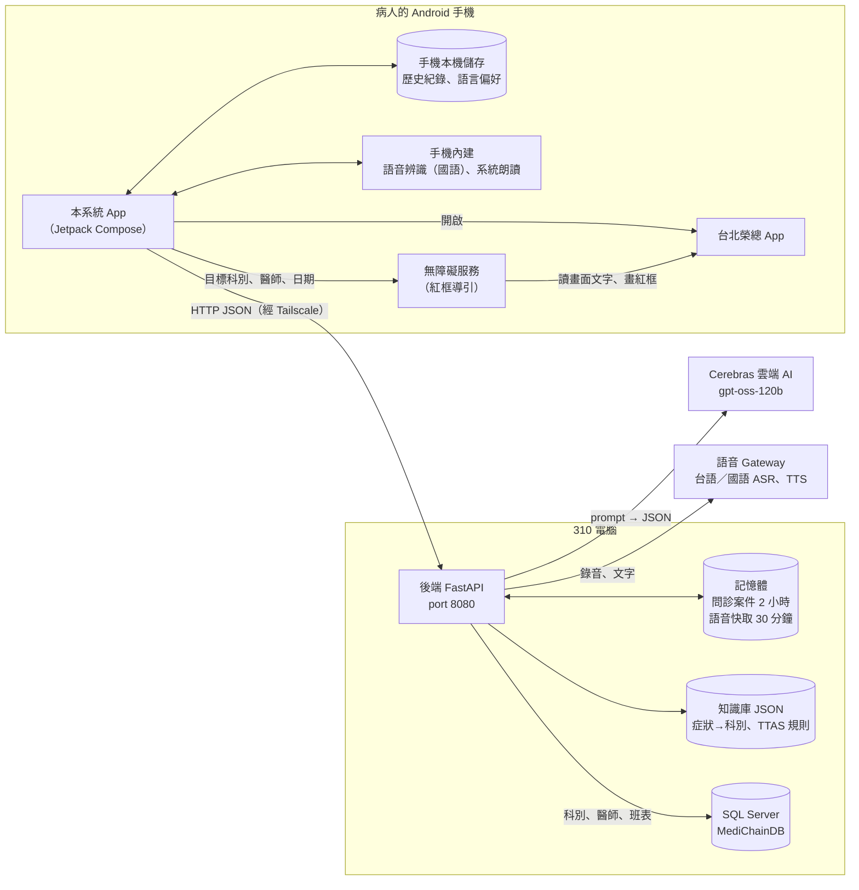
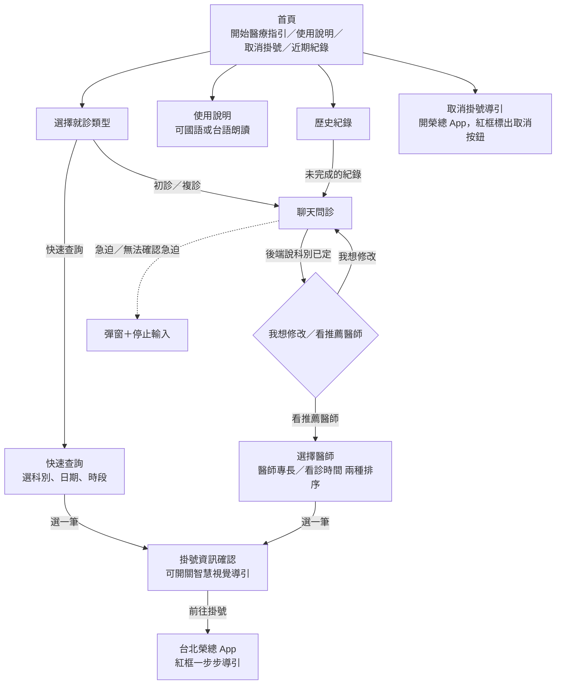
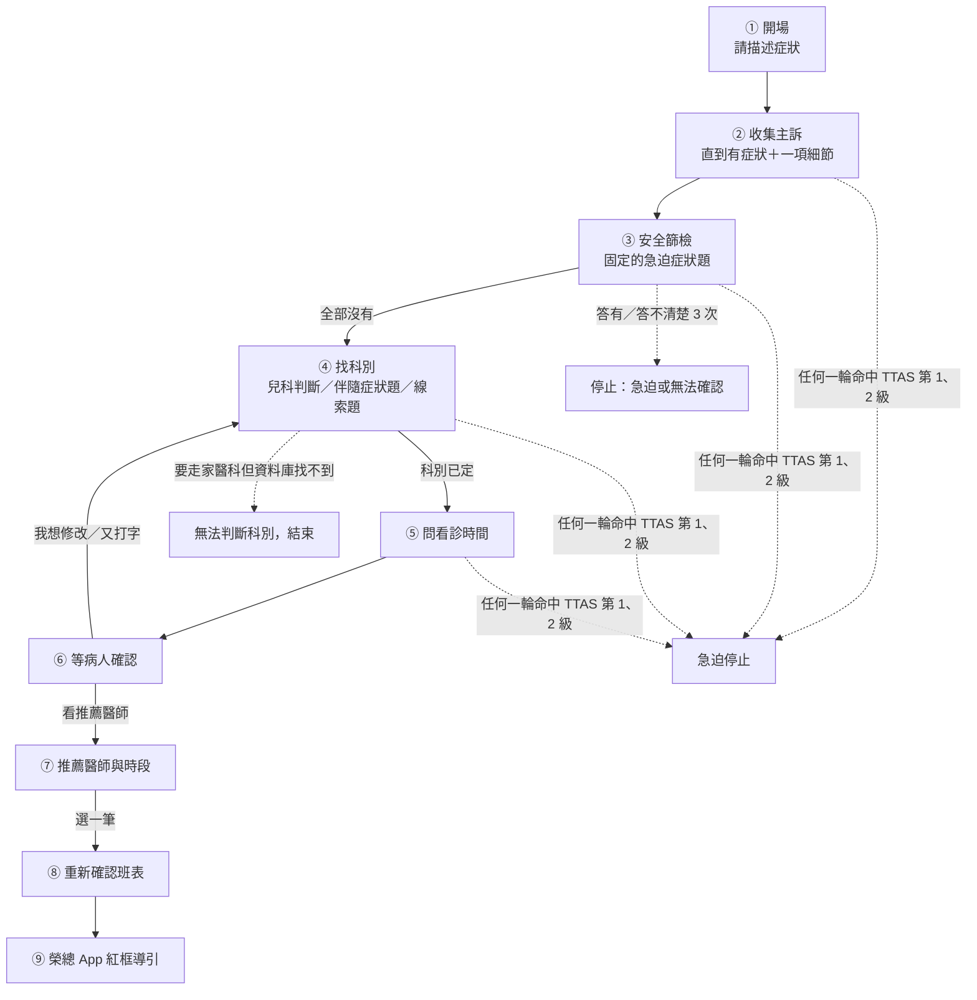

# 整體說明

> 對象：組員、準備報告的人、之後接手的人（不需要看過程式碼）
> 依據：`New_Android_Backend` 分支 commit `4349a2e`（2026-11-03）的前端（`android/`）與後端（`backend/`）程式碼，加上 `docs/問診邏輯說明.md`。
> 和《問診邏輯說明》的關係：那份是**後端問診規則的細節版**（每條規則、函式名稱、數字）；這份是**整個系統的白話總覽**，多了 App 畫面、各端怎麼連、特殊情況總表、問題清單。看到「→ 細節：邏輯 §x」就是去《問診邏輯說明》第 x 節查。
> 原則：以程式碼為準。文件之間、文件和程式不一致時，以程式碼為準。

---

## 0. 一分鐘看懂

這是一套「**用聊天幫病人找出該掛哪一科，再帶他到台北榮總 App 掛號**」的系統。

一位病人實際會經歷的對話：

> App：請描述目前最主要的不舒服症狀。
> 病人：我頭暈三天了
> App：請問是否有突發胸痛、嚴重呼吸困難、意識不清、大量出血、半邊無力或劇烈頭痛等急迫症狀？
> 病人：都沒有
> App：請問您有沒有耳鳴、耳痛或耳聾（聽力變差）的情況，或以前曾被告知有？
> 病人：有耳鳴
> （再問兩題，分辨是耳科還是神經內科）
> App：最近哪幾天、哪個時段比較方便看診？不方便的時間也可以告訴我；都可以的話直接說『都可以』。
> 病人：下週三早上
> App：根據您剛才提到的症狀「頭暈」……因此目前建議您先看耳科。請確認後取得推薦掛號方案。
> 病人按「看推薦醫師」→ 看到醫師與時段清單 → 選一筆 → 按「前往掛號」
> → 手機打開台北榮總 App，畫面上用**紅框**一步一步標出下一個要點的地方。

三句話記住分工：

1. **App 只管畫面、錄音、播放、導引**，不做任何醫療判斷。
2. **後端管所有判斷**。AI 只幫忙「聽懂人話」，AI 的每個結果都要先通過後端驗證（例如 AI 引用的病人原話必須真的出現在對話裡）才會被採用；要不要停止、該看哪科、什麼時候問完，都是後端程式規則決定。
3. **資料庫管真實資料**。科別、醫師、班表都以 SQL Server 為準，系統不會推薦資料庫裡沒有的科或時段。

---

## 1. 系統架構與各端連結

### 1.1 架構圖



### 1.2 每一端負責什麼

| 元件 | 在哪裡 | 負責 | 不負責 | 程式位置 |
|---|---|---|---|---|
| Android App | 病人手機 | 畫面、文字／語音輸入、播放語音、顯示推薦、存歷史紀錄、開啟榮總 App | 任何醫療判斷（急不急、看哪科都聽後端） | `android/app/src/main/java/com/example/medicalaiguidance/` |
| 無障礙服務 | 手機（App 的一部分，使用者要到系統設定開啟） | 在台北榮總 App 上讀畫面文字，用紅框標出下一步；偵測掛號成功畫面；也能導引「取消掛號」 | **不會自動點擊**，也不會代填身分證號等個資，全部由病人自己操作 | `service/MyAccessibilityService.kt`、`service/OverlayManager.kt` |
| 後端 API | 310 電腦（PowerShell 啟動） | 問診流程、驗證 AI、TTAS 急迫判斷、科別計分與決定、日期換算、查班表、排序、重驗班表 | 畫面 | `backend/app/routes/`、`backend/app/services/` |
| AI 模型 | Cerebras 雲端，固定 `gpt-oss-120b` | 聽懂病人的話、語意比對官方症狀詞、提出候選科別排名、寫線索題問句、（選用）醫師專長評分 | 決定流程、決定急迫、決定最終科別（唯一例外見 3.2 ④） | `backend/app/services/ai_service.py` |
| 資料庫 | SQL Server，資料庫 `MediChainDB` | 科別、醫師、班表的真實資料 | — | `backend/app/db.py` |
| 知識庫 | 後端資料夾裡的 JSON | 院方公開的「症狀→科別」資料 2,468 筆（1,678 個症狀詞、42 個科別）：臺北榮總為主，另有臺中、高雄、屏東榮總、榮總分院、國軍醫院、雙和、亞東、義大、新光、國泰；衛福部 TTAS 急診檢傷規則 64 條 | — | `backend/knowledge/` |
| 語音 Gateway | 另一個服務（網址寫在 `.env`） | 台語／國語語音轉文字（ASR）、文字轉語音（TTS） | — | `backend/app/services/voice_client.py` |

### 1.3 各端怎麼連

**手機 ↔ 後端**
- 走 HTTP（不是 HTTPS），App 設定允許明文連線。
- 示範環境：手機透過 Tailscale 連到 310 電腦上的後端。
- 後端網址寫在 `android/local.properties` 的 `API_BASE_URL`，**編譯時寫進 APK**；沒設就用模擬器專用的 `http://10.0.2.2:8080`。所以換後端位置要重新編譯 APK。
- App 等待時間：連線 15 秒、等回應 60 秒。
- 後端沒有登入或金鑰檢查，跨網域（CORS）全開（見 5.3）。

**後端 ↔ AI**
- 用 Cerebras SDK，金鑰是 `.env` 的 `CEREBRAS_API_KEY`。
- 一律要求 JSON 回覆；每次最多等 8 秒；失敗不自動重試。
- 沒設金鑰時 AI 不可用，問診只能回技術性提示，無法往下走。

**後端 ↔ 資料庫**
- 用 pyodbc＋ODBC Driver 17，連線資訊在 `backend/.env`（`DB_SERVER`、`DB_NAME`、`DB_USER`、`DB_PASSWORD`）。
- 程式預設值指向 Azure（`medichain-server.database.windows.net`）；2026-11-02 在 310 上實際查過的是 310 本機 docker 容器 `medichain-sql` 裡的 `MediChainDB`（133 個科別）。實際連哪裡以 310 的 `.env` 為準。
- 用到的表：`Department`、`DepartmentCategory`、`Doctor`、`Schedule`。
- 資料庫連不上時，後端回 503「正式資料目前無法查詢，請稍後重試。」

**後端 ↔ 語音 Gateway**
- 呼叫 `{VOICE_GATEWAY_URL}/api/process`，用 `service_type` 分四種：`taiwanese_asr`、`chinese_asr`、`taiwanese_tts`、`chinese_tts`。
- `.env` 的 `VOICE_ENABLED` 預設 false；沒開時語音 API 回錯誤，App 改用手機內建朗讀。

**App ↔ 台北榮總 App**
- App 用套件名稱 `tw.com.bicom.VGHTPE` 開啟榮總 App；手機沒裝就改開榮總網站首頁。
- 無障礙服務只在榮總 App 畫面在前景時運作，靠讀畫面上的文字（「行動掛號」、科別名、醫師名、日期數字）找目標；取消掛號的按鈕若沒有文字，另外用榮總 App 的按鈕 ID `tw.com.bicom.VGHTPE:id/btnCancel` 辨認（仍要求按鈕可點、啟用）。

### 1.4 App 實際呼叫哪些 API

| 什麼時候 | 呼叫 | 用途 |
|---|---|---|
| 進入聊天、每次送出訊息 | `POST /chat` | 問診一輪 |
| 按「看推薦醫師」 | `POST /chat`（`confirmed=true`）→ `POST /recommend` | 確認科別、取得推薦清單 |
| 按「我想修改」 | `POST /chat`（`revision_requested=true`） | 延續原本的問診做修改 |
| 選一筆醫師時段 | `POST /generate_script` | 後端回資料庫重新確認班表還在 |
| 從歷史紀錄打開未完成的問診 | `GET /chat/{case_id}/resume` | 續接 |
| 快速查詢 | `GET /reference/departments` → `GET /schedules/search` → `POST /generate_script` | 不問診，直接查某科某天某時段 |
| 台語語音輸入 | `POST /voice/asr` | 錄音轉文字，**只填進輸入框**，要按送出才算 |
| 播放語音 | `POST /voice/tts`、`POST /voice/tts/cleanup` | 文字轉語音、離開時清快取 |

後端有、但 App 畫面沒用到：`POST /voice/chat`（一次做完語音→問診→語音）、`POST /followup/recommend`（舊的回診流程）、`GET /reference/doctors`。每個 API 的參數 → 細節：邏輯 §8。

### 1.5 資料存在哪裡、放多久

| 資料 | 存在哪 | 放多久 | 影響 |
|---|---|---|---|
| 問診案件（對話、狀態、科別、推薦清單） | 後端記憶體 | 閒置 2 小時過期；**後端重開就全部消失** | 過期後 App 顯示「原問診已失效，請重新開始問診。」 |
| 語音合成快取 | 後端記憶體 | 30 分鐘 | 只為了重播快一點 |
| 歷史紀錄（對話、推薦清單、選了哪筆） | 手機本機（SharedPreferences） | 直到使用者刪除或解除安裝 App | 可以一直看，但後端案件過期後不能再續問 |
| 語言偏好（國語／台語） | 手機本機 | 永久 | — |
| 知識庫、TTAS 規則 | 後端 `backend/knowledge/*.json` | 跟著 git | 改檔即生效（每次算科別都重新讀檔） |
| 挑症狀詞的本地模型（約 600MB）與每個官方詞的向量 | 後端電腦 `backend/.model_cache/`（**不進 git**） | 永久；第一次啟動後端時自動下載與計算 | 知識庫新增的詞要**重開後端**才會算向量；沒重開前，語意比對改送整份清單（較慢，但結果不受影響） |
| 科別、醫師、班表 | SQL Server | 由資料庫維護 | 推薦的唯一來源 |
| 醫師學歷、經歷、照片 | App 內建 `assets/teacher_profiles.json` | 跟著 APK | 不是即時資料 |

### 1.6 程式碼地圖

```
backend/
  app/main.py              啟動、註冊所有 API
  app/config.py            可調整的數字（輪數上限、題數、家醫科 ID…）
  app/db.py                所有 SQL 查詢
  app/schemas.py           API 與案件狀態的資料格式
  app/routes/              每個 API 的入口（chat、recommend、generate_script、voice…）
  app/services/            真正的邏輯
    conversation_service.py          決定下一句問什麼（流程核心）
    rag_triage_adapter.py            Turn Interpreter：叫 AI 讀懂病人這一句
    department_reasoning_service.py  科別判定總流程
    department_clues.py              計分、線索題、定科規則
    department_knowledge.py          載入與檢查知識庫
    concept_shortlist.py             語意比對前先挑出最像的官方詞（本地模型）
    pediatric_routing.py             未滿 18 歲先看兒科
    ttas_evaluator.py 等              TTAS 檢傷
    time_preference_service.py       看診時間換算
    appointment_service.py           查班表、排序推薦
    specialty_scoring.py             醫師專長 AI 評分（預設關閉）
    ai_service.py                    呼叫 Cerebras
    case_store.py                    記憶體案件庫
  knowledge/               知識庫與 TTAS 規則
  tests/                   pytest 測試
  benchmark/               對話跑分腳本；concept_shortlist_recall.py 量挑詞會不會漏掉正確的詞
android/app/src/main/java/com/example/medicalaiguidance/
  screen/                  每個畫面
  viewmodel/               畫面背後的狀態與按鈕行為
  repository/              呼叫後端、存歷史紀錄
  network/                 HTTP 與資料格式
  service/                 無障礙紅框導引（掛號、取消掛號）
  util/                    錄音、播放、內建預錄語音
docs/                      文件
scripts/                   Windows 安裝、啟動、測試腳本
```

### 1.7 怎麼跑起來

- **後端**：`scripts/setup.ps1` 建環境，`scripts/run-backend.ps1 -Port 8080 -HostName 0.0.0.0` 啟動；打開 `/health` 看到 `{"status":"ok"}` 代表活著。`backend/.env` 要填 AI 金鑰、資料庫、語音 Gateway（範本是 `.env.example`）。
- **更新後端程式後**：先執行 `.\.venv\Scripts\python.exe -m pip install -r requirements.txt` 補裝新套件（在 `backend/` 目錄），再啟動。**第一次啟動**會先下載挑症狀詞用的模型（`jinaai/jina-embeddings-v2-base-zh`，約 600MB），要等幾分鐘才會出現 `Application startup complete`；之後啟動約 2 秒。下載或載入失敗時，畫面會印「找症狀詞的模型載入失敗…」，後端照常啟動，只是語意比對改送整份清單、回覆較慢。電腦連不上模型網站時，可把別台電腦的 `backend/.model_cache/` 整個複製過來。`.env` 設 `CONCEPT_EMBEDDING_MODEL=`（空白）可關閉這個功能。
- **App**：在 `android/local.properties` 設 `API_BASE_URL`，執行 `gradlew.bat assembleDebug` 編譯。新 APK 放 GitHub Releases 分享，不放進 git。
- 後端只能開**一個** worker：案件存在記憶體，開多個會各自一份，對話會接不起來。

---

## 2. App 畫面流程（病人實際看到的）



| 畫面 | 病人做什麼 | 背後發生什麼 | 檔案（`screen/`） |
|---|---|---|---|
| 首頁 | 按「開始醫療指引」、看使用說明、取消掛號、看近期紀錄 | 近期紀錄從手機本機讀出 | `HomeScreen.kt` |
| 使用說明 | 看五張介紹卡，可按「國語朗讀」或「台語朗讀」 | 國語用手機系統朗讀；台語播 App 內建的預錄 mp3；引導去開無障礙權限 | `GettingStartedScreen.kt` |
| 選擇就診類型 | 選初診、複診或快速查詢 | 初診、複診進聊天；快速查詢進查詢頁 | `VisitTypeSelectionScreen.kt` |
| 聊天問診 | 打字或語音輸入，按「送出」；可按每則訊息的「播放」聽語音 | 每送一句呼叫一次 `/chat`；等待時顯示「正在分析中請稍後」；後端說可以確認時，出現「我想修改」「看推薦醫師」兩個按鈕；急迫時跳彈窗並移除輸入框 | `ChatScreen.kt`、`viewmodel/ChatViewModel.kt` |
| 選擇醫師 | 在「醫師專長」「看診時間」兩個分頁間切換，看詳情、播放醫師資訊，按「選擇」 | 資料來自 `/recommend`；兩種排序一樣時顯示「目前兩種排序結果相同」；按選擇時呼叫 `/generate_script` 重新確認班表 | `DoctorSelectionScreen.kt`、`viewmodel/DoctorViewModel.kt` |
| 掛號資訊確認 | 看科別、醫師、時間，決定要不要「啟用智慧視覺導引」，按「前往掛號」→「確認前往」 | 沒開無障礙權限會先請病人去設定開啟；開啟榮總 App 後，這筆歷史紀錄標成「已完成」 | `ConfirmNeedScreen.kt` |
| 榮總 App 紅框導引 | 照紅框自己點、自己填資料 | 步驟：行動掛號 → 繼續掛號 → 依門診科別 → 科別 → 診別 → 選擇看診時間 → 日期 → 醫師 → 填寫個人資料 → 確認送出。到了個資表單（身分證號；初診還有姓名、出生年月日），紅框會先隱藏，等病人自己填完再標出「確認送出」；看到成功畫面就顯示完成訊息 | `service/MyAccessibilityService.kt` |
| 快速查詢 | 選科別、日期、時段（上午／下午／晚上），按查詢，選一筆 | 不問症狀、不用 AI；只查「複診」班表；選了之後同樣到掛號資訊確認頁 | `QuickSearchScreen.kt`、`viewmodel/QuickSearchViewModel.kt` |
| 歷史紀錄 | 依「全部／已完成／未完成」篩選，點進去看 | 未完成的會呼叫 resume 續接；已完成、急迫停止的只能看不能改；摘要標「導引完成摘要（非醫院掛號結果）」 | `HistoryScreen.kt` |

語音輸入的差別：
- **國語**：用手機內建的語音辨識（跳出系統的辨識畫面）。
- **台語**：App 錄音後送後端 `/voice/asr`，後端再轉給語音 Gateway。
- 兩種都**只把辨識出的文字填進輸入框**，病人看過、按「送出」才算回答。

語音播放的順序：先找 App 內建的預錄檔（只有固定幾句）→ 沒有就請後端合成 → 後端也失敗就用手機系統朗讀（只會念國語）。

---

## 3. 問診邏輯：一次問診的各個階段

### 3.1 每一輪後端在做什麼（白話版）

病人每送出一句話，後端依序做：

1. 用 `case_id` 找回這個案件。
2. 請 AI（叫 **Turn Interpreter**）讀這句話：抽出症狀、部位、多久、多嚴重、這句在回答哪一題、想看診的時間、是不是在幫家人問、有沒有 TTAS 急迫證據……
3. **逐筆驗證** AI 的結果：引用的病人原話要真的出現在訊息裡、信心 ≥ 0.55、格式正確。不合格的那一筆直接丟掉。
4. 跑 TTAS 規則：命中第 1、2 級 → 立刻停止問診。
5. 如果正在安全篩檢 → 判讀病人對安全題的回答。
6. 重新計算科別（候選有哪些、各幾分、能不能定科）。
7. 決定下一句：安全篩檢題、年齡題、伴隨症狀題、線索題、看診時間題、確認句或停止句。
8. 把回覆文字和狀態（`stage` 等）回給 App。

→ 細節：邏輯 §2.2（完整 17 個步驟）

### 3.2 階段總覽



下面每個階段都用「做什麼 → 會說什麼 → 什麼時候往下 → 誰決定」說明。

#### ① 開場

- App 一進聊天頁就呼叫 `/chat`（不帶訊息），後端回固定句「請描述目前最主要的不舒服症狀。」
- 初診、複診的問診方式完全一樣，差別只在最後查班表時篩「初診」或「複診」的班。

#### ② 收集主訴

- **目的**：先弄清楚主要哪裡不舒服。
- **往下的條件**：有主要症狀，再加上至少一項細節（部位、多久、多嚴重、怎麼開始、伴隨症狀之一），而且都有病人原話依據、信心夠。
  - 「頭暈」→ 還不夠，會追問。
  - 「頭暈三天了」→ 夠了，進安全篩檢。
  - 部位、時間、嚴重度**不是全部必填**，有一項就行。
- **誰出題**：AI（叫 **planner**）寫追問句，後端檢查：不能重複、不能問已經答過的、不能提科別或醫師、不能有簡體字等。不合格就請 AI 重寫一次；還是不行，或 AI 沒回應，就走後端固定句（見 4.4）。
- → 細節：邏輯 §3.2

#### ③ 安全篩檢

- **固定題**：「請問是否有突發胸痛、嚴重呼吸困難、意識不清、大量出血、半邊無力或劇烈頭痛等急迫症狀？」
- **為什麼要這題**：TTAS 裡很多急迫情況（胸痛、半邊無力、呼吸很喘）需要醫護人員現場判斷，程式沒辦法從文字確認，這些規則只當參考、不執行。所以另外用一題固定問題直接問病人。
- **病人怎麼回答 → 系統怎麼做**：

| 病人回答 | 系統行為 |
|---|---|
| 「都沒有」 | 篩檢完成，進入找科別 |
| 「有，胸口很痛」 | **立刻停止**，請病人去急診、危急打 119 |
| 「還好吧」「不太確定」、離題閒聊 | 重問完整題目並提示「都沒有的話回答『沒有』就可以」；最多 3 次；第 3 次之前先預告；3 次都不清楚 → **停止**，說明無法確認是否急迫 |
| 改講別的症狀（「我還有咳嗽」） | 不算次數；先記下「已記下您說的「咳嗽」」，再重問安全題 |
| 「這是什麼意思？」 | 不算次數；先用白話解釋，再重問 |

- → 細節：邏輯 §5.3

#### ④ 找科別

這是最複雜的一段，白話拆成五步：

**第 1 步：找候選科**
把病人的症狀拿去比對知識庫（院方公開的「症狀→科別」資料），有兩種比法，結果合併：
- **字面比對**：官方的症狀詞完整出現在病人的話裡。例：病人說「頭暈」，官方詞「頭暈」就命中；持有「頭暈」的 7 個科都成為候選。但官方詞若是從一個詞的中間開始，字面就不算，改由 AI 判斷意思。「詞」是 AI 拆出來的部位，或同一段話裡比較長的官方詞：「舌頭痛」AI 會拆成「舌頭」＋「疼痛」，所以不會被當成「頭痛」；「坐骨神經痛」不會被當成「經痛」。沒說部位的症狀照舊，例「我經痛很嚴重」直接對到婦產科的「經痛」，不需要部位。
- **AI 語意比對**：AI 找「意思一樣」的官方詞（最多 5 個），再由第二次 AI 審核，審核只能刪不能加。2026-11-04 起，後端會先在本機替病人的每句話挑出最像的官方詞（字面最像的前 20 個，加上本地模型認為意思最像的前 30 個），AI 只從這份短清單裡選，不再收到整個知識庫。例：「拉肚子」的短清單裡會有「腹瀉」。

**第 2 步：兩道過濾**
- **部位過濾**：病人講過部位後，沒帶部位的症狀只能幫「部位對應的科」加分，不能把病人帶到別科。
  - 例：「眼睛紅腫酸痛」→ 問「請問眼睛是否有分泌物？」→「有淺黃色分泌物」。「分泌物」在知識庫裡屬於婦產科，但它講的是眼睛，所以不會把病人帶去婦產科。
- **主訴過濾**：推薦的科必須看得了第一句說的主要症狀。
  - 例：主訴「我掉了好多頭髮」，後來答「我最近眼睛很乾」。眼科有「眼睛乾澀」但沒有「掉頭髮」，所以眼科不會被推薦；「眼睛很乾」只幫同時看掉髮和乾眼的過敏免疫風濕科加分。

**第 3 步：計分**
- 某科分數 ＝ 支持這科的「不同病人原話片段」數 ＋ 病人答「有」、且這科持有的線索題題數。
- 同一件事只算一次：病人答線索題「有耳鳴」，這題已經幫耳科加 1 分，AI 從這句另外抽出的「耳鳴」不會再幫耳科加分。
- 答「沒有」不扣分。沒有權重。AI 不參與計分（AI 的排名只在平手時用）。

**第 4 步：決定下一步**（依序檢查，先符合先做）

| 情況 | 系統怎麼做 |
|---|---|
| 就診者未滿 18 歲 | 直接建議兒科（兒童內科；症狀對到兒童腸胃科就給兒童腸胃科），不問線索題 |
| 幫兒子、女兒、孫子等問，但沒講年齡 | 問一次「請問您兒子今年幾歲？」，再依回答判斷 |
| 病人指定科別（「我想看皮膚科」） | 直接用病人指定的科，不問線索題（安全篩檢照做）；篩檢完就問看診時間、進確認，AI 不會再加問其他題目（修訂後也一樣） |
| 完全沒有候選科 | 繼續一般追問，等第 8 輪、第 20 輪的家醫科安全網 |
| 只剩一科（家醫科不算） | 先問「除了「頭暈」，最近還有沒有其他不舒服的地方？」（最多 2 次），沒說出新症狀就定這一科 |
| 兩科以上 | 問**線索題**：每題針對一個科，問該科 1～3 個官方症狀詞；**至少 3 題、最多 5 題** |
| 病人說不想再回答 | 用目前分數直接決定 |

**線索題怎麼定科**：
- 問滿 3 題後，領先的科明確領先、而且對手那邊的題目都答「沒有」→ 定領先的科。
- 領先科和第 2 名**輪流被問**，避免某科只是因為被多問幾題而贏。
- 問滿 5 題 → 依最高分決定。
- 平手 → 交給 AI 排名第一的科；AI 也排不出 → 家庭醫學科。
- 只有一種情況由 AI 直接定科：AI 判斷「已經確定是某一科」，而且線索題已經問夠（或只剩一科時伴隨症狀題已問完）。

**線索題不會問的詞**：性病、癌症／腫瘤、懷孕相關；只有病名的詞（例「腕隧道症候群」）也不出題，因為病人答不出來。但病人自己說出口時，照樣拿來找科別。

**第 5 步：例子（頭暈＋耳鳴）**

| 輪 | 病人 | 系統內部 | 系統說 |
|---|---|---|---|
| 1 | 最近一直頭暈，三天了 | 有症狀＋時間 → 進安全篩檢 | 安全篩檢題 |
| 2 | 都沒有 | 篩檢完成；「頭暈」命中 7 科，各 1 分 | 第 1 題問耳科：耳鳴、耳痛、耳聾？ |
| 3 | 有耳鳴，不會痛 | 耳科 2 分，其他 1 分；才問 1 題 | 第 2 題問神經內科：肌肉抽筋、走路不穩？ |
| 4 | 都沒有 | 分數不變 | 第 3 題再問耳科 |
| 5 | 也沒有 | 滿 3 題，耳科領先、對手沒答過「有」→ 定耳科 | 問看診時間 |

- → 細節：邏輯 §4（全部規則、知識庫來源、更多例子）

#### ⑤ 問看診時間

- 科別定了之後，後端用固定句問時間；**日期**和**時段**分開看，缺哪個問哪個，每個最多問 2 次。
- 「都可以」→ 不限制。病人一開始就講過的，不會再問。
- AI 負責聽懂「下週三早上」；**換算成真正的日期是後端做的**（以台北時區的今天為準）。
  - 例：今天 2026-11-02（週一），「下週三早上」→ 2026-11-11 上午。
- 「不行」的時間（例「星期一不行」）之後**一律排除**。
- 沒說「這／下」的星期幾（例「最好週三」）指**每個週三**，不是只有這週。
- → 細節：邏輯 §6

#### ⑥ 等病人確認

- 後端回固定的確認句：「根據您剛才提到的症狀「頭暈」……因此目前建議您先看耳科。請確認後取得推薦掛號方案。」
- 病人說過看診時間時，下面多一行系統換算後的時間，例「就醫時間偏好：週三優先，其次週二；週五不方便；時段不限。」
- App 顯示「我想修改」「看推薦醫師」。**AI 不能替病人確認**，一定要病人按。
- 確認前又打字，或按「我想修改」→ 當成**修訂**：延續原本的問診（已回答的不重問），只重算科別。
  - 確認句的「不適部位」會列出病人說過的所有部位，照說的順序，例「屁股、大腿」。
  - 按「我想修改」後，如果病人只說「我想要更改日期跟時段」、沒說要改成什麼，系統固定反問一次：「請直接告訴我要改成什麼，例如「改成下週四下午」「改看皮膚科」，或補充新的症狀。」

#### ⑦ 推薦醫師與時段（`/recommend`）

- **查哪些班**：這一科、從今天起 21 天內（病人指定更遠的日期就延長，最多 90 天）、醫師在職、初複診符合。
- **排除**：請假、額滿、關診；今天已過截止時間的診（上午 10:00、下午 15:00、晚上 19:00 之後不推當天）；病人說不行的日期和時段。
- **兩欄結果**：
  - 「醫師專長優先」：最多 5 位醫師，每位最多 3 個時段，共 15 筆。
  - 「看診時間優先」：最符合時間偏好的 5 筆。
- **時間怎麼排**：依病人偏好分層，不設權重。例：病人說「最好下週三，不然下週四；上午優先，下午也可以」→「下週三上午」排第一層；「下週三下午」和「下週四上午」各有一項是次要選擇，同在第二層；「下週四下午」排第三層。
- **醫師專長評分**：預設關閉，所有醫師都算一樣（0.5）。開啟時才請 AI 判斷每位醫師專長和病人症狀的相關程度。
- **推薦理由**（科別理由、時間理由）是後端用固定句組出來的，不另外呼叫 AI。
- 查不到任何班表 → 「目前找不到符合條件的……班表」。
- → 細節：邏輯 §6.3

#### ⑧ 重新確認班表（`/generate_script`）

- 病人選了一筆之後，後端用這筆的班表 ID **回資料庫再查一次**：班還在嗎？初複診對嗎？問診真的已完成、已確認、不急迫嗎？
- 有變動 → 回 409，App 顯示錯誤請病人重選。
- 後端同時會產生一份 10 步的導引腳本，但 App 目前沒有使用這份腳本（見 5.4）。

#### ⑨ 榮總 App 紅框導引

- 病人在確認頁按「前往掛號」→ App 把科別、診別、醫師、日期交給無障礙服務 → 開啟台北榮總 App。
- 無障礙服務讀榮總 App 的畫面文字，找到下一步的按鈕就畫紅框；病人點對了就換下一步。
- 到了個資表單（身分證號等），紅框會先隱藏、不標示個資欄位，等病人自己填完再標出「確認送出」。
- 找不到目標（例如要捲動）會顯示提示；醫師那一診已「額滿／請假／關診／停診」會提示「在畫面自行切換其他日期 / 選擇其他醫師」。
- 偵測到掛號成功畫面 → 顯示完成訊息；離開榮總 App 超過 4 秒 → 導引結束。
- 病人也可以關掉「智慧視覺導引」，只開啟榮總 App 自己操作。

### 3.3 AI 和後端怎麼分工

| 判斷 | AI 做 | 後端做 |
|---|---|---|
| 病人說了什麼症狀、部位、多久、多嚴重 | 抽出來 | 驗證原話存在、信心 ≥ 0.55、格式對 |
| 這句在回答哪一題、是不是「不想回答」「我說錯了」 | 判讀 | 驗證原話與信心 |
| 急迫嗎 | 只抽 TTAS 事實（例「化學藥水噴到眼睛」） | **級數由規則決定**；安全篩檢是否完成也是後端判斷 |
| 症狀對到哪個官方症狀詞 | 語意比對＋審核 | 字面比對；官方詞必須真的在知識庫裡 |
| 候選科別排名 | 提出最多 3 個 | 驗證科別在資料庫、證據追得回原話 |
| 計分、出題範圍、何時定科 | 不參與 | 全部由程式規則決定 |
| 線索題問句怎麼說 | 寫問句 | 檢查有沒有逐字包含症狀詞、只有一個問號、沒有禁用字 |
| 就診者是誰、年齡原文 | 抽出來 | 用程式讀數字判斷是否未滿 18 歲 |
| 「下週三早上」 | 理解意思 | 換算日期、排除、分層 |
| 醫師專長相關程度（預設關閉） | 從五個等級選一個 | 換成分數；任何一批出錯就全部改成一樣 |
| 流程狀態、是否確認、是否完成 | **不准輸出** | 全部由後端決定 |
| 固定句（安全篩檢、時間題、確認句、急迫停止、家醫科說明） | 不參與 | 後端寫死的文字 |

一輪對話最多會呼叫 AI 約 7 次（讀懂這句、修復一次、語意比對、審核、提出候選、寫問句、修復一次），每次最多等 8 秒。→ 細節：邏輯 §7

---

## 4. 特殊情況總表

### 4.1 安全相關

| 情況 | 病人可能怎麼說 | 系統怎麼做 | App 看到什麼 |
|---|---|---|---|
| TTAS 第 1、2 級（任何一輪都會檢查） | 「化學藥水噴到眼睛」、「發燒到 41.5 度」 | 立刻停止；回「初步篩檢結果顯示您的狀況可能較危急，線上問診無法判斷嚴重程度，因此不會繼續掛號導引。請立即前往急診；情況危急請撥打 119。」；推薦與導引 API 都拒絕 | 「急迫症狀提醒」彈窗，輸入框消失，這筆紀錄之後只能看 |
| TTAS 第 3～5 級 | — | 只記錄，問診照常 | 無 |
| 安全篩檢答「有」 | 「有，胸口很悶」 | 立刻停止，回請病人去急診、危急打 119（不說 TTAS 級數） | 「急迫症狀提醒」彈窗 |
| 安全篩檢 3 次都答不清楚 | 「還好吧」×3 | 停止；回「因為還沒能確認您是否有急迫症狀，系統不能繼續一般掛號導引…」 | 「無法確認急迫症狀」彈窗 |
| 到第 20 輪安全篩檢還沒完成 | 一直講別的 | 同上，無法確認停止 | 同上 |
| 安全篩檢時改講症狀 | 「我還會咳嗽」 | 不算次數，記下症狀後重問安全題 | 一般訊息 |

### 4.2 科別相關

| 情況 | 病人可能怎麼說 | 系統怎麼做 |
|---|---|---|
| 指定科別 | 「我想看皮膚科」 | 科別在資料庫找得到就直接採用，不問線索題；安全篩檢後直接問時間、進確認 |
| 幫小孩問 | 「我女兒 5 歲，發燒三天」 | 安全篩檢後直接建議兒童內科，說明「就診者未滿 18 歲，依醫院就醫指引，兒童的各種症狀可先看兒科」 |
| 幫家人問但沒講年齡 | 「我兒子咳嗽好幾天了」 | 問一次「請問您兒子今年幾歲？」；答「7歲」→ 兒科；答「35」或「不知道」→ 當成人 |
| 幫長輩問 | 「我媽頭暈」 | 當成人，不問年齡 |
| 病人自己是幼稚園老師 | 「我是幼稚園老師，喉嚨痛」 | AI 判斷是本人看病，當成人 |
| 只剩一科 | 「痔瘡在痛」 | 先問「除了「痔瘡」，最近還有沒有其他不舒服的地方？」，沒有就定直腸外科 |
| 不想再回答 | 「我說不出更多了」「我要先掛號」 | 用目前分數決定；完全沒有候選就走家醫科 |
| 第 8 輪還沒定科 | — | 只有一個科分數最高 → 直接定它；否則問「目前還沒辦法確定要看哪一科，要繼續描述，還是先掛家庭醫學科？」 |
| 第 20 輪還沒定科 | — | 走家庭醫學科 |
| 線索題平手、AI 也排不出 | — | 走家庭醫學科：「目前的症狀無法明確區分科別，系統建議先由家庭醫學科初步評估。」 |
| 要走家醫科但資料庫找不到家醫科 | — | 「資訊不足，無法判斷科別。請改用手動選科或洽醫院掛號服務。」結束 |
| 症狀知識庫裡沒有 | 「子宮刺刺的」 | 沒有候選科，繼續追問，最後多半走家醫科 |
| 說了症狀但不知道是哪個部位 | 「有淺黃色分泌物」（前面沒講部位） | 問一次「請問您說的「淺黃色分泌物」是在哪個部位呢？」 |

所有走到家醫科的情況，一樣要病人按確認才會往下。

### 4.3 對話相關

| 情況 | 病人可能怎麼說 | 系統怎麼做 |
|---|---|---|
| 看不懂問題 | 「這是什麼意思？」 | 先用一兩句白話解釋，再重問；不算一次回答 |
| 說已經講過了 | 「我剛剛說過了」 | AI 必須找到之前那句原話，對得上才算已回答；安全篩檢題不能用這招跳過 |
| 改口 | 「我說錯了，是右腳不是左腳」 | 換掉舊資料，重新算科別 |
| 確認前又打字／按「我想修改」 | 「其實我還會耳鳴」 | 修訂：延續問診，已答過的不重問，重算科別 |
| 按「我想修改」後沒說要改什麼 | 「我想要更改日期跟時段」 | 固定反問「請直接告訴我要改成什麼…」，只問 1 次 |
| 確認前說不是這科 | 「我不想看耳科」 | 也算修訂，但用一樣的證據重算，**可能又得到同一科**（見 5.2） |

### 4.4 技術相關

| 情況 | 系統怎麼做 | App 看到什麼 |
|---|---|---|
| AI 逾時或錯誤 | 不算題數，請病人重送 | 「系統剛剛沒有回應，請再傳一次剛才的訊息。」 |
| AI 有回應，但寫的題目都不能用 | 不叫病人重試，改走固定下一步：還沒做安全篩檢 → 「可以再多說一點嗎？例如哪裡不舒服、從什麼時候開始、有多嚴重。」；科別已定 → 問時間或確認；科別未定 → 問要繼續描述還是先掛家醫科 | 一般訊息 |
| 沒設 AI 金鑰 | 問診無法理解病人的話 | 技術性提示 |
| 資料庫連不上 | 503 | 「正式資料目前無法查詢，請稍後重試。」 |
| 找不到班表 | 503 | 後端「找不到符合條件的班表」訊息，或「目前沒有可推薦醫師」 |
| 選了之後班表變了 | 409 | 錯誤訊息，請重選 |
| 案件過期（閒置 2 小時或後端重開） | 404 | 「原問診已失效，請重新開始問診。」 |
| 從歷史紀錄續接 | 呼叫 resume；原本急迫停止的會恢復成停止狀態 | 可繼續回答，或只能看 |
| 語音服務沒開或失敗 | 改用手機系統朗讀（國語） | 「後端語音暫不可用，改用系統朗讀」 |
| 台語辨識失敗 | 輸入框不變 | 「台語辨識失敗，請改用文字輸入。」 |
| 手機沒有語音輸入服務 | — | 「這台手機沒有可用的語音輸入服務」 |
| 沒開無障礙權限 | 不啟動導引 | 先跳說明，按「前往開啟」到系統設定 |
| 手機沒裝榮總 App | 改開榮總網站首頁 | 瀏覽器 |
| 導引中離開榮總 App 超過 4 秒 | 導引結束 | 紅框消失 |

### 4.5 不經過問診的流程

| 流程 | 怎麼走 |
|---|---|
| 快速查詢 | 病人自己選科別、日期、時段 → 後端直接查「複診」班表，不問症狀、不用 AI → 選一筆 → 重新確認 → 榮總 App 導引 |
| 取消掛號導引 | 首頁按「取消掛號」→ 開榮總 App，紅框標出取消按鈕；取消清單上的提示氣泡顯示在畫面上方，不遮住掛號資料；有多筆預約時請病人自己點要取消的那筆；沒有預約時顯示「目前沒有可取消的預約。」。完全在手機上，不經過後端 |
| 複診 | 和初診一樣走聊天問診，差別只在推薦時只查「複診」班表 |

---

## 5. 目前的問題、缺陷與限制

每一項都寫「現象 → 原因 → 影響」。標「⚠」的是比較可能在示範時遇到、或影響安全判斷的項目。

### 5.1 醫療與安全

1. **⚠ 這不是診斷工具，也沒有臨床準確率驗證。** 系統只做「掛號導引」；規則來自院方公開資料與衛福部 TTAS，但整體推薦對不對沒有經過醫療人員系統性驗證。內部 benchmark 只跑過自己設計的對話，比賽前也不再重跑。報告時不能宣稱準確率。

2. **⚠ 急迫判斷有漏網的可能。** TTAS 64 條規則只有 28 條會執行，其他（胸痛、半邊無力、呼吸窘迫程度等）需要臨床判斷，只靠一題固定安全篩檢題補。病人如果誤答「沒有」，系統沒辦法發現。TTAS 缺的資料（例如沒量體溫）只會記錄，**不會追問**。

3. **TTAS 的年齡和兒科判斷的年齡是兩條路。** 「我女兒 5 歲」兒科判斷讀得到（來自 AI 抽的就診者資料），但 TTAS 的成人／兒童規則要另外有 AI 抽出的年齡數字才會跑；沒有就跳過那些規則。

4. **App 判斷「急迫停止」有一部分靠比對文字。** App 看到回覆同時含「119」和「急診」或「情況危急」就停止；「無法確認急迫症狀」的歷史紀錄標題也靠回覆裡的「還沒能確認您是否有急迫症狀」。後端改這些句子時，App 要同步改（`ChatViewModel.kt`、`History.kt`），否則判斷會失效。

5. **兒童一律先看兒科。** 依臺中榮總「兒童各種症狀若無法確認可先掛一般兒科」的指引，未滿 18 歲不論什麼症狀都先建議兒童內科（只有兒童腸胃科、新生兒科、兒童牙科、兒童泌尿暨兒童外科四個次專科會被選到，而且要病人說出標明小孩的詞，例「新生兒黃疸」「小兒疝氣」）。例如小孩眼睛外傷也會先建議兒童內科。

6. **線索題的括號說明可能被 AI 講錯。** 實際發生過：AI 把「刺眼」（光線刺眼）說明成「眼睛感到刺痛」，病人照說明答「有刺痛」，就被記成「刺眼」。後端只檢查問句有沒有包含症狀詞，沒檢查說明對不對。

### 5.2 找科別的準確度

7. **⚠ 字面比對只認「官方詞整段出現在病人的話裡」。** 例：「眼睛紅紅的很癢」裡沒有連續的「眼睛癢」，字面比對只對到家醫科的「癢」，要靠 AI 語意比對補上；實測過 AI 有時補得上、有時補不上。另外，「從詞中間開始不算」要靠 AI 有拆出部位；AI 沒拆、知識庫也沒有比較長的官方詞時，仍可能誤對。「右耳痛」的「耳痛」字面不再命中，要靠 AI 意思比對補上；負責審核的 AI 已明確被告知「少了左右側不算改變意思」，以前它會以「耳痛沒有寫右邊」把這筆刪掉。

8. **⚠ AI 每次結果不一定一樣。** 除了醫師專長評分，其他 AI 呼叫都沒有固定隨機性（沒設 temperature=0），同一句話不同次可能得到不同的候選排名、不同的問句，最後結果也可能不同。測試時遇到「上次可以、這次不行」常是這個原因。

9. **知識庫有涵蓋不到的症狀。** 知識庫只收院方公開頁面寫明「看哪科」的資料，口語說法（例「子宮刺刺的」）、沒有官方來源的（例「屁股痛」「大腿痛」「手肘痛」）就對不到，最後多半走家醫科。2026-11-04 起資料來源擴大到其他榮總、國軍醫院和幾家公私立醫院（共 11 個來源、2,468 筆），例如「落枕」「坐骨神經痛」「五十肩」現在都對得到。臺北榮總以外的資料，科名是我們對應到 310 科別的，不是臺北榮總原文；骨科類一律對到一般骨科。來源順序：臺北榮總 → 臺中 → 高雄 → 屏東榮總 → 榮總分院 → 公立 → 私立，只影響線索題先問哪個詞。→ 細節：邏輯 §4.6

10. **問診可能偏長。** 兩科以上候選時至少問 3 題線索題，加上症狀、安全篩檢、看診時間，病人通常要回 6 句左右才到確認。這是 2026-11-03 因為「問診太短」刻意調長的。

11. ~~**線索題的回答可能被重複加分。**~~ ✅ 2026-11-03 已修正。以前病人答「有耳鳴」時，如果 AI 同時把「耳鳴」當成新症狀抽出，該科會同時得到「原話片段」和「線索題」各 1 分（只回「有」的病人只得 1 分，多說症狀名稱反而多 1 分）。現在同一個回答裡重說的症狀，對已經因這題加過分的科別不再加分；同一句另外說的新症狀（例「有耳鳴，也會想吐」的「想吐」）照樣加分。→ 細節：邏輯 §4.3

12. **等確認時說「不是這科」可能又得到同一科。** 因為是用同樣的證據重算。

13. **年齡題可能在科別已算出來之後才問。** 「我兒子…」那一輪可能先用成人規則算出某科，下一輪病人回答年齡後才改成兒科。結果正確，只是中間狀態短暫是成人科別。

14. ~~**確認句不會引用病人用自然語言說的時間**~~ ✅ 2026-11-03 已修正。現在確認句最後會列出系統換算後的時間，例「下週三早上可以，星期一不行」→「就醫時間偏好：11 月 11 日（週三）上午；週一不方便。」病人可以在確認前看出 AI 有沒有聽錯。另外規定沒說「這／下」的「週三」是每個週三，避免週三當天說「最好週三」被當成今天。→ 細節：邏輯 §6.2、§6.2.1

15. ~~**知識庫越大，給 AI 的提示越長。**~~ ✅ 2026-11-04 已解決。以前語意比對每一輪都把**整個知識庫**（所有對到資料庫的科，844 個詞、約 6,600 字）放進提示。現在後端先用本地模型替病人的每句話挑出最像的詞，每句最多 50 個（約 400 字），提示長度不再隨知識庫變大。實測 102 句口語說法，正確的詞有 101 句在短清單裡（只漏「大不出來」→「便秘」；實際系統還會用 AI 整理過的症狀名稱一起找，通常補得回來）。每句挑詞約 0.03 秒。2026-11-04 知識庫擴建到 1,678 個詞後重測，仍是 101/102（「眼前有黑點飄來飄去」改挑到同樣屬於眼科的官方詞「眼前有小黑影」，已列為算對）。擴建知識庫後請重開後端，並在 `backend/` 執行 `.\.venv\Scripts\python.exe -m benchmark.concept_shortlist_recall` 確認找到率沒有下降。→ 細節：邏輯 §4.2、§4.6

16. **多花時間的地方。** 已判定是兒童時，仍會照跑一輪科別 AI（結果被兒科蓋掉）；剛好要進安全篩檢的那一輪仍會呼叫一次 planner（結果不用）。不影響結果，只是慢一點。

**2026-11-03 310 實測新發現（尚未解決）**
- **⚠「屁股痛」的科別只由後來補充的症狀決定。** 實際結果是心臟外科。這不代表科別錯（沒有官方資料可以這樣判斷），而是知識庫沒有「屁股／臀部」，第一句對不到任何科，主訴過濾就不起作用；後面的「大腿有點酸」被 AI 對到「下肢酸痛」，這個詞在官方資料只列心臟血管外科（血管問題造成的腿痠）；「有點麻」沒說部位，被部位規則拿掉，最後只剩心臟外科。需要找到官方資料寫明臀部痛看哪科才能補上。2026-11-04 把所有找得到的榮總、公立、私立醫院「看哪一科」表都查過並收進知識庫，仍沒有任何一家寫「屁股痛／臀部痛」，只有三軍總醫院的「臀部腫塊」（大腸直腸外科），所以這個情況還沒解決。→ 細節：邏輯 §10 #17
- **線索題回答偶爾沒被認出來。** 問「有沒有腿部酸麻」，病人答「我的大腿有點酸」，AI 大約 5 次有 1 次沒對上，系統就重問；病人說「我講過了」也不會回頭找前一句。→ 細節：邏輯 §10 #18

### 5.3 系統架構與穩定性

17. **⚠ 問診案件只存在後端記憶體。** 後端重開，所有進行中的問診全部消失；閒置 2 小時也會過期；不能開多個 worker。手機上的歷史紀錄還在，但已經不能續問。

18. **⚠ 只靠一家 AI。** 固定用 Cerebras；它慢或掛掉時，問診只能一直回「請再傳一次」。每次 AI 呼叫最多 8 秒、不自動重試，一輪最多約 7 次，網路不好時病人會等比較久。

19. **醫師專長評分預設關閉。** 關閉時所有醫師分數一樣，「醫師專長優先」那一欄其實沒有依專長排序，主要差別只剩「一位醫師可列 3 個時段」。310 的 `.env` 是否開啟待確認。

20. **讀科別時沒有篩「停用」。** 讀資料庫科別的 SQL 沒有「是否啟用」條件，如果資料庫有停用的科也會被當成有效。

21. **安全性只適合內網示範。** 後端沒有登入或金鑰、跨網域全開、走 HTTP 明文；病人症狀以明文傳送；手機歷史紀錄沒有加密。正式上線前都要處理。

22. **後端位置寫死在 APK。** 換電腦或換 IP 要重新編譯 App。

23. **開發用的電腦沒有 SQL Server。** 本機測試靠替換假資料，真實資料庫的行為要到 310 才測得到。

24. **醫師學經歷是 App 內建的靜態檔**（`teacher_profiles.json`），不會跟著醫院更新。

### 5.4 App 端

25. **⚠ 紅框導引依賴台北榮總 App 的畫面文字。** 榮總 App 改版、改字、換版面，就可能找不到目標而卡住。只支援台北榮總 App。實機完整走完掛號的端到端驗證仍需持續做（README 也列為已知限制）。

26. **後端的導引腳本沒有被用到。** `/generate_script` 回傳的 10 步腳本，App 的無障礙服務沒有讀；App 自己依科別、醫師、日期產生步驟（還多了個資表單的等待與「確認送出」）。兩邊各自維護，容易不一致。後端這支 API 目前實際作用只剩「重新確認班表」。

27. **App 內建的預錄語音大多是舊句子。** 預錄的國台語音檔是舊版固定問卷的句子（部位、多久、嚴重度…），新流程只會用到開場句和安全篩檢句；其他句子要靠語音 Gateway 即時合成，沒開時改用手機系統朗讀，而**系統朗讀只會念國語**，選台語的病人會聽到國語。

28. **國語語音輸入靠手機內建辨識。** 不同手機效果不同；有些手機沒有語音輸入服務就不能用。

29. **App 留有舊功能的程式碼。** 一次多題的「批次問卷」（後端已不支援，送 `answers` 會回 400，後端也永遠回空的題目清單）、`/voice/chat`、`/followup/recommend` 的包裝都還在，但沒有畫面在用。

30. **快速查詢只查複診。** 只查「複診」班表，而且要醫師有複診紀錄；初診病人用快速查詢可能查不到想要的班。

### 5.5 文件與維護

31. **README 部分內容過時。** 仍寫「初診與複診的 Batch triage：一次顯示多題」；連到的 `docs/SETUP_AND_RUN.md`、`docs/TESTING.md` 不存在；「Cerebras 尚未以正式 Key 完成真實 API smoke test」與 310 實際在用的情況不符。

32. **`docs/修改計畫.md` 前面的規格章節和程式不一致。** 差異整理在《問診邏輯說明》§9。

33. **設定檔和程式裡有沒在用的東西。** `AI_PROVIDER`、`LLM_MODEL`、`GOOGLE_API_KEY`、`EMBEDDING_MODEL`（舊的 Gemini 程式還在 `ai_service.py`，但執行時固定用 Cerebras）、`AI_REPLY_GENERATION_ENABLED`、`AI_REPLY_TIMEOUT_SECONDS` 都沒有作用。整體的死碼清理（Architecture Cleanup Gate）延到比賽（2026-11-07）之後。

34. **測試狀態（2026-11-03 在開發電腦上跑）。** 後端 pytest：1,104 個全部通過（加上確認句列出所有部位、時間順位 log 後）。之前 `tests/test_phase5_ttas_rules.py` 的 5 個錯誤是這台電腦 pytest 預設暫存資料夾沒有權限（`PermissionError`），用 `--basetemp` 指定到有權限的資料夾就會通過，是環境問題、不是程式邏輯。另有 FastAPI `on_event` 已淘汰的警告。Android 單元測試這次沒有跑。實際驗收靠在 310 上人工測試。

---

## 6. 名詞小字典

| 名詞 | 意思 |
|---|---|
| 案件（case） | 一次問診。後端用 `case_id` 認它，存在記憶體 2 小時 |
| 主訴 | 病人第一則說出症狀的訊息，代表最主要的不舒服 |
| Turn Interpreter | 每輪第一個 AI 呼叫，把病人的話整理成結構化資料 |
| planner | 寫下一個追問句的 AI |
| 原話依據 | AI 抽出的東西必須能在病人訊息裡找到逐字原文，否則不採用 |
| 信心 0.55 | AI 對每筆結果自評的信心，低於 0.55 一律丟掉 |
| 安全篩檢 | 那一題固定的急迫症狀問題 |
| TTAS | 衛福部「台灣急診五級檢傷分類」，第 1 級最急 |
| 知識庫 | 院方公開的「症狀→科別」資料，存成 JSON |
| 官方症狀詞（概念） | 知識庫裡的一個症狀詞，例「耳鳴」 |
| direct／specialty 證據 | direct＝院方寫明「這個症狀看哪科」，可以出線索題；specialty＝科別或醫師專長說明、病名，只用來計分，不出題 |
| 候選科 | 目前可能的科別 |
| 線索題 | 用某科的官方症狀詞問病人「有沒有…」，用來分辨候選科 |
| 伴隨症狀題 | 只剩一科時問的「還有沒有其他不舒服」 |
| 家醫科安全網 | 第 8 輪詢問、第 20 輪上限、平手無解時改建議家庭醫學科 |
| 修訂 | 確認前修改；延續原本的問診，只重算科別 |
| 兩欄推薦 | 「醫師專長優先」與「看診時間優先」兩種排序 |
| 智慧視覺導引 | 在台北榮總 App 上畫紅框提示下一步的無障礙功能 |

---

## 7. 延伸閱讀

| 想知道 | 看這份 |
|---|---|
| 後端每條問診規則、函式、數字 | `docs/問診邏輯說明.md` |
| 計畫、歷史決定、各階段驗收 | `docs/修改計畫.md` |
| API 回傳範例 | `docs/PHASE6_BACKEND_API_CONTRACT.md` |
| 歷史紀錄續接規則 | `docs/PHASE7_HISTORY_RESUME_CONTRACT.md` |
| 前端最近的改動 | `docs/FRONTEND_CHANGES_20261101.md` |
| TTAS 規則怎麼整理的 | `backend/knowledge/ttas/README.md` |
